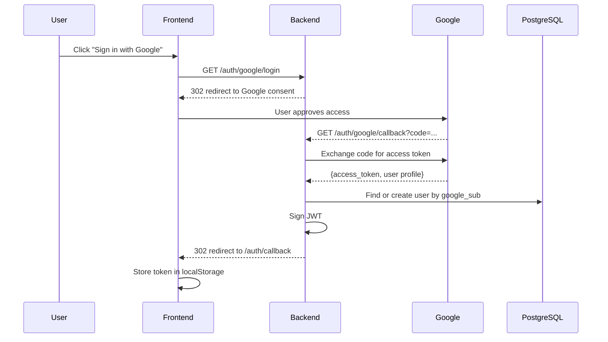
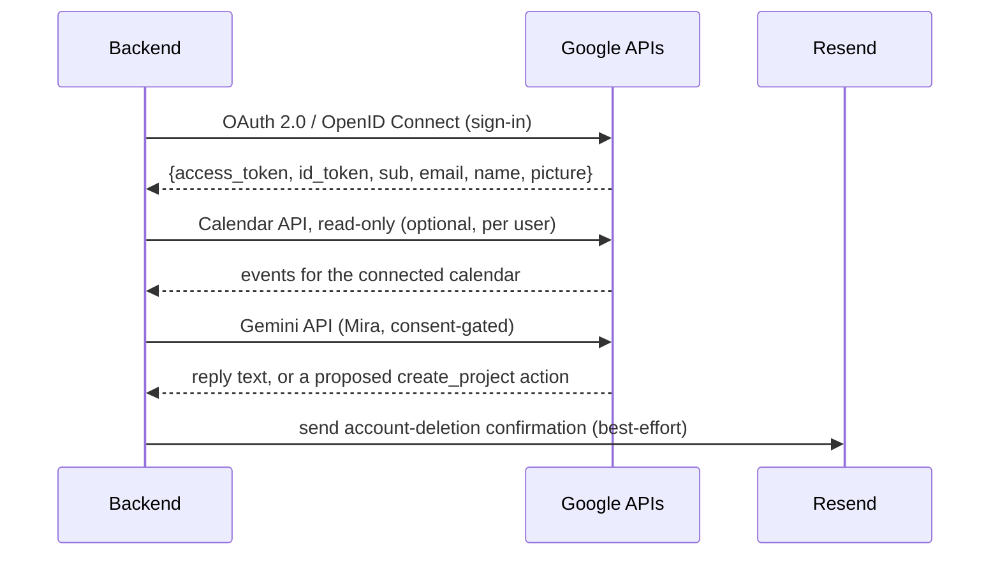

# Backend

The backend is a **FastAPI** application running on Python 3.12+ with async SQLAlchemy ORM.

## Entry point

`chronicles-logbook/backend/main.py` creates the FastAPI app, adds the session and CORS middleware, and
registers every router:

```python
app = FastAPI(title="Chronicles API", lifespan=lifespan)

app.add_middleware(SessionMiddleware, secret_key=SESSION_SECRET_KEY, same_site="lax", https_only=COOKIE_SECURE)
app.add_middleware(CORSMiddleware, allow_origins=_cors_origins, allow_credentials=True, ...)

app.include_router(projects.router)       # plus invitations, entries, saved_filters, statistics,
app.include_router(auth.router)           # transfer, tasks, calendar, activities, ai, automation
...                                       # (three routers), dashboard, streaks and achievements
```

`GET /health` returns `{"status": "ok"}` and does no database work, so it measures the network and the
framework, not the database (used by the latency checks in
[API Performance](../testing/api-performance.md)).

### What happens on start-up

The **lifespan** function does more than create tables. In order, and only on PostgreSQL where noted:

1. Takes a transaction-scoped **advisory lock** (`pg_advisory_xact_lock`) so the two uvicorn workers
   (`startup.txt`: `--workers 2`) take turns instead of racing to create the same table.
2. Runs `Base.metadata.create_all`, which builds missing **tables** but never adds a missing **column**.
3. Adds missing columns with `ALTER TABLE ... ADD COLUMN IF NOT EXISTS` from the `_ADDED_COLUMNS` list, and the
   `ix_entries_deleted_at` index. On SQLite it instead brings an older local file up to date
   (`add_missing_sqlite_columns`).
4. Backfills: entries that predate history get their current state as version 1, entries from before statuses
   get `Still to do` or `Done`, and version-1 rows get the action `created`.

This is the **only** thing that changes an existing production database, because the deploy never runs the SQL
files in `migrations/`. It only ever adds, which is why the code calls it "not a substitute for Alembic". The
reasoning, the incident behind it and a test that guards it are in
[Decisions: DB-51 to DB-53](../decisions/data-and-backend.md#db-51-schema-changes-reach-production-through-a-startup-patch-not-alembic).

CORS origins come from `CORS_ORIGINS` (comma-separated) and fall back to the local development origins.

## Router modules

| Router | Prefix | Responsibility |
|---|---|---|
| `auth` | `/auth` | Google OAuth authentication, Google Calendar OAuth, current user, account deletion |
| `projects` | `/projects` | Project CRUD, archiving/unarchiving, entry management (create, edit, history, revert, restore), schema definitions and previews, sharing, leaving a project |
| `invitations` | `/invitations` | The invitee's side of sharing: list, accept, decline |
| `tasks` | `/projects/{project_id}/tasks` | Task CRUD, toggle completion, filtering, checklists |
| `entries` | `/entries` | Global entry search across projects |
| `automation` | `/projects/{project_id}/rules`, `/reminders` | Sprint 3: entry rules, recurring entries, the cross-project reminders bell |
| `statistics` | `/statistics` | Workspace-wide totals, streaks, field timeline, per-project field statistics |
| `calendar` | `/calendar` | Google Calendar event reads, local calendar "activities" |
| `activities` | `/calendar/activities` | Private, local-only calendar day items (never written to Google) |
| `ai` | `/ai` | Mira: consent (versioned), saved conversations, streamed replies with proposed actions, and the legacy single-shot chat |
| `streaks` | `/streaks` | The login and activity streaks |
| `achievements` | `/achievements` | Badges with progress, and marking their celebrations as shown |
| `dashboard` | `/dashboard` | The grid dashboard: panels, their sizes and the grid width |
| `saved_filters` | `/saved-filters` | Named, reusable Entries-page search combinations |
| `transfer` | `/export`, `/import`, `/projects/{id}/export.csv` | Full-account JSON export, additive import, and a per-project CSV |

## Supporting modules

Logic that is neither routing nor persistence lives in its own module, so a
router reads as a sequence of decisions rather than an implementation.

| Module | Responsibility |
|---|---|
| `app/config.py` | Settings, read from the environment |
| `app/database.py` | Async engine, session factory, `JSONType`, connection pool sizing |
| `app/models.py` | SQLAlchemy ORM models |
| `app/schemas.py` | Pydantic request and response models, including schema-field validation |
| `app/security.py` | Token issuing and verification |
| `app/email.py` | Outbound mail via Resend (account-deletion confirmation only) |
| `app/computed.py` | Evaluates `computed` field expressions |
| `app/schema_migration.py` | Works out and applies what a schema edit does to existing entries |
| `app/automation.py` | Sprint 3: matches an entry against a project's rules and applies their actions |
| `app/custom_statistics.py` | Sprint 3: the figures a person defines for themselves (`sum`, `avg`, `min`, `max`, `count` over number fields, in the same safe grammar as computed fields) |
| `app/search.py` | Structured, type-aware search over custom fields: conditions combined with AND or OR, ranked by relevance (US-3.11), also reused by rules |
| `app/services/gemini_service.py` | Wraps the Google Gemini API for Mira, including streaming and function calling; the one file to change to swap AI providers |
| `app/mira_tools.py` | The closed list of functions Mira may propose, their argument validation, and the plain-language summary of each |
| `app/mira_context.py` | Builds the small workspace snapshot Mira is shown (names, ids, a few titles; never full entries) |
| `app/statuses.py` | Per-project entry statuses: defaults, and keeping `status` and `todo` in agreement |
| `app/achievements.py` | The badge catalogue, the figures they watch (counted from stored work) and awarding |

### `app/computed.py`

A `computed` field carries an `expression` a user typed, which the server has to
evaluate on every entry write. It is parsed with Python's `ast` module and walked
against an allowlist of node types — numbers, field references, `+ - * /`, unary
minus, parentheses. Anything else raises. `eval` is never called.

Computed fields may read other computed fields, so evaluation order is decided by
a topological sort, which is also what detects a cycle. The grammar and its
failure modes are documented on
[Schema and field types](../api/schema.md#computed-fields).

### `app/schema_migration.py`

Editing a schema on a project with entries is the only operation in Chronicles
that changes data the user did not just type, so it is built around one function,
`simulate`, which takes a project, its entries and a proposed schema, and returns
both a report of the differences and the migrated entries.

The preview endpoint calls it and discards the entries; the apply endpoint calls
it and writes them. Sharing that single path is what stops the report a user
approves from disagreeing with what is saved. See
[Editing a live schema](../api/schema.md#editing-a-live-schema).

## Authentication Flow

### Google OAuth Accounts



## Key Dependencies

| Package | Purpose | Motivation |
|---|---|---|
| `fastapi` | Web framework | First-class `async` support, automatic OpenAPI docs, and Pydantic-native validation. Chosen over Flask (no built-in async) and Django (heavier, ORM-coupled) |
| `uvicorn` | ASGI server | Standard ASGI server for FastAPI; handles HTTP requests asynchronously. Pairs with FastAPI's async-first design |
| `sqlalchemy[asyncio]` | Async ORM | Non-blocking database queries matter because user-defined schema queries are JSONB-heavy. SQLAlchemy 2.0's async sessions integrate cleanly with FastAPI's dependency injection |
| `asyncpg` | PostgreSQL async driver | Maintains async context end-to-end (FastAPI → SQLAlchemy → driver). Sync drivers (psycopg2) would block the event loop under load |
| `pyjwt` | JWT token signing and validation | JWT issued server-side after OAuth exchange; stateless validation on every request. Chosen for its focused, well-maintained API |
| `httpx` | HTTP client | Used for Google API calls (token exchange, userinfo) and as the test client in pytest. Async-capable, replacing both `requests` and test-specific clients |
| `python-dotenv` | Environment variable loading | Loads `.env` files for local development without polluting the system environment. Standard Python ecosystem choice |
| `pydantic` | Request/response validation | Declarative schemas with automatic type coercion and validation messages. FastAPI uses it natively, so request bodies, query params, and response models are all Pydantic |
| `authlib` | Google OAuth integration | Implements the OAuth 2.0 / OpenID Connect flow (state, token exchange, userinfo). Chosen over `authlib` alternatives for its framework-agnostic design and maintained OIDC support |
| `aiosqlite` | In-memory SQLite for tests | Allows async test fixtures to run without a live PostgreSQL instance. Mirrors asyncpg's async interface so test code doesn't need a separate code path |

## External API Integration

The backend calls four external services, all fully implemented and in
active use — full detail (exact URLs, scopes, consent, failure behaviour,
cost) now lives in one place to avoid this page drifting out of sync with it
again: **[External Services & Integrations](../api/external-services.md)**.
In short:



| Service | Used for | Configuration |
|---|---|---|
| Google OAuth 2.0 / OpenID Connect | Sign-in — the only authentication method | `GOOGLE_CLIENT_ID`, `GOOGLE_CLIENT_SECRET` |
| Google Calendar API (read-only) | Optional per-account calendar sync on the Calendar view | (same OAuth client, separate `calendar.readonly` grant) |
| Google Gemini API | Mira, the AI assistant — consent-gated, degrades to a local-only mode if declined | `GEMINI_API_KEY`, `GEMINI_MODEL` |
| Resend | Account-deletion confirmation email (best-effort, failure doesn't block deletion) | `RESEND_API_KEY`, `EMAIL_FROM` |

## CORS configuration

CORS origins are configured via the `CORS_ORIGINS` environment variable (comma-separated). In production, this points to the Azure App Service URL.

AI Declaration: The preceding document was reviewed and edited with: Qoder.
Router/module tables and the External API Integration section were corrected
and updated for Sprint 3 with Claude Code (Sonnet 5) — the previous version
described Google Calendar as "planned" (it has been implemented since Sprint
2) and named a "Brevo SMTP" / "welcome email" integration that does not
exist; the actual email integration is Resend, account-deletion-only.
