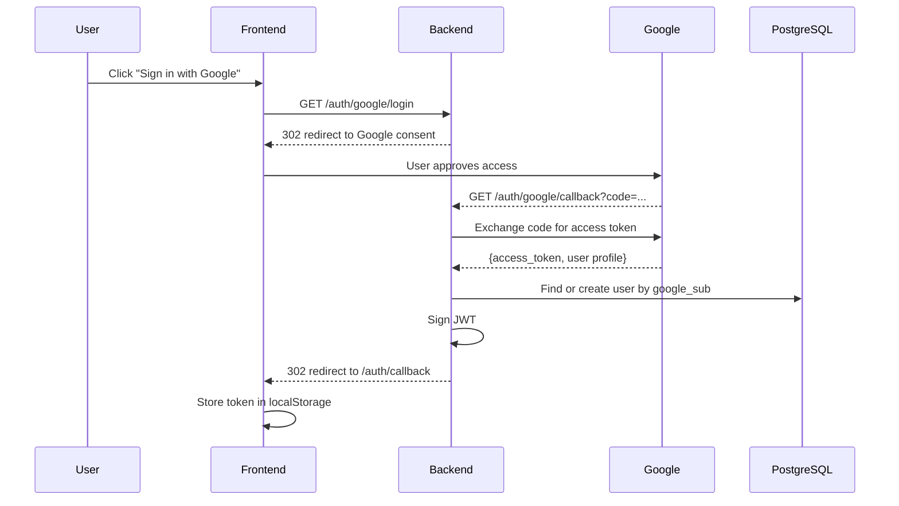
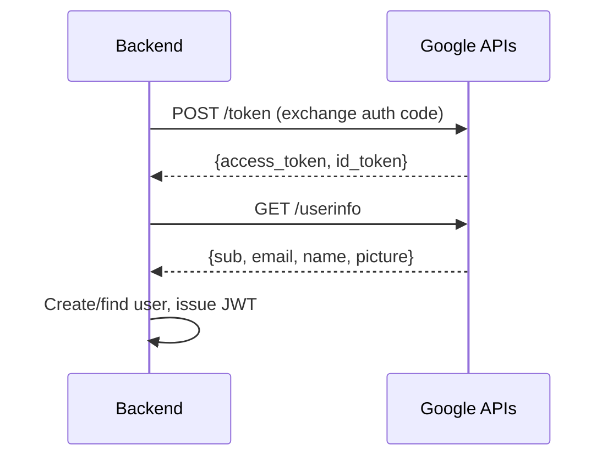

# Backend

The backend is a **FastAPI** application running on Python 3.12+ with async SQLAlchemy ORM.

## Entry point

`chronicles-logbook/backend/main.py` creates the FastAPI app and registers all routers:

```python
app = FastAPI(title="Chronicles Logbook", version="1.0.0")

app.include_router(auth.router)
app.include_router(projects.router)
app.include_router(tasks.router)
app.include_router(entries.router)
```

The app uses a **lifespan context manager** to create database tables on startup:

```python
@asynccontextmanager
async def lifespan(app: FastAPI):
    async with engine.begin() as conn:
        await conn.run_sync(Base.metadata.create_all)
    yield
```

## Router modules

| Router | Prefix | Responsibility |
|---|---|---|
| `auth` | `/auth` | Google OAuth authentication, current user, account deletion |
| `projects` | `/projects` | Project CRUD, archiving/unarchiving, entry management, schema definitions |
| `tasks` | `/projects/{project_id}/tasks` | Task CRUD, toggle completion, filtering, checklists |
| `entries` | `/entries` | Global entry search across projects |

## Authentication Flow

### Google OAuth Accounts



## Key Dependencies

| Package | Purpose | Motivation |
|---|---|---|
| `fastapi` | Web framework | First-class `async` support, automatic OpenAPI docs, and Pydantic-native validation. Chosen over Flask (no built-in async) and Django (heavier, ORM-coupled) |
| `uvicorn` | ASGI server | Standard ASGI server for FastAPI; handles HTTP requests asynchronously. Pairs with FastAPI's async-first design |
| `sqlalchemy[asyncio]` | Async ORM | Non-blocking database queries matter because user-defined schema queries are JSONB-heavy. SQLAlchemy 2.0's async sessions integrate cleanly with FastAPI's dependency injection |
| `asyncpg` | PostgreSQL async driver | Maintains async context end-to-end (FastAPI → SQLAlchemy → driver). Sync drivers (psycopg2) would block the event loop under load |
| `pyjwt` | JWT token signing and validation | JWT issued server-side after OAuth exchange; stateless validation on every request. Chosen for its focused, well-maintained API |
| `httpx` | HTTP client | Used for Google API calls (token exchange, userinfo) and as the test client in pytest. Async-capable, replacing both `requests` and test-specific clients |
| `python-dotenv` | Environment variable loading | Loads `.env` files for local development without polluting the system environment. Standard Python ecosystem choice |
| `pydantic` | Request/response validation | Declarative schemas with automatic type coercion and validation messages. FastAPI uses it natively, so request bodies, query params, and response models are all Pydantic |
| `authlib` | Google OAuth integration | Implements the OAuth 2.0 / OpenID Connect flow (state, token exchange, userinfo). Chosen over `authlib` alternatives for its framework-agnostic design and maintained OIDC support |
| `aiosqlite` | In-memory SQLite for tests | Allows async test fixtures to run without a live PostgreSQL instance. Mirrors asyncpg's async interface so test code doesn't need a separate code path |

## External API Integration

Chronicles integrates with external services, satisfying the project brief's requirement for external API integration.

### Google OAuth 2.0 (via Authlib) — implemented

Google's OAuth 2.0 API is used for passwordless authentication. The backend communicates with Google's token endpoint and userinfo endpoint to exchange authorization codes for user profile data.



**Configuration:** `GOOGLE_CLIENT_ID` and `GOOGLE_CLIENT_SECRET` environment variables.

### Google Calendar API — planned

The Google Calendar API is the next planned external integration. Outstanding tasks with due dates will sync to the student's Google Calendar, so unfinished work surfaces outside the app.

**Planned scope:**

- Create calendar events from tasks that have a `due_date`
- Update events when task due dates change
- Remove events when tasks are deleted or completed
- Use the same Google OAuth token (with calendar scope) for authentication

**Motivation:** The team decided at the Sprint 5 PO review (2026-08-24) to pursue Google Calendar integration as the external API feature, since it adds tangible value for students who already use Google Calendar for scheduling.

### Brevo SMTP (Transactional Email)

Brevo's SMTP service is used to send transactional emails for account creation welcome and account deletion notifications.

| Email | Trigger |
|---|---|
| Welcome email | First Google OAuth login (new user created) |
| Account deleted notification | `DELETE /auth/account` (success) |

**Configuration:** `BREVO_SMTP_HOST`, `BREVO_SMTP_PORT`, `BREVO_SMTP_USERNAME`, `BREVO_SMTP_PASSWORD`, `MAIL_FROM`, `MAIL_FROM_NAME` environment variables.

## CORS configuration

CORS origins are configured via the `CORS_ORIGINS` environment variable (comma-separated). In production, this points to the Azure App Service URL.

AI Declaration: The preceding document was reviewed and edited with: Qoder
