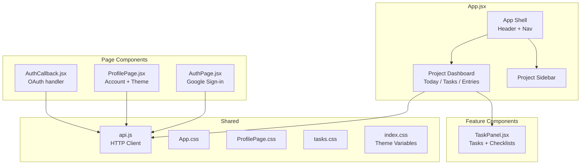

# Frontend

The frontend is a **React 19** application built with **Vite** (v8.2.0) and **React Router**.

## File Architecture

Views are rendered through React Router routes defined in `main.jsx`. The main app shell and project dashboards live in `App.jsx`, while focused features are split into dedicated components.



| File | Responsibility |
|---|---|
| `App.jsx` | Auth-aware app shell, navigation, project sidebar, project dashboard, Today/Tasks/Entries views |
| `AuthPage.jsx` | Google sign-in page with "Continue with Google" button |
| `AuthCallback.jsx` | Handles OAuth callback token exchange |
| `ProfilePage.jsx` | Account details, theme switcher, sign-out, delete-account confirmation |
| `TaskPanel.jsx` | Task creation/editing, task list, filters, checklist UI with progress bar |
| `api.js` | HTTP client wrapping all backend endpoints |
| `App.css` | Component styles (~900 lines) |
| `ProfilePage.css` | Profile page styles |
| `tasks.css` | Task-specific styles (~190 lines) |
| `index.css` | Global CSS variables, light/dark/system themes |

## Routing

```mermaid
graph LR
    L[Landing /] -->|not signed in| LP[Auth Page]
    L -->|signed in| APP
    APP[/app] --> Shell[App Shell]
    Shell --> PD[Project Dashboard]
    PROF[/profile] --> PP[Profile Page]
    CB[/auth/callback] --> AC[AuthCallback]
```

```jsx
<BrowserRouter>
  <Routes>
    <Route path="/" element={<LandingRoute />} />
    <Route path="/app" element={<ProtectedAppRoute />} />
    <Route path="/profile" element={<ProtectedProfileRoute />} />
    <Route path="/auth/callback" element={<AuthCallback />} />
  </Routes>
</BrowserRouter>
```

`localStorage` holds the JWT (`chronicles_token`) and cached user info (`chronicles_user`). Protected routes redirect unauthenticated users to `/`.

## Theme system

The frontend supports three modes: **light**, **dark**, and **system**. Themes are controlled by a `data-theme` attribute on the `<html>` element and a set of CSS custom properties defined in `index.css`:

```css
:root {
  --bg: #f7f7fa;
  --surface: #ffffff;
  --text: #2a2a3b;
  --muted: #8b8ba3;
  --blue: #6366f1;
  --mauve: #c4b5fd;
  --line: #e6e6ee;
  --radius: 14px;
}

[data-theme="dark"] {
  --bg: #1a1a2e;
  --surface: #23233a;
  --text: #e6e6ee;
  --muted: #8b8ba3;
  --line: #3a3a55;
}
```

## Colour palette

- **Blue** (`--blue: #6366f1`) — actions, links, interactive elements
- **Mauve** (`--mauve: #c4b5fd`) — highlights, completed states
- **Grey tones** (`--muted`) — secondary text, borders

## State management

The app uses React's built-in `useState`, `useEffect`, `useCallback`, `useMemo`, and `useNavigate` hooks. There is no Redux, Zustand, or other external state management library. Each route/component fetches its own data; `api.js` injects the JWT from `localStorage` automatically.

## Build and tooling

| Tool | Purpose |
|---|---|
| Vite | Dev server and production bundler |
| Vitest | Unit and component tests |
| oxlint | JavaScript/JSX linter |
| npm | Package management |

## Key design decisions

- **React Router for view routing** — the app has grown beyond a single view; React Router gives clean URLs (`/app`, `/profile`) and handles auth redirects naturally.
- **CSS custom properties over CSS-in-JS** — themes are achieved purely through CSS variables, keeping the styling layer simple and performant.
- **Fetch-based API client** — `api.js` wraps the native `fetch` API with token injection and error handling, rather than using Axios or another library.
