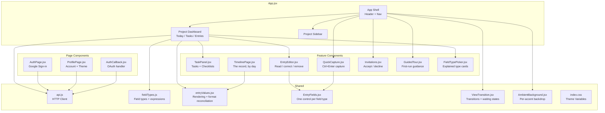
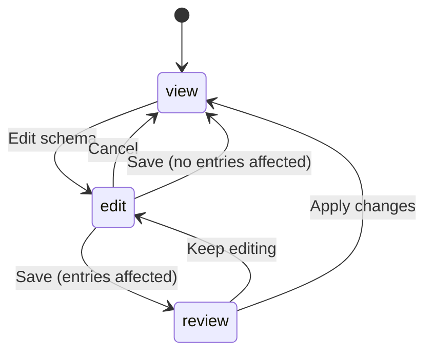

# Frontend

The frontend is a **React 19** application built with **Vite** (v8.2.0) and **React Router**.

## File Architecture

Views are rendered through React Router routes defined in `main.jsx`. The main app shell and project dashboards live in `App.jsx`, while focused features are split into dedicated components.



| File | Responsibility |
|---|---|
| `App.jsx` | Auth-aware app shell, navigation, project sidebar, project dashboard, statistics, schema builder and editor |
| `AuthPage.jsx` | Sign-in page |
| `AuthCallback.jsx` | Handles OAuth callback token exchange |
| `ProfilePage.jsx` | Account details, theme and accent, replaying the guided tour, sign-out, delete-account confirmation |
| `TaskPanel.jsx` | Task creation/editing, task list, filters, checklist UI with progress bar |
| `TimelinePage.jsx` | The record end to end: entries grouped by day on an alternating spine, searchable and narrowable to one project |
| `WorkspacePages.jsx` | The entries table (rows open in place) and the tasks workspace |
| `EntryEditor.jsx` | One entry, read then corrected or removed. Builds its form from the entry's own format, never the project's current one |
| `QuickCapture.jsx` | <kbd>Ctrl</kbd>+<kbd>Enter</kbd> capture from anywhere, with the predictable values remembered per project |
| `Invitations.jsx` | The notification for invitations to other people's projects, and answering them |
| `GuidedTour.jsx` | The first-run walkthrough and each page's first-visit card. Anchors are measured at the moment a step is shown, and a step whose anchor is off screen is skipped |
| `tourSteps.js` | What the guidance says, and per-account memory of what has been shown |
| `FieldTypePicker.jsx` | The field-type chooser: a grid of cards carrying each type's purpose, a worked example and what capture looks like |
| `api.js` | HTTP client wrapping all backend endpoints |
| `fieldTypes.js` | The field-type registry (`FIELD_TYPE_META` — label, hint, badge, colour, purpose, example and capture note for every type) that the builder, the picker, the entry form and the entry table all read from, plus the parser and evaluator for computed-field expressions |
| `entryValues.jsx` | How a stored value renders as the kind of thing it is, and how one list shows entries written under different versions of a format (`columnsFor`, `cellFor`, `sameFormat`) |
| `EntryFields.jsx` | One input per field type, shared by the capture form, the editor and quick capture, so "press Enter to add a tag" cannot behave three different ways |
| `ViewTransition.jsx` | The entrance animation between views, the flowing-lines loader, and skeleton rows |
| `AmbientBackground.jsx` | The backdrop, one scene per accent, drawn rather than photographed |
| `App.css` | Component styles |
| `index.css` | Global CSS variables, light/dark/system themes, accents |

Each feature component has a stylesheet of the same name; only the shared ones
are listed above.

## Routing

```mermaid
graph LR
    L[Landing /] -->|not signed in| LP[Auth Page]
    L -->|signed in| APP
    APP[/app] --> Shell[App Shell]
    Shell --> PD[Project Dashboard]
    PROF[/profile] --> PP[Profile Page]
    CB[/auth/callback] --> AC[AuthCallback]
```

```jsx
<BrowserRouter>
  <Routes>
    <Route path="/" element={<LandingRoute />} />
    <Route path="/app" element={<ProtectedAppRoute />} />
    <Route path="/profile" element={<ProtectedProfileRoute />} />
    <Route path="/auth/callback" element={<AuthCallback />} />
  </Routes>
</BrowserRouter>
```

`localStorage` holds the JWT (`chronicles_token`) and cached user info (`chronicles_user`). Protected routes redirect unauthenticated users to `/`.

## Theme system

The frontend supports three modes: **light**, **dark**, and **system**. Themes are controlled by a `data-theme` attribute on the `<html>` element and a set of CSS custom properties defined in `index.css`:

```css
:root {
  --bg: #f7f7fa;
  --surface: #ffffff;
  --text: #2a2a3b;
  --muted: #8b8ba3;
  --blue: #6366f1;
  --mauve: #c4b5fd;
  --line: #e6e6ee;
  --radius: 14px;
}

[data-theme="dark"] {
  --bg: #1a1a2e;
  --surface: #23233a;
  --text: #e6e6ee;
  --muted: #8b8ba3;
  --line: #3a3a55;
}
```

## Colour palette

- **Blue** (`--blue: #6366f1`) — actions, links, interactive elements
- **Mauve** (`--mauve: #c4b5fd`) — highlights, completed states
- **Grey tones** (`--muted`) — secondary text, borders
- **Green (`--success`) / red (`--error`)** — a project's status dot in the sidebar, reused verbatim on linked-project chips elsewhere so one colour language is learned once
- **Amber** (`--warning: #b45309`) — an action that is allowed but will change data the user did not just type, such as a schema edit that reshapes existing entries. Distinct from `--error`, which marks something that failed

## Responsive layout

The app is built fluid rather than per-device: `.app-shell` is
`width: min(1360px, calc(100% - 48px))`, so it fills a phone and centres with
gutters on a desktop without either being a special case. Breakpoints then handle
what fluidity alone cannot.

| Width | What changes |
|---|---|
| ≥ 1360px | Shell stops growing and centres; content keeps a comfortable measure |
| 860px | Two-column layouts (project detail, workspace grids) collapse to one |
| 760px | Home hub panels stack; internal padding tightens |
| 720px | The three-column feature grid becomes one |
| 680 / 560 / 420px | Setup grids step down; footer actions, the share panel and the invite form go full-width |

Three rules are worth stating because they are the ones that actually break:

- **Reflow the layout, scroll the data.** The entries table cannot be made
  narrow without becoming unreadable, so it keeps a `min-width` inside a wrapper
  with `overflow: auto`. The table scrolls; the page never does.
- **Unbreakable strings need `overflow-wrap: anywhere`.** An email address is a
  single "word". Without it, one shared collaborator's address is enough to push
  the panel wider than the viewport and make the whole page scroll sideways —
  no column count fixes that.
- **Touch targets key off the pointer, not the width.** A 34px control is fine
  with a mouse and misses under a thumb, so `@media (pointer: coarse)` raises
  controls to 44px. Keying off the input device rather than the screen means a
  touchscreen laptop is covered too, which a width breakpoint would miss.

Appearance across real devices is still checked by hand: `jsdom` runs the
component tests with no layout engine, so it cannot catch a visual overflow.

## Accents

On top of light/dark, the owner picks an **accent** — Chronicles, Ocean, Forest
or Rose — on the profile page or during setup. It is stored in `localStorage`
and applied as a `data-accent` attribute on `<html>` by `applyPreferences()` in
`preferences.js`, alongside `data-theme` and `data-density`. `main.jsx` reapplies
all three on load, before React renders, so the first paint is already correct.

Each accent redefines the same palette variables rather than introducing new
ones, with a separate set for dark:

```css
:root[data-accent="ocean"]                    { --blue:#1686c8; --blue-bg:#dceff8; … }
:root[data-theme="dark"][data-accent="ocean"] { --blue:#4baee5; --blue-bg:#193847; … }
```

Two rules keep this honest, both of which were silently broken:

- **Everything tinted must read from the palette.** Component CSS asks for
  `--accent` / `--accent-light`, which nothing defined, so eight highlight rules
  quietly fell back to a hard-coded purple and ignored the accent entirely.
  `index.css` now aliases them (`--accent: var(--blue)`), and because custom
  properties resolve where they are *used*, the alias follows whatever the active
  theme and accent set. Hard-coded hex in a component is the bug to look for.
- **"System" sets no `data-theme` attribute.** The light `[data-accent]` rules
  therefore matched on a dark OS too, and beat the dark palette on source order —
  light accents on a dark background. The dark accents are repeated inside a
  `@media (prefers-color-scheme: dark)` block guarded with
  `:not([data-theme="light"])`, so an explicit Light choice still wins.

### The backdrop follows the accent

Each accent also has a **scene** behind the workspace, rendered by
`AmbientBackground.jsx`: light through a canopy for Forest, deep water for
Ocean, drifting petals for Rose, folded violet for Chronicles.

They are drawn with layered gradients and a little SVG rather than shipped as
photographs, for three reasons that all point the same way — a photograph is a
megabyte the app has to load before it looks like anything, it cannot follow a
colour change without a second copy of every file, and it crops badly between a
phone and an ultrawide.

Two things keep them out of the way of the work:

- **The veil sits above the scene, not below it.** It is a wash of `--bg` that
  dims whatever the scene happens to put behind a word, and it is heavier in
  dark mode. Every surface on top is opaque and blurred, so the backdrop can
  afford to be seen.
- **`prefers-reduced-motion` stops the drift** in the stylesheet, so it is
  honoured whether or not the component re-renders.

The component watches `data-accent` and `data-theme` on `<html>` with a
`MutationObserver`, so the scene changes in the same frame as the colour without
`preferences.js` having to know a background exists.

## Navigation and the account menu

The top bar carries two controls: the **avatar**, which opens the profile, and a
**menu** holding Search, Export/Import and a Profile link.

- **Sign out and Delete account are only on the profile page.** They were also in
  this menu, which put an irreversible action one click inside a menu opened for
  something else, and gave two routes to the same thing.
- **Search opens the command palette** (`Ctrl`/`Cmd` + `K`), which searches
  pages, commands and projects. The palette owns its own open state, so the menu
  asks for it with a `chronicles:open-command-palette` window event rather than
  threading state through every component in between. Choosing a project in it
  opens that project — it previously navigated to Home and left you to find it.
- **The avatar shows the Google profile photo** when the account has one,
  falling back to initials. The photo already arrived from the OAuth profile and
  was stored in `users.avatar_url`; the UI simply never rendered it. Images are
  requested with `referrerPolicy="no-referrer"`, without which Google's CDN
  refuses them.

Menu entries that do nothing are worse than no entry: Notifications, Analytics
and Settings sat here doing nothing (two of them navigating to the profile page
by copy-paste), so they were removed rather than left to be clicked.

## State management

The app uses React's built-in `useState`, `useEffect`, `useCallback`, `useMemo`, and `useNavigate` hooks. There is no Redux, Zustand, or other external state management library. Each route/component fetches its own data; `api.js` injects the JWT from `localStorage` automatically.

## Schema builder

`SchemaBuilder` in `App.jsx` is the only component with three distinct modes, because editing a schema is the only action in the app that can rewrite data the user did not just type.



| Mode | What it is for |
|---|---|
| `view` | Read-only summary of the saved fields. The default, so a schema cannot be altered by clicking into a form while reading it |
| `edit` | Editable rows — name, type, dropdown options, calculation, link target. Local only; nothing has been sent |
| `review` | The server's report of what the edit would do to existing entries, one row per change, before anything is applied |

Saving is a two-request sequence. `previewSchemaChange` asks the server what the
edit would do; if it reports `entries_affected === 0` the edit is applied
immediately, since there is nothing to warn about. Otherwise the report is shown
in `review` mode and `updateSchema` is only called once the user confirms. See
[Editing a live schema](../api/schema.md#editing-a-live-schema).

After a successful save the whole entry list is refetched rather than patched in
place. A migration can backfill, coerce or retire a value on every entry, so the
copy held in the client is stale in too many ways to reconstruct locally.

## Computed field expressions

`fieldTypes.js` contains a hand-written tokeniser and recursive-descent parser for the arithmetic used by computed fields. It exists so a calculation updates as the user types, without a request per keystroke.

```js
withComputedValues({ hours: 3, rate: 20 }, schema)
// → { hours: 3, rate: 20, pay: 60 }
```

This deliberately duplicates `app/computed.py` on the server. The client copy is a convenience for the entry form; the server's is the authority, and anything a client sends for a computed field is discarded. Neither uses `eval` — the client parses to its own expression tree, the server walks a Python `ast` with a node allowlist.

`expressionError` returns the same class of message the server would, so a
mistyped expression is reported beside the field instead of after a failed save.
One case is left to the server: an indirect cycle (A uses B, B uses A) is caught
by the server's topological sort, while the client's evaluator simply caps its
passes so it cannot hang.

Expressions are **edited by name and stored by id**. The chips insert a field's
name in braces, a stored id-form expression is converted back to names when the
editor opens (`expressionToDisplay`), and whatever was typed is canonicalised
to ids when it is saved (`expressionCanonical`) — on the client and again on
the server, so both agree on what "unchanged" means. Renaming a field rewrites
the name inside every calculation that refers to it as the rename happens
(`renameFieldInExpression`); and since the stored form is by id, a rename is a
label change and never breaks a calculation.

A bare field name typed without braces — `Hours * 2` — is the natural first
attempt, so the parser recognises it and answers with what to do next (refer to
a field by its name in braces) rather than a generic "unknown field" dead end.

While a formula is being written, the builder shows a live preview of its
answer (`previewExpressionValue`). It prefers the figures from the project's
most recent entry, so what gets checked is a number the owner recognises; when
no entry can answer the formula — a new project, or a field the latest entry
predates — every referenced field counts as 2 and the preview says which of the
two it is doing.

The entry list recomputes each entry's values with `withComputedValues` rather
than reading back what the server stored. The two agree — every write and every
schema change re-derives the stored values — but an entry captured offline holds
no stored calculation until it syncs, and the list should show the same figure
the form did. Computed values carry a small `ƒ` mark, in the same mauve as the
form's "calculated" tag, so a derived figure is never mistaken for one that
was typed in.

## Project links

A link field names its target once, in the schema — `SchemaFieldEditor` offers
a "Links to" picker of the owner's other projects — and every entry derives its
value from it. The entry form therefore shows the target as the same chip the
entry list shows, under a blue "Linked" tag, rather than asking for it, and
the payload never includes the field: the server fills it from the schema, the
same contract a calculation has.

A link has **three** states, and they must not be collapsed into one. A field
that was never pointed anywhere is not the same as one whose target has since
been deleted, and saying the wrong one sends the owner somewhere that cannot fix
it:

| State | Schema view | Entry form |
|---|---|---|
| No target chosen | "Not pointed at a project yet — choose one in Edit schema." | "Not pointed at a project yet" |
| Target exists | "Links to *name*" | the target's `LinkChip` |
| Target deleted | "Links to a project you no longer have" | a static chip saying the same |

Saving a reference without a target is rejected by the API
(`_validate_reference_targets`, `422`), so the first state only occurs in
schemas written before that rule existed. `linked_project_id` stays optional on
the Pydantic model precisely so those older schemas and their export files still
load.

Wherever a linked value is shown — the entry form, the entry list, the timeline
— it renders as a `LinkChip`: the target's name on the sidebar's status dot,
clickable through to the project itself. The status is derived from the target's open tasks with
`useProjectStatuses`, by the same rule the sidebar uses, so the colour means the
same thing everywhere it appears. Blue is the link's colour, distinct from the
mauve a calculation is marked with, so a glance at a form or a table cell
separates "typed in / calculated / linked" without reading anything.

The tag's word and colour are not decided where they are rendered: both come
from `FIELD_TYPE_META` in `fieldTypes.js`, the one registry every view reads —
the builder's type labels, the schema summary's labels, the form's tags and
the table's header dots. Renaming a badge or adding a type is one edit, and
the views cannot drift apart.

## Entry list

One row is one entry, so the row is the unit of attention: a hover light marks
where an entry ends and the next begins, and hints that a row is a thing rather
than a list of loose values. Column labels are truncated past twenty characters
with the full name riding along as a tooltip, since a header three lines tall
sets the height of every row beneath it. The two special columns — a link, a
calculation — carry a small dot in their header in the registry's colour, the
word on hover, so the table stays calm while still saying which columns are
not plain typing. Figures are right-aligned in fixed-width digits, because a
numeric column is read down, not across.

### Values are not strings

Every value renders through `ValueView` in `entryValues.jsx`, and every list
imports it, so a tag looks like a tag in the entry list, the timeline, the
entries table and the CSV export alike. Before that each view called
`String(value)` on whatever it found, which turned tags into `a,b`, checklists
into `[object Object]` and links into bare uuids — the richer field types
looked broken everywhere except the form that had just created them.

| Type | Renders as |
|---|---|
| `tags` | A chip per tag |
| `checklist` | A progress bar and `done/total`, with the items on hover |
| `link` | The target entry's own title, clickable |
| `project_reference` | The target project's name, clickable |
| `computed` | The figure, marked ƒ so it is not mistaken for one that was typed |

### One table over several formats

A format change leaves past entries alone, so a list has to show one set of
columns over entries that do not all agree about what the columns are.

- `columnsFor(project, entries)` works out that set: the project's current
  fields first, then anything an entry recorded under a field the project has
  since dropped, marked `retired`.
- `cellFor(entry, column, project)` decides, per entry, whether a value was
  recorded under the field as it is defined now (`current`), under an earlier
  version of it (`earlier`, shown as written with a dotted underline), or never
  at all (`missing`, shown as *not recorded* — distinct from blank).
- A retired column is rendered only on the entries that actually recorded
  something under it. Printing "not recorded" for a dropped field on every
  entry written since would bury the live fields in history.
- `sameFormat(a, b)` compares two formats field by field on the properties that
  define one. Stringifying them does not work: the API fills every optional key
  in (`options: null`) while a stored snapshot carries only the keys it was
  saved with, so a raw comparison reported every entry as written under an
  older format and badged the whole logbook.

## Build and tooling

| Tool | Purpose |
|---|---|
| Vite | Dev server and production bundler |
| Vitest | Unit and component tests |
| oxlint | JavaScript/JSX linter |
| npm | Package management |

## Key design decisions

- **React Router for view routing** — the app has grown beyond a single view; React Router gives clean URLs (`/app`, `/profile`) and handles auth redirects naturally.
- **CSS custom properties over CSS-in-JS** — themes are achieved purely through CSS variables, keeping the styling layer simple and performant.
- **Fetch-based API client** — `api.js` wraps the native `fetch` API with token injection and error handling, rather than using Axios or another library.
- **Preview before applying a schema change** — the alternative is an undo, which would mean storing a copy of every entry before every edit. Showing what will happen is cheaper than being able to reverse it, and clearer at the moment the decision is made.

AI Declaration: The preceding document was reviewed and edited with: Qoder
