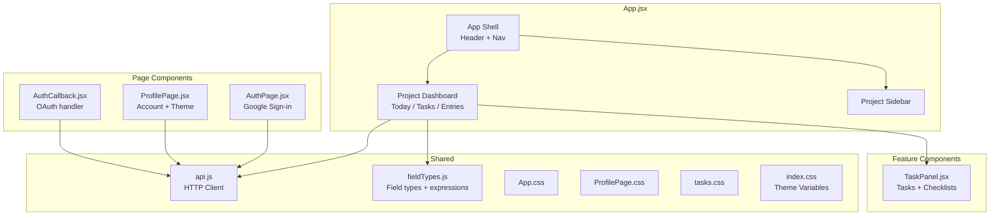
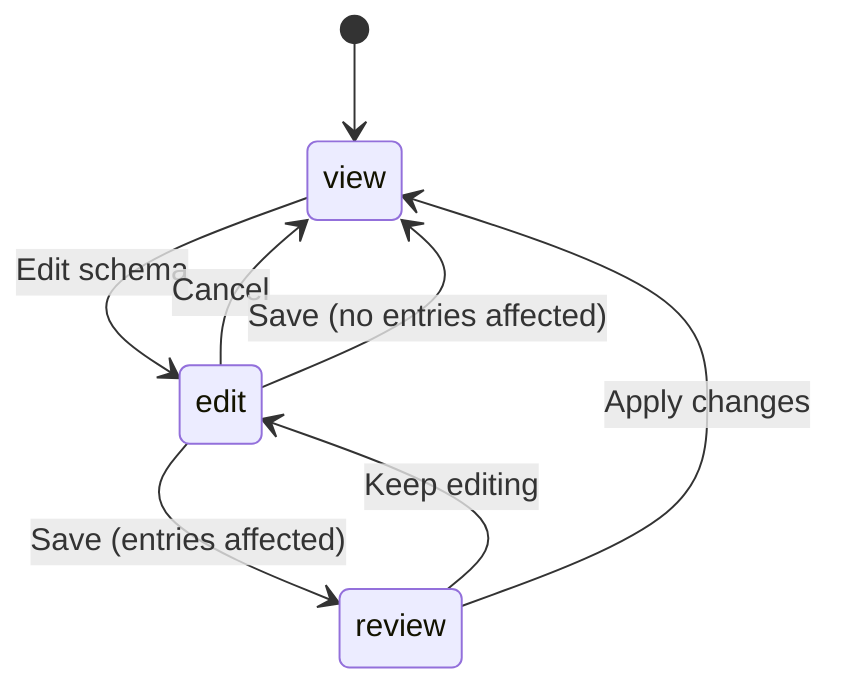

# Frontend

The frontend is a **React 19** application built with **Vite** (v8.2.0) and **React Router**.

## File Architecture

Views are rendered through React Router routes defined in `main.jsx`. The main app shell and project dashboards live in `App.jsx`, while focused features are split into dedicated components.



| File | Responsibility |
|---|---|
| `App.jsx` | Auth-aware app shell, navigation, project sidebar, project dashboard, Today/Tasks/Entries views, schema builder and editor |
| `AuthPage.jsx` | Google sign-in page with "Continue with Google" button |
| `AuthCallback.jsx` | Handles OAuth callback token exchange |
| `ProfilePage.jsx` | Account details, theme switcher, sign-out, delete-account confirmation |
| `TaskPanel.jsx` | Task creation/editing, task list, filters, checklist UI with progress bar |
| `api.js` | HTTP client wrapping all backend endpoints |
| `fieldTypes.js` | The field-type catalogue, the parser and evaluator for computed-field expressions, and the name↔id resolution those expressions are edited through |
| `App.css` | Component styles (~2100 lines) |
| `ProfilePage.css` | Profile page styles |
| `tasks.css` | Task-specific styles (~250 lines) |
| `index.css` | Global CSS variables, light/dark/system themes |

## Routing

```mermaid
graph LR
    L[Landing /] -->|not signed in| LP[Auth Page]
    L -->|signed in| APP
    APP[/app] --> Shell[App Shell]
    Shell --> PD[Project Dashboard]
    PROF[/profile] --> PP[Profile Page]
    CB[/auth/callback] --> AC[AuthCallback]
```

```jsx
<BrowserRouter>
  <Routes>
    <Route path="/" element={<LandingRoute />} />
    <Route path="/app" element={<ProtectedAppRoute />} />
    <Route path="/profile" element={<ProtectedProfileRoute />} />
    <Route path="/auth/callback" element={<AuthCallback />} />
  </Routes>
</BrowserRouter>
```

`localStorage` holds the JWT (`chronicles_token`) and cached user info (`chronicles_user`). Protected routes redirect unauthenticated users to `/`.

## Theme system

The frontend supports three modes: **light**, **dark**, and **system**. Themes are controlled by a `data-theme` attribute on the `<html>` element and a set of CSS custom properties defined in `index.css`:

```css
:root {
  --bg: #f7f7fa;
  --surface: #ffffff;
  --text: #2a2a3b;
  --muted: #8b8ba3;
  --blue: #6366f1;
  --mauve: #c4b5fd;
  --line: #e6e6ee;
  --radius: 14px;
}

[data-theme="dark"] {
  --bg: #1a1a2e;
  --surface: #23233a;
  --text: #e6e6ee;
  --muted: #8b8ba3;
  --line: #3a3a55;
}
```

## Colour palette

- **Blue** (`--blue: #6366f1`) — actions, links, interactive elements
- **Mauve** (`--mauve: #c4b5fd`) — highlights, completed states
- **Grey tones** (`--muted`) — secondary text, borders
- **Green (`--success`) / red (`--error`)** — a project's status dot in the sidebar, reused verbatim on linked-project chips elsewhere so one colour language is learned once
- **Amber** (`--warning: #b45309`) — an action that is allowed but will change data the user did not just type, such as a schema edit that reshapes existing entries. Distinct from `--error`, which marks something that failed

## State management

The app uses React's built-in `useState`, `useEffect`, `useCallback`, `useMemo`, and `useNavigate` hooks. There is no Redux, Zustand, or other external state management library. Each route/component fetches its own data; `api.js` injects the JWT from `localStorage` automatically.

## Schema builder

`SchemaBuilder` in `App.jsx` is the only component with three distinct modes, because editing a schema is the only action in the app that can rewrite data the user did not just type.



| Mode | What it is for |
|---|---|
| `view` | Read-only summary of the saved fields. The default, so a schema cannot be altered by clicking into a form while reading it |
| `edit` | Editable rows — name, type, dropdown options, calculation, link target. Local only; nothing has been sent |
| `review` | The server's report of what the edit would do to existing entries, one row per change, before anything is applied |

Saving is a two-request sequence. `previewSchemaChange` asks the server what the
edit would do; if it reports `entries_affected === 0` the edit is applied
immediately, since there is nothing to warn about. Otherwise the report is shown
in `review` mode and `updateSchema` is only called once the user confirms. See
[Editing a live schema](../api/schema.md#editing-a-live-schema).

After a successful save the whole entry list is refetched rather than patched in
place. A migration can backfill, coerce or retire a value on every entry, so the
copy held in the client is stale in too many ways to reconstruct locally.

## Computed field expressions

`fieldTypes.js` contains a hand-written tokeniser and recursive-descent parser for the arithmetic used by computed fields. It exists so a calculation updates as the user types, without a request per keystroke.

```js
withComputedValues({ hours: 3, rate: 20 }, schema)
// → { hours: 3, rate: 20, pay: 60 }
```

This deliberately duplicates `app/computed.py` on the server. The client copy is a convenience for the entry form; the server's is the authority, and anything a client sends for a computed field is discarded. Neither uses `eval` — the client parses to its own expression tree, the server walks a Python `ast` with a node allowlist.

`expressionError` returns the same class of message the server would, so a
mistyped expression is reported beside the field instead of after a failed save.
One case is left to the server: an indirect cycle (A uses B, B uses A) is caught
by the server's topological sort, while the client's evaluator simply caps its
passes so it cannot hang.

Expressions are **edited by name and stored by id**. The chips insert a field's
name in braces, a stored id-form expression is converted back to names when the
editor opens (`expressionToDisplay`), and whatever was typed is canonicalised
to ids when it is saved (`expressionCanonical`) — on the client and again on
the server, so both agree on what "unchanged" means. Renaming a field rewrites
the name inside every calculation that refers to it as the rename happens
(`renameFieldInExpression`); and since the stored form is by id, a rename is a
label change and never breaks a calculation.

A bare field name typed without braces — `Hours * 2` — is the natural first
attempt, so the parser recognises it and answers with what to do next (refer to
a field by its name in braces) rather than a generic "unknown field" dead end.

While a formula is being written, the builder shows a live preview of its
answer (`previewExpressionValue`). It prefers the figures from the project's
most recent entry, so what gets checked is a number the owner recognises; when
no entry can answer the formula — a new project, or a field the latest entry
predates — every referenced field counts as 2 and the preview says which of the
two it is doing.

The entry list recomputes each entry's values with `withComputedValues` rather
than reading back what the server stored. The two agree — every write and every
schema change re-derives the stored values — but an entry captured offline holds
no stored calculation until it syncs, and the list should show the same figure
the form did. Computed values carry a small `ƒ` mark, in the same mauve as the
form's "calculated" tag, so a derived figure is never mistaken for one that
was typed in.

## Project links

A link field names its target once, in the schema — `SchemaFieldEditor` offers
a "Links to" picker of the owner's other projects — and every entry derives its
value from it. The entry form therefore shows the target as read-only text
with a blue "linked" tag rather than asking for it, and the payload never
includes the field: the server fills it from the schema, the same contract a
calculation has.

Wherever a linked value is shown — the entry list, the timeline — it renders as
a `LinkChip`: the target's name on the sidebar's status dot, clickable through
to the project itself. The status is derived from the target's open tasks with
`useProjectStatuses`, by the same rule the sidebar uses, so the colour means the
same thing everywhere it appears. Blue is the link's colour, distinct from the
mauve a calculation is marked with, so a glance at a form or a table cell
separates "typed in / calculated / linked" without reading anything.

## Entry list

One row is one entry, so the row is the unit of attention: a hover light marks
where an entry ends and the next begins, and hints that a row is a thing rather
than a list of loose values. Column labels are truncated past twenty characters
with the full name riding along as a tooltip, since a header three lines tall
sets the height of every row beneath it. Figures are right-aligned, because a
numeric column is read down, not across.

## Build and tooling

| Tool | Purpose |
|---|---|
| Vite | Dev server and production bundler |
| Vitest | Unit and component tests |
| oxlint | JavaScript/JSX linter |
| npm | Package management |

## Key design decisions

- **React Router for view routing** — the app has grown beyond a single view; React Router gives clean URLs (`/app`, `/profile`) and handles auth redirects naturally.
- **CSS custom properties over CSS-in-JS** — themes are achieved purely through CSS variables, keeping the styling layer simple and performant.
- **Fetch-based API client** — `api.js` wraps the native `fetch` API with token injection and error handling, rather than using Axios or another library.
- **Preview before applying a schema change** — the alternative is an undo, which would mean storing a copy of every entry before every edit. Showing what will happen is cheaper than being able to reverse it, and clearer at the moment the decision is made.

AI Declaration: The preceding document was reviewed and edited with: Qoder
