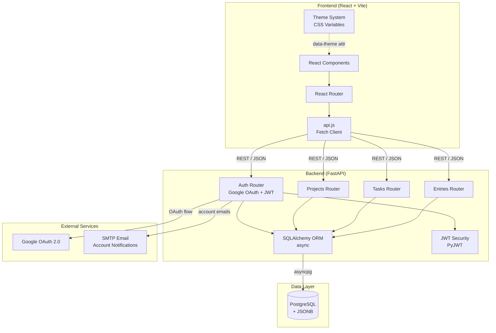
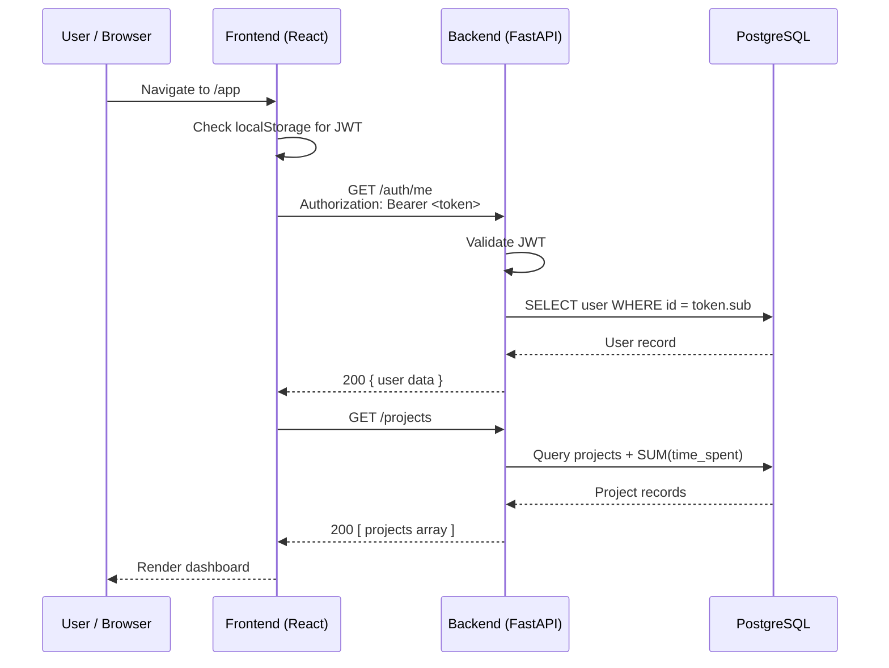
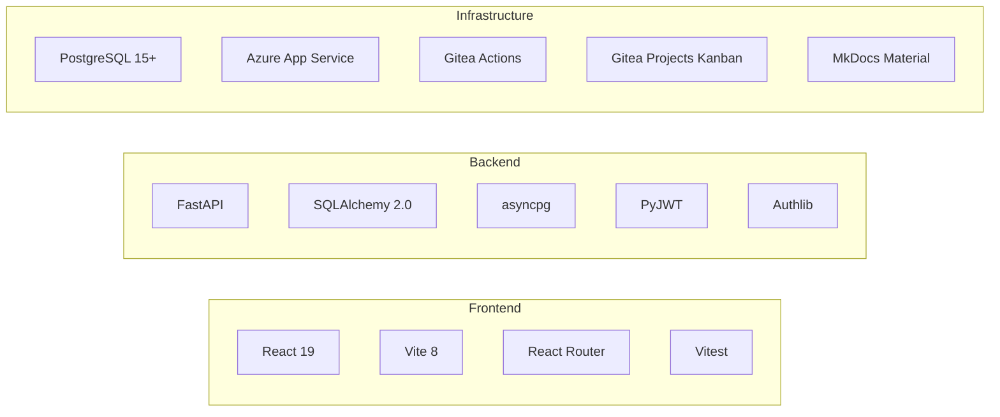

# Architecture Overview

Chronicles follows a **non-monolithic architecture** with a clear separation between the backend API and the frontend client.

## System Architecture



## Request Lifecycle



## Design Principles

1. **User-defined schemas** — the platform never hardcodes field names. Entries store data in JSONB columns and all queries, filters, and statistics operate generically over user-defined fields.
2. **Non-monolithic** — the backend and frontend are separate services with a hand-written REST API. They can be deployed, tested, and scaled independently.
3. **Async-first** — the backend uses `async`/`await` throughout (FastAPI + async SQLAlchemy + asyncpg) for better concurrency under load.
4. **GitHub Flow** — all contributors work on feature branches and merge via pull requests into `main`.

## Technology Stack



### Technology choices and motivations

| Layer | Choice | Why |
|---|---|---|
| React 19 + Vite | Frontend framework + bundler | Mature component model for schema-driven forms; Vite's HMR speeds development; React Router gives clean URLs and auth-aware redirects |
| FastAPI | Backend framework | First-class `async` support, automatic OpenAPI docs, and Pydantic-native validation. Chosen over Flask/Django which lack built-in async and auto-docs |
| SQLAlchemy 2.0 async | ORM | Non-blocking database queries matter because user-defined schema queries are JSONB-heavy. Async engine pairs naturally with FastAPI |
| asyncpg | PostgreSQL driver | Maintains async context end-to-end (FastAPI → SQLAlchemy → driver). Sync drivers would block the event loop under load |
| PostgreSQL + JSONB | Database | JSONB stores user-defined entry fields flexibly alongside strongly-typed core columns. Chosen over SQLite (App Service persistence limits) and Firebase (would make our API non-hand-written) |
| Google OAuth + Authlib | Authentication | Eliminates password storage burden; Google OpenID Connect provides verified emails. Chosen over local password auth for security and simplicity |
| PyJWT | Session tokens | JWT issued server-side after OAuth exchange; stateless validation on every request |
| Azure App Service + Web Apps | Hosting | Non-monolithic split (separate backend/frontend services) satisfying the project brief. Consolidated on Azure for simpler credential management |
| Gitea Actions | CI/CD | Repository is self-hosted on Gitea; Actions runs lint/test/build on PRs and auto-deploys on merge to main |
| Gitea Projects (Kanban) | Work tracking | User stories tracked as board items with acceptance criteria and checklists; pull-based workflow with WIP limits |
| MkDocs Material | Documentation | Markdown-first authoring with built-in search and Mermaid support; no JavaScript build step required |

## Repository Structure

```
Chronicles/
├── .gitea/                    # CI/CD workflows
│   └── workflows/
│       ├── ci.yml             # Lint, test, build on every PR
│       └── deploy.yml         # Deploy to Azure on push to main
├── CONTRIBUTING.md            # Git workflow quick reference
├── chronicles-logbook/
│   ├── backend/               # FastAPI application
│   │   ├── app/
│   │   │   ├── routers/       # API endpoint modules
│   │   │   │   ├── auth.py    # Google OAuth authentication
│   │   │   │   ├── projects.py
│   │   │   │   ├── entries.py
│   │   │   │   └── tasks.py
│   │   │   ├── models.py      # SQLAlchemy ORM models
│   │   │   ├── schemas.py     # Pydantic request/response schemas
│   │   │   ├── database.py    # Engine, session, base class
│   │   │   ├── security.py    # JWT creation and validation
│   │   │   ├── email.py       # SMTP email for account notifications
│   │   │   └── config.py      # Environment variable loading
│   │   ├── migrations/        # SQL migration scripts
│   │   ├── tests/             # pytest test suite
│   │   ├── main.py            # App entry point and router registration
│   │   └── requirements.txt   # Python dependencies
│   └── frontend/              # React + Vite application
│       └── src/
│           ├── App.jsx        # Main app shell, navigation, dashboard
│           ├── AuthPage.jsx   # Google sign-in UI
│           ├── ProfilePage.jsx # Account management
│           ├── TaskPanel.jsx  # Task + checklist UI
│           ├── api.js         # HTTP client for backend
│           ├── App.css        # Component styles
│           ├── index.css      # Global CSS variables, themes
│           └── ...
├── docs/                      # MkDocs documentation source
├── mkdocs.yml                 # Documentation site configuration
└── README.md
```

AI Declaration: The preceding document was reviewed and edited with: Qoder
