# Use Case Diagrams

This page presents the UML use case diagrams for the Chronicles digital logbook. Each diagram maps a user story to its actor interactions and system boundaries.

Diagrams are not included for US6 (password reset — feature removed post-sprint per the PO's Google OAuth decision), US12 (quick capture — not completed), US13 (quick capture — not completed), and US18 (statistics — not completed).

## US2 — Define Entry Fields

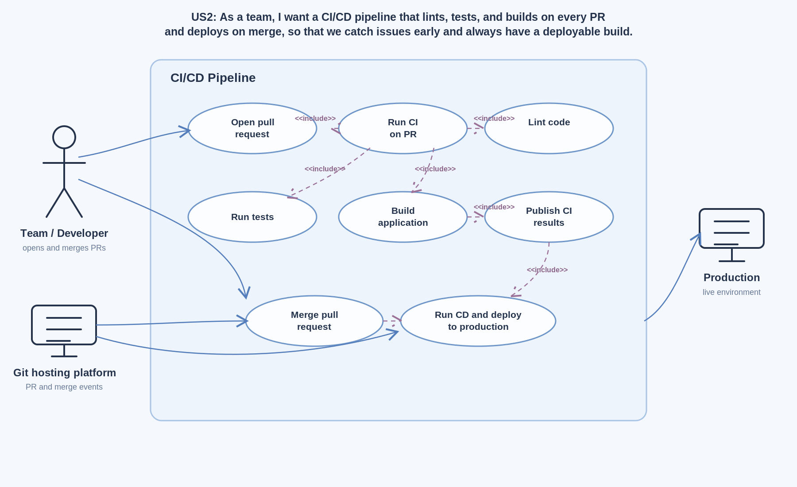

## US3 — Log Entry with User-Defined Fields

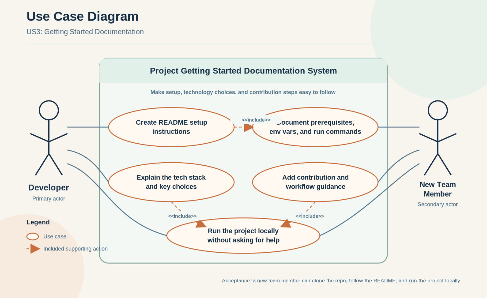

## US5 — Account Deletion

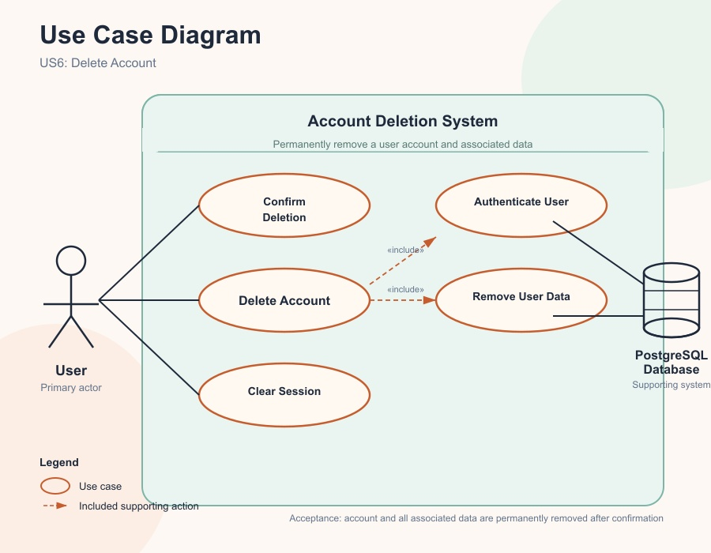

## US7 — API Skeleton

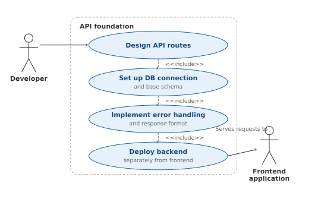

## US9 — External API Integration Plan

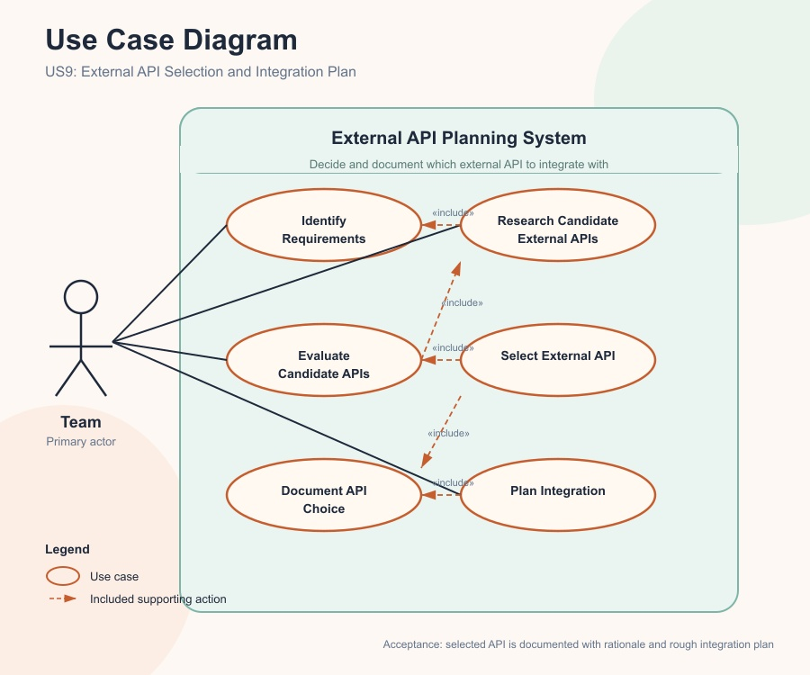

## US10 — Per-Project Entry Format

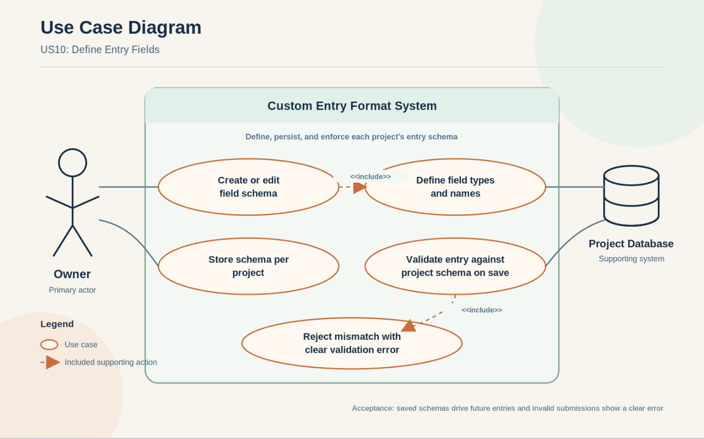

## US11 — Per-Project Formats

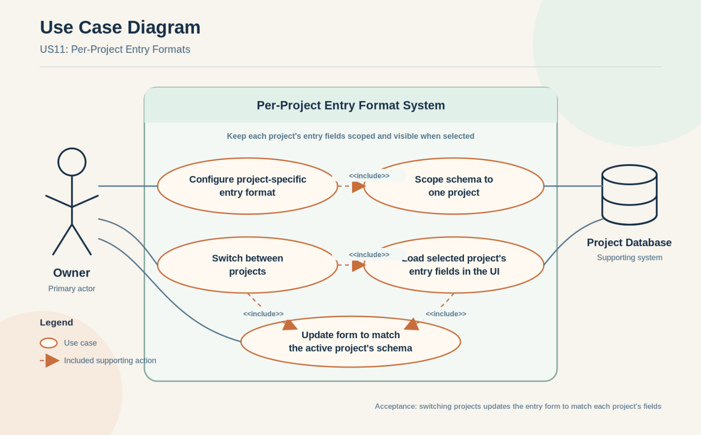

## US16 — Time Tracking (Log Time)

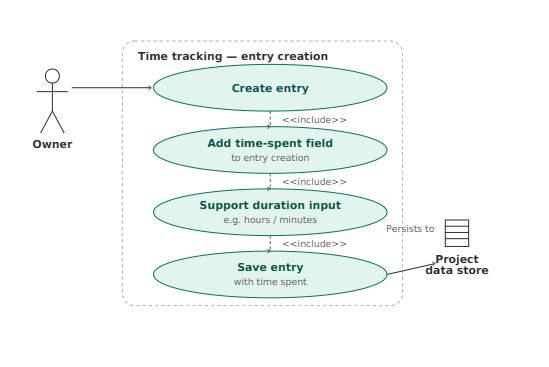

## US17 — Time Tracking (Accumulated Totals)

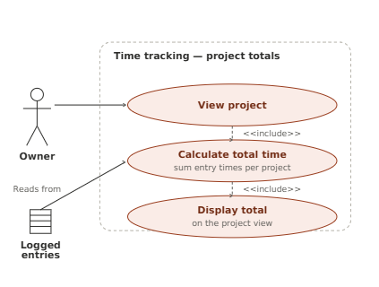

## US19 — Timeline View

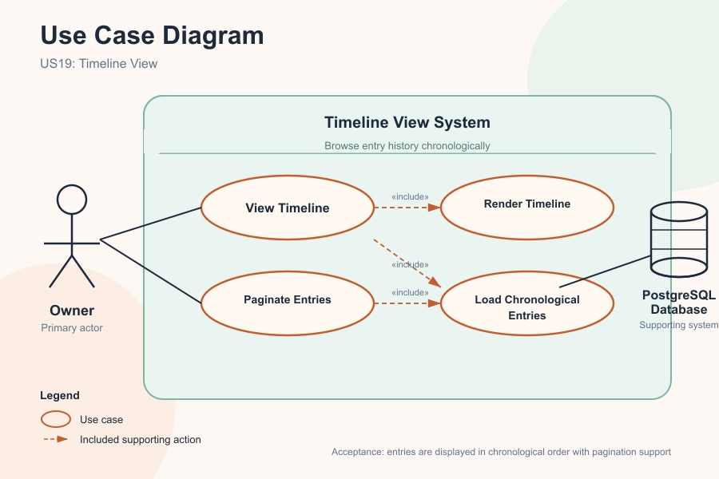

## US20 — Search Entries

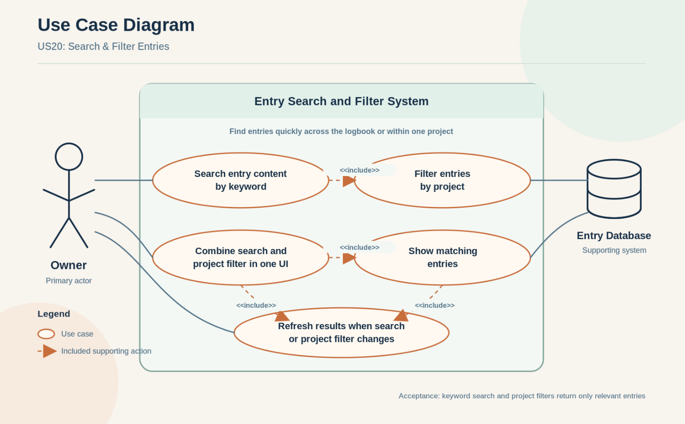

## US24 — Task Tracking

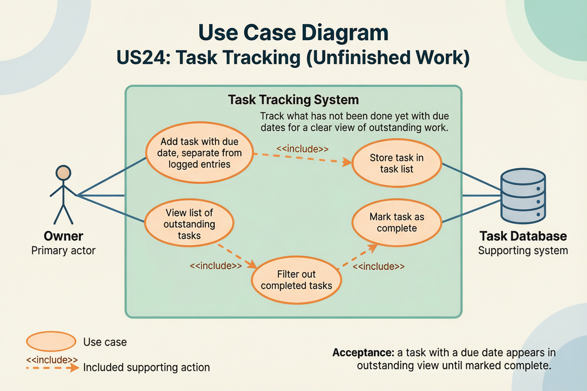
