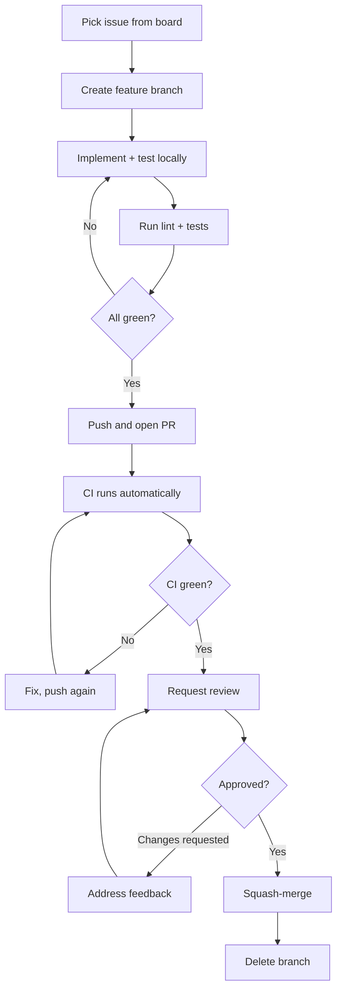

# Contributing

This page is a development-focused guide for working on Chronicles. For the full Git workflow, branching model, and commit conventions, see [Git Workflow](../methodology/git-workflow.md).

## Development Workflow



## Setting Up Your Environment

```bash
# Backend
cd chronicles-logbook/backend
python -m venv .venv
.\.venv\Scripts\Activate.ps1   # Windows PowerShell
pip install -r requirements.txt
pip install ruff pytest pytest-asyncio httpx aiosqlite

# Frontend (new terminal)
cd chronicles-logbook/frontend
npm install
```

## Code Style

| Language | Tool | Command | Auto-fix |
|---|---|---|---|
| Python | ruff | `python -m ruff check .` | `python -m ruff check . --fix` |
| JavaScript/JSX | oxlint | `npm run lint` | — |

Run both before committing. CI will also enforce these checks and block merge on failure.

## Running Tests

=== "Backend"

    ```bash
    python -m pytest          # All tests
    python -m pytest -v       # Verbose output
    python -m pytest -k "auth"  # Filter by name
    ```

=== "Frontend"

    ```bash
    npm run test -- --run     # Single run
    npm run test              # Watch mode
    ```

## Sprint Structure

| Phase | Days | Activity |
|---|---|---|
| Planning | 1–4 | Story estimation, delegation at sprint planning |
| Development + Testing | 5–16 | Implementation with tests and documentation |
| Review & Retrospective | 17–19 | Sprint review with client, retrospective |

## Reviewing Pull Requests

A reviewer checks for:

- **Correctness** — does the change match the issue description?
- **Convention adherence** — commit messages, naming, code style
- **Test coverage** — are new paths and edge cases tested?
- **Accessibility** — for UI changes, are ARIA attributes and keyboard navigation present?
- **No regressions** — do all existing tests still pass?

## Architecture Decision Records

Significant technical decisions are documented as ADRs following [Nygard's format](https://cognitect.com/blog/2011/11/15/documenting-architecture-decisions). Key decisions for Chronicles include:

- **JSONB for user-defined schemas** — allows per-project custom fields without database migrations
- **Async-first backend** — FastAPI + async SQLAlchemy + asyncpg for concurrency
- **CSS custom properties for theming** — no CSS-in-JS overhead
- **Fetch-based API client** — no Axios dependency, uses native browser APIs
