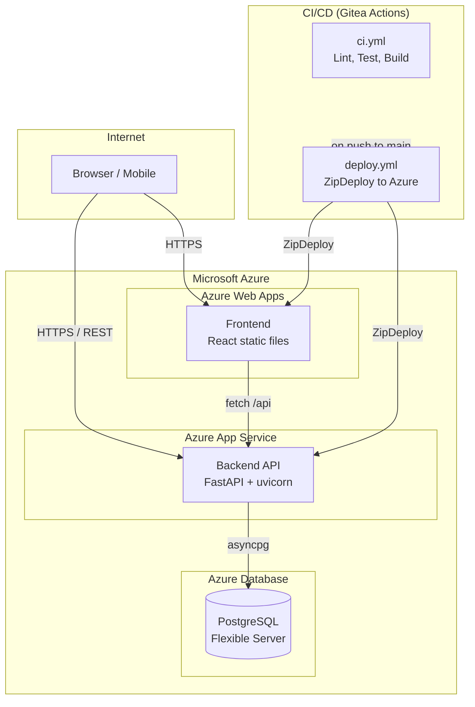
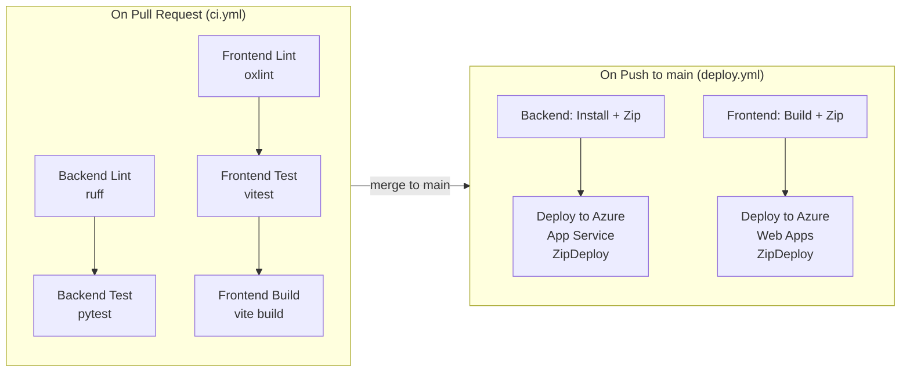

# Deployment

## Infrastructure Overview



| Component | Service |
|---|---|
| Backend API | Azure App Service (Python 3.12) |
| Frontend | Azure Web Apps (static files) |
| Database | Azure Database for PostgreSQL Flexible Server |
| CI/CD | Gitea Actions |
| Documentation | MkDocs static site |

## CI/CD Pipeline



Gitea Actions workflows are configured in `.gitea/workflows/`. The CI pipeline runs on every push and pull request:

1. **Lint** — ruff (Python) and oxlint (JavaScript)
2. **Test** — pytest (backend) and vitest (frontend)
3. **Build** — production builds for both frontend and documentation
4. **Deploy** — push to Azure (main branch only)

### CI Configuration

The CI workflow (`.gitea/workflows/ci.yml`) runs two parallel jobs:

| Job | Steps |
|---|---|
| `backend` | Checkout → Python 3.12 → Install deps → ruff lint → pytest |
| `frontend` | Checkout → Node 20 → npm ci → oxlint lint → vitest → vite build |

### Deploy Configuration

The deploy workflow (`.gitea/workflows/deploy.yml`) runs two parallel jobs on push to `main`:

| Job | Steps |
|---|---|
| `deploy_backend` | Checkout → Python 3.12 → Install deps → Zip → ZipDeploy to Azure App Service |
| `deploy_frontend` | Checkout → Node 20 → npm ci → vite build → Zip → ZipDeploy to Azure Web Apps |

Deployment credentials are stored as Gitea repository secrets (`AZURE_BACKEND_PUBLISH_PROFILE`, `AZURE_FRONTEND_PUBLISH_PROFILE`).

## Backend Deployment

The FastAPI app is deployed to Azure App Service with Python 3.12. The startup command is defined in `startup.txt`:

```
python -m uvicorn main:app --host 0.0.0.0 --port 8000
```

### Environment Variables

| Variable | Required | Description |
|---|---|---|
| `DATABASE_URL` | Yes | Azure PostgreSQL connection string (`postgresql+asyncpg://...`) |
| `JWT_SECRET_KEY` | Yes | Production signing key (min 32 chars) |
| `SESSION_SECRET_KEY` | Yes | Session encryption key |
| `CORS_ORIGINS` | Yes | Production frontend URL |
| `GOOGLE_CLIENT_ID` | No | Google OAuth client ID |
| `GOOGLE_CLIENT_SECRET` | No | Google OAuth client secret |
| `SMTP_HOST` | No | SMTP server for transactional emails |
| `SMTP_PORT` | No | SMTP port (default: 587) |
| `SMTP_USER` | No | SMTP username |
| `SMTP_PASSWORD` | No | SMTP password |
| `FRONTEND_URL` | No | Frontend base URL for OAuth redirects |
| `GOOGLE_CALENDAR_REDIRECT_URI` | No | `https://BACKEND_HOST/auth/google/calendar/callback`; defaults to `OAUTH_REDIRECT_URI` with `/calendar` inserted. Must be registered in the Google OAuth client |

## Frontend Deployment

The React app is built with Vite and deployed as static files to Azure Web Apps:

```bash
npm run build   # Produces static files in dist/
```

The `VITE_API_URL` environment variable is injected at build time to point the frontend at the production backend.

## Documentation Deployment

The MkDocs site is built into a `site/` directory:

```bash
python -m mkdocs build   # Produces static files in site/
```

The built site can be deployed to any static hosting service (Gitea Pages, GitHub Pages, Cloudflare Pages).

## Database Migrations

How a schema change reaches the production database is the part of deployment
that has actually broken, so it is worth being precise about.

### What runs automatically

On startup the API calls `Base.metadata.create_all()`, which creates any
**table** that does not yet exist — so a brand-new model (for example
`project_members`, `mira_consents`) needs no manual step. It then runs every
statement in `_ADDED_COLUMNS` in `main.py` as
`ALTER TABLE … ADD COLUMN IF NOT EXISTS …`.

That list exists because `create_all()` **never adds a column to a table that
already exists**. A model that gains a field works on every developer's
machine — their database is rebuilt from the models — and fails in production,
where the table predates the field, with `UndefinedColumnError` on every query
that selects it.

### What does not run automatically

The deploy workflow zips the backend and ships it. **It does not run the files
in `migrations/`.** Those files are the human-readable record of each change
and are safe to apply by hand (every statement is idempotent), but nothing in
the pipeline applies them.

The rule that follows: **any migration that adds a column to an existing table
must also add that column to `_ADDED_COLUMNS`.** A test
(`tests/test_main.py::test_added_columns_covers_every_migration_column`)
parses the migration files and fails CI if one adds a column the list omits.

### The incident this comes from

On 2026-09-14 the deployed API returned 500 on every project endpoint. Five
columns — `projects.retired_schema`, `entries.retired_data`,
`projects.schema_version`, `entries.schema_version`, `entries.schema_snapshot`
— existed in the models and not in production. `_ADDED_COLUMNS` listed two
columns while the migrations added nine, and two feature branches had each
numbered their migration `004`, which is how the second was missed in the
merge. The list was completed, the later migration renumbered `005`, and the
guard test added, all the same day.

### Applying a migration by hand

For a change that the startup patch cannot express (a data backfill, a
constraint, a rename), apply the file directly. The local network used for
development blocks outbound port 5432, so this is done from **Azure Cloud
Shell**, which runs inside Azure:

```bash
psql "host=<server>.postgres.database.azure.com port=5432 dbname=chronicles user=<admin> password=<password> sslmode=require"
```

then paste the migration's statements at the `psql` prompt, and verify with
`\d projects` / `\d entries`.

### The migration files

| File | Adds |
|---|---|
| `001_schema_updates.sql` | Base tables, `entries.time_spent`, `tasks.checklist`, legacy renames |
| `002_calendar_token_timestamps.sql` | `google_calendar_tokens.created_at` / `updated_at` |
| `003_login_sessions.sql` | `login_sessions` table |
| `004_retired_schema_fields.sql` | `projects.retired_schema`, `entries.retired_data` |
| `005_schema_versioning.sql` | `schema_version` on both, `entries.schema_snapshot`, backfill |
| `006_project_members.sql` | `project_members` table |
| `007_authorship.sql` | `created_by` on entries and tasks, `tasks.completed_by`, backfill to owner |

## Environment Configuration

| Environment | Frontend URL | Backend URL |
|---|---|---|
| Local development | `http://localhost:5173` | `http://localhost:8000` |
| Production | Azure Web Apps URL | Azure App Service URL |

AI Declaration: The preceding document was reviewed and edited with: Qoder
