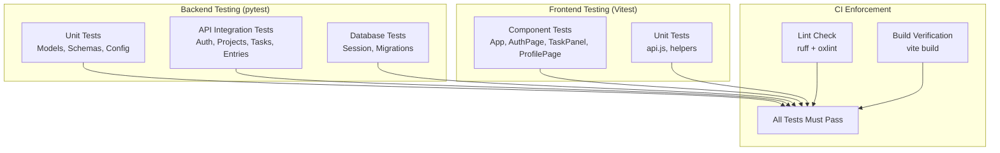

# Testing

## Testing Strategy



## Backend Tests

The backend uses **pytest** with **pytest-asyncio** for async test support.

### Running Tests

```bash
cd chronicles-logbook/backend
python -m pytest              # Run all tests
python -m pytest -v           # Verbose output
python -m pytest -k "auth"    # Run tests matching "auth"
```

### Test Structure

Tests are in `chronicles-logbook/backend/tests/`. The test suite uses an in-memory SQLite database via `aiosqlite` for isolation — no PostgreSQL needed for tests.

```python
@pytest.fixture
async def client():
    # Creates a test app with SQLite in-memory DB
    # Yields an httpx.AsyncClient for making requests
    ...
```

### Test Files

| File | Coverage |
|---|---|
| `test_auth.py` | Google OAuth, account deletion |
| `test_config.py` | Environment variable loading and defaults |
| `test_database.py` | Database session, engine creation |
| `test_entries.py` | Entry CRUD, time tracking, global search |
| `test_main.py` | App startup, lifespan, router registration |
| `test_models.py` | ORM model definitions and relationships |
| `test_routers_projects.py` | Project CRUD, archiving, schema management |
| `test_schemas.py` | Pydantic schema validation |
| `test_tasks.py` | Task CRUD, checklists, toggle, filtering |

### Writing New Tests

```python
import pytest
from httpx import AsyncClient

@pytest.mark.asyncio
async def test_create_task(client: AsyncClient, auth_headers: dict):
    response = await client.post(
        "/projects/{project_id}/tasks",
        json={"title": "Test task", "due_date": "2026-08-25"},
        headers=auth_headers,
    )
    assert response.status_code == 201
    data = response.json()
    assert data["title"] == "Test task"
    assert data["completed"] is False
```

---

## Frontend Tests

The frontend uses **Vitest** for unit and component tests.

### Running Tests

```bash
cd chronicles-logbook/frontend
npm run test            # Watch mode
npm run test -- --run   # Single run
```

### Test Files

| File | Coverage |
|---|---|
| `App.test.jsx` | App shell, navigation, project dashboard |
| `AuthPage.test.jsx` | Sign-in, sign-up form validation |
| `AuthCallback.test.jsx` | OAuth callback token handling |
| `TaskPanel.test.jsx` | Task list, filters, checklist creation and toggling |
| `ProfilePage.test.jsx` | User display, theme cycling, sign-out, delete account |
| `api.test.js` | HTTP client, token injection, error handling |
| `main.test.jsx` | Route protection, redirect logic |

### Writing New Tests

```javascript
import { describe, it, expect } from "vitest"
import { render, screen } from "@testing-library/react"

describe("TaskPanel", () => {
  it("renders the task form", () => {
    render(<TaskPanel projectId="proj-1" />)
    expect(screen.getByRole("heading", { name: /tasks/i })).toBeInTheDocument()
  })

  it("filters tasks by status", () => {
    // Test filter logic
  })
})
```

---

## Linting

| Tool | Scope | Command | Auto-fix |
|---|---|---|---|
| ruff | Python (backend) | `python -m ruff check .` | `python -m ruff check . --fix` |
| oxlint | JavaScript/JSX (frontend) | `npm run lint` | — |

Both tools are enforced in CI. A failing lint check blocks merge to `main`.

---

## Test Policy

### When to Write Tests

- **Every new API endpoint** must have at least one test for the happy path and one for each error case.
- **Every new frontend component** must have a test that verifies it renders correctly.
- **Bug fixes** must include a test that reproduces the bug before the fix, and passes after.

### Test Naming Convention

```
test_<action>_<scenario>_<expected_result>
```

Example: `test_create_task_with_checklist_returns_201`

### Coverage Targets

The project aims for tests that cover all user-facing API endpoints and critical UI interactions. Coverage is measured by the breadth of endpoint and component coverage rather than line-coverage percentage.

---

## Sprint 2 Requirements

The rubric requires:

- Tests must pass and not be skipped
- Each user story should have corresponding tests
- Linting should show no errors or warnings
- A testing document describing strategy and test cases

This documentation serves as the testing document for the project.

AI Declaration: The preceding document was reviewed and edited with: Qoder
