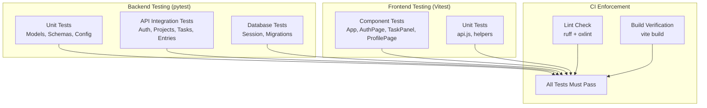

# Testing

## Testing Strategy



## Backend Tests

The backend uses **pytest** with **pytest-asyncio** for async test support.

### Running Tests

```bash
cd chronicles-logbook/backend
python -m pytest              # Run all tests
python -m pytest -v           # Verbose output
python -m pytest -k "auth"    # Run tests matching "auth"
```

### Test Structure

Tests are in `chronicles-logbook/backend/tests/`. The test suite uses an in-memory SQLite database via `aiosqlite` for isolation — no PostgreSQL needed for tests.

```python
@pytest.fixture
async def client():
    # Creates a test app with SQLite in-memory DB
    # Yields an httpx.AsyncClient for making requests
    ...
```

### Test Files

33 files, 696 tests. Sprint 1–2 core:

| File | Coverage |
|---|---|
| `test_auth.py` | Google OAuth, account deletion |
| `test_computed.py` | Expression parsing, safe evaluation, dependency order, cycle rejection |
| `test_config.py` | Environment variable loading and defaults |
| `test_database.py` | Database session, engine creation |
| `test_entries.py` | Entry CRUD, time tracking, global search |
| `test_main.py` | App startup, lifespan, router registration |
| `test_models.py` | ORM model definitions and relationships |
| `test_rich_fields.py` | Project-reference and computed field validation on entry writes |
| `test_routers_projects.py` | Project CRUD, archiving, schema management |
| `test_schema_editing.py` | Schema change preview and apply, entry migration, retired fields |
| `test_schemas.py` | Pydantic schema validation |
| `test_tasks.py` | Task CRUD, checklists, toggle, filtering |
| `test_sharing.py` | Project invitations, member permissions |
| `test_transfer.py` | Full-account JSON export/import |
| `test_structured_search.py` | AND/OR condition search, per-field-type operators |
| `test_saved_filters.py` | Saving, listing and re-applying a saved search |
| `test_statistics.py` | Workspace totals, streaks, field timeline |
| `test_calendar_multi.py`, `test_calendar_regressions.py` | Multi-account Google Calendar sync |
| `test_login_sessions.py`, `test_dev_login.py` | Session refresh/expiry; the `ENABLE_DEV_LOGIN` local bypass |
| `test_ai.py`, `test_mira_consent.py` | Mira chat (consent-gated), the consent endpoint itself |

Sprint 3 additions:

| File | Coverage |
|---|---|
| `test_automation.py` | Entry rules (conditions, actions), recurrence, reminders — 1,030 lines, the largest suite in the project |
| `test_dashboard.py` | Customisable dashboard panels (US-3.9) |
| `test_custom_statistics.py` | Per-project field statistics/grouping |

Added after the Sprint 3 review:

| File | Coverage |
|---|---|
| `test_entry_history.py` | Baseline version 1, per-version changed fields, revert, restoring deleted entries |
| `test_statuses.py` | Custom statuses: rules, project validation, entry create/update, removal and redefinition, search by status, history |
| `test_streaks.py` | Streak counting rules and endpoints; no back-filling; isolation |
| `test_activities_edit.py` | Editing scheduled activities, validation, ownership |
| `test_mira_conversations.py` | Saved conversations, SSE streaming, ordering, consent gating, the Gemini stream wrapper |
| `test_mira_tools.py` | Mira's 26 functions, argument validation, several actions per reply, the workspace snapshot, consent versioning |
| `test_achievements.py` | The badge catalogue, earning, celebration tracking, quiet catch-up, summaries |
| `test_dashboard.py` (extended) | Grid width, panel sizes and their limits |
| `test_entries.py` (extended) | Due time, unknown-field and length limits |

### Writing New Tests

```python
import pytest
from httpx import AsyncClient

@pytest.mark.asyncio
async def test_create_task(client: AsyncClient, auth_headers: dict):
    response = await client.post(
        "/projects/{project_id}/tasks",
        json={"title": "Test task", "due_date": "2026-08-25"},
        headers=auth_headers,
    )
    assert response.status_code == 201
    data = response.json()
    assert data["title"] == "Test task"
    assert data["completed"] is False
```

---

## Frontend Tests

The frontend uses **Vitest** for unit and component tests.

### Running Tests

```bash
cd chronicles-logbook/frontend
npm run test            # Watch mode
npm run test -- --run   # Single run
```

### Test Files

61 files, 770 tests. Core:

| File | Coverage |
|---|---|
| `App.test.jsx` | App shell, navigation, project dashboard |
| `AuthPage.test.jsx` | Sign-in, sign-up form validation |
| `AuthCallback.test.jsx` | OAuth callback token handling |
| `fieldTypes.test.js` | Field-type catalogue, expression parsing and evaluation, computed values |
| `SchemaEditor.test.jsx` | Schema view/edit/review modes, change preview, reference and computed fields on an entry |
| `walkthroughs.test.js`, `Walkthrough.test.jsx` | The walkthrough timeline (what is on screen at any time, typing, clicks, order) and the player (poster, play, pause, scrub, replay, transcript, accessibility) |
| `ProjectForms.test.jsx` | Built-in fields in the schema, the required switch, short and long text in an entry, and the new-project drawer with its default form |
| `Drawer.test.jsx`, `FormField.test.jsx`, `formFields.test.js` | The drawer (docking, focus, Escape, resizing by pointer and keyboard, remembered width), one form question, and the built-in and required-field rules |
| `TaskPanel.test.jsx` | Task list, filters, checklist creation and toggling |
| `ProfilePage.test.jsx` | User display, theme cycling, sign-out, delete account |
| `api.test.js`, `api.endpoints.test.js` | HTTP client, token injection, error handling, every endpoint wrapper |
| `main.test.jsx` | Route protection, redirect logic |
| `offlineSync.test.js`, `offlineQueue.test.js` | Sync queue ordering, retry, per-user isolation (see "what was deliberately not tested" below) |
| `CalendarView.test.jsx` | Month grid, multi-account Google Calendar, day dialog |
| `StructuredSearch.test.jsx`, `SavedFilterBar.test.jsx` | Condition builder, saved-filter chips |
| `CommandPalette.test.jsx` | `Ctrl`/`Cmd`+`K` search, focus return on close |
| `useDialogFocus.test.jsx` | Shared modal focus-trap/return-focus hook |
| `MiraAssistant.test.jsx`, `MiraConsentPage.test.jsx` | Mira chat, project-proposal confirmation, consent gate |

Sprint 3 additions:

| File | Coverage |
|---|---|
| `AutomationPanel.test.jsx`, `automationRules.test.js` | Rule builder, condition matching, action wording |
| `RecurrenceControl.test.jsx` | Repeat-schedule picker and validation |
| `Reminders.test.jsx` | Overdue/due-today/upcoming bell |
| `EntryTimeline.test.jsx` | Chronological Activity view, pagination, date filters |
| `FieldStatisticsPanel.test.jsx` | Per-project field statistics |
| `DataTransfer.test.jsx` | Account export/import |

Added after the Sprint 3 review:

| File | Coverage |
|---|---|
| `EntryHistory.test.jsx` | Versions, reverting, "as it stood on" a date |
| `speech.test.js` | Dictation: alternatives and vocabulary, "mirror" versus Mira, spoken punctuation, punctuation from pauses, capitals; speaking and settings |
| `ActivityHub.test.jsx` | The Logged and Scheduled tabs |
| `OfflineStatus.test.jsx` (extended) | Offline refresh warning, the field flagged in the review panel, date picker |
| `Streaks.test.jsx` | Both streak counters and live updates |
| `MiraMarkdown.test.jsx`, `MiraAssistant.test.jsx`, `miraActions.test.js` | Markdown rendering without HTML injection, history, streaming, proposal cards, every action handler, name resolution, batching and failure |
| `TrashIcon.test.jsx`, `NavIcons.test.jsx` | The delete control and navigation icons |
| `ActivitiesPage.test.jsx`, `DayActivityDialog.test.jsx` | Adding, editing and deleting activities; managing entries and projects from the day view |
| `preferences.test.js` | Colour maths (mixing, hue rotation); basic and advanced custom colours; no trace of a previous colour; reset; presets clearing them |
| `DashboardPage.test.jsx` (extended) | Grid width, resizing, pointer drag and drop |
| `StatusEditor.test.jsx`, `BoardView.test.jsx` (extended) | Status rules, editor, picker, board columns and moves |
| `HomeWorkspace.test.jsx` | The welcome and the embedded dashboard |
| `EntryTaskGuide.test.jsx`, `TaskPanel.test.jsx` (extended) | The entry-or-task guide and the finish-a-task nudge |
| `Achievements.test.jsx` | Badge art, confetti, the profile section and the celebration queue |

Other suites exist alongside these (BoardView, Invitations, GuidedTour,
HelpPage, ViewTransition and more) for the rest of the app surface;
`npx vitest run` runs all 61.

### Writing New Tests

```javascript
import { describe, it, expect } from "vitest"
import { render, screen } from "@testing-library/react"

describe("TaskPanel", () => {
  it("renders the task form", () => {
    render(<TaskPanel projectId="proj-1" />)
    expect(screen.getByRole("heading", { name: /tasks/i })).toBeInTheDocument()
  })

  it("filters tasks by status", () => {
    // Test filter logic
  })
})
```

---

## Linting

| Tool | Scope | Command | Auto-fix |
|---|---|---|---|
| ruff | Python (backend) | `python -m ruff check .` | `python -m ruff check . --fix` |
| oxlint | JavaScript/JSX (frontend) | `npm run lint` | — |

Both tools are enforced in CI. A failing lint check blocks merge to `main`.

---

## Test Policy

### When to Write Tests

- **Every new API endpoint** must have at least one test for the happy path and one for each error case.
- **Every new frontend component** must have a test that verifies it renders correctly.
- **Bug fixes** must include a test that reproduces the bug before the fix, and passes after.

### Test Naming Convention

```
test_<action>_<scenario>_<expected_result>
```

Example: `test_create_task_with_checklist_returns_201`

### Coverage Targets

The Sprint 3 guidance sets 30% as acceptable and 60% as preferable, averaged
across codebases if there is more than one. Both of ours clear that
comfortably on their own, without needing to average up:

| Codebase | Statement coverage | Tests | Measured |
|---|---|---|---|
| Backend (pytest + coverage.py) | **95%** (4,871 statements, 238 missed) | 780, across 37 test files | 9 October 2026 |
| Frontend (Vitest + @vitest/coverage-v8) | **84.6%** (87.6% of lines) | 987, across 75 test files | 9 October 2026 |

!!! warning "Targets, not gates"
    Neither suite has a `fail-under` threshold, so CI would not fail if coverage fell. The percentages are the
    team's own targets. See [What we do not test](../decisions/not-tested.md#the-numbers-and-what-enforces-them).

Reproduce these numbers directly rather than trusting the badge:

```bash
cd chronicles-logbook/backend && python -m pytest --cov=app --cov-report=term-missing
cd chronicles-logbook/frontend && npx vitest run --coverage
```

The badges on the README are generated from the same numbers by CI
(`.gitea/workflows/ci.yml`) on every push to `main`, so they track this table;
they are a shortcut for a glance, not the coverage report itself.

Line coverage is reported here because it's what the tooling measures
directly, but breadth of endpoint and component coverage is the target the
team actually works to — a line executed incidentally is not the same as a
behaviour that has been checked. The "what was deliberately not tested"
section below exists for exactly that reason: a percentage on its own can't
distinguish the two, so the gaps and the reasoning behind them are written
out explicitly instead of just cited as a number.

---

## The testing tools, and why each one

Every tool here was chosen over an alternative; the reason matters as much as the choice.

### Backend

| Tool | What it does | Why this one |
|---|---|---|
| **pytest** | Test runner | Plain functions and bare `assert` rather than a class hierarchy, so a test reads like a description of the behaviour. Its fixture model is what makes the database-per-test setup in `conftest.py` possible without repetition. |
| **pytest-asyncio** | Runs the async tests | The whole API is `async def`; without it, every test would need its own event-loop boilerplate. Configured as `asyncio_mode = "auto"` so tests need no decorator — one less thing to forget and a class of silently-skipped tests that cannot happen. |
| **pytest-cov** | Coverage measurement | Wraps `coverage.py` into the pytest run, so coverage comes from the same command CI already runs rather than a separate pass that can drift out of step. |
| **aiosqlite** | Async SQLite driver, tests only | Lets the suite run against a throwaway file database with no PostgreSQL server, so CI needs no database service and a developer can run tests on a fresh clone. The application itself runs on PostgreSQL via asyncpg. |
| **httpx `ASGITransport`** | Drives the app in tests | Sends real requests through the whole ASGI stack — routing, dependencies, middleware, serialisation — without binding a port. Calling endpoint functions directly would skip exactly the layers most likely to break. |
| **ruff** | Linting | Replaces flake8, isort and several plugins with one tool that runs in well under a second, which is what makes it viable as a pre-merge check rather than something people skip. |

### Frontend

| Tool | What it does | Why this one |
|---|---|---|
| **Vitest** | Test runner | Shares Vite's transform pipeline, so tests resolve modules exactly as the app does. A separate runner (Jest) would need its own duplicate transform config, which is a second place for the build to be subtly wrong. |
| **@testing-library/react** | Component testing | Queries by role, label and visible text rather than by class name or component internals. A test written that way fails when the user's experience breaks and survives a refactor that changes none of it — the opposite of a snapshot test. |
| **@testing-library/jest-dom** | DOM assertions | `toBeInTheDocument()`, `toBeDisabled()` and similar, so failures describe the DOM rather than printing a boolean. |
| **jsdom** | DOM implementation | Runs component tests in Node with no browser. Faster and more reproducible than a real browser for unit-level work; the trade-off is no real layout or paint, which is why UI appearance is still checked by hand. |
| **@vitest/coverage-v8** | Coverage | Uses V8's built-in coverage rather than instrumenting the source, so the code under test is the code that ships. |
| **oxlint** | Linting | Substantially faster than ESLint on this codebase and needs no configuration file to be useful. |

### A measurement bug worth recording

Backend coverage read **74%** for most of Sprint 2 and was wrong.

SQLAlchemy's asyncio support runs the ORM inside **greenlet** switches, and `coverage.py` only traces the concurrency models it is told about. With its default (`thread`), every line of an endpoint body reached after `await db.execute(...)` was recorded as never executed. `statistics.py` reported 23% while seventeen tests were calling its endpoints and asserting on the responses.

The fix is one line in `pyproject.toml`:

```toml
[tool.coverage.run]
concurrency = ["thread", "greenlet"]
```

Real coverage was **93%** all along. The lesson recorded here is that a coverage number is itself a measurement that can be wrong, and a figure far below what the tests visibly do is a reason to check the instrument before writing more tests. Chasing that 74% by adding tests would have produced redundant tests and still not moved the number.

### What was deliberately *not* tested

- **`generate_reply()` in `gemini_service.py`** was unreachable — nothing in the application or the tests called it. It accounted for 26 of the 32 uncovered statements in that module. It was **deleted rather than tested**: writing tests for dead code raises the percentage while testing nothing, which is worse than leaving it uncovered because it disguises the problem.
- **The Google OAuth callback and Calendar token-refresh paths** are partly uncovered (`auth.py` 85%, `calendar.py` 84%). Exercising them means standing in a fake Google, and a mock of an OAuth provider mostly tests the mock. These paths are verified by signing in for real against the deployed app.
- **The IndexedDB adapter in `offlineQueue.js`** (lines 40–69). `jsdom` provides no IndexedDB, so covering it needs a `fake-indexeddb` dependency. The queue's *behaviour* — ordering, per-user isolation, retry, rejection, attempt counting — is fully covered through `createMemoryAdapter`, which is the logic worth testing; the adapter itself is a thin translation to the browser API.
- **`DayActivityDialog.jsx`** had no test file when this list was written, a genuine gap rather than a considered exclusion. It has one now (`DayActivityDialog.test.jsx`). Its focus handling is the browser's own, because it is a native `<dialog>`.

!!! info "The complete, current list"
    This section is the original short list. Everything not tested, with the reason, the mitigation and the
    risk for each, is on [What we do not test, and why](../decisions/not-tested.md). It covers Mira against the
    real model, dictation, PostgreSQL-only behaviour, layout, real touch gestures, accessibility automation,
    performance and cold starts, other browsers, time zones and very large logbooks.

A worked example of why the *number* is not the goal: a first attempt at testing `newEntryId`'s older-browser fallback deleted `crypto.randomUUID` with `Reflect.deleteProperty`. The test passed — but `crypto`'s own properties are not configurable, so the deletion silently did nothing, the real implementation ran, and its output matched the UUID pattern being asserted. Coverage is what exposed it: the fallback's lines were still reported as unexecuted. Replacing the whole global with `vi.stubGlobal("crypto", {})` made the test real. **A passing test that never reaches the code it names is worse than no test, because it reports the opposite of the truth.**

---

## Accessibility checks

The landing page is audited with Lighthouse (see [API Performance](../testing/api-performance.md)), but
Lighthouse cannot sign in, so it never sees the app itself. The signed-in screens are checked with
**axe-core 4.10.2**, the engine inside most accessibility tools, run in the browser against the running
app. It was run with the WCAG 2.0, 2.1 and 2.2 level A and AA rules plus axe's best-practice rules (the
ones that cover semantic HTML and ARIA use).

| | |
|---|---|
| **Screens** | Home, a project's Entries, Schema, Tasks and Automation tabs, the new-entry form, the entry panel (reading, editing, history), the schema editor (reading, editing, adding a field), Dashboard, Today, Outstanding, Activities, Mira, Statistics, Calendar, Board, All Entries, All Tasks, the Learning hub and its guides (with a video playing and the transcript open), Help, Profile, Achievements |
| **Conditions** | Desktop width (1280 px) and phone width (375 px), each in the light and the dark theme. The phone passes covered the main app screens and the standalone pages, not every tab |
| **Not covered** | The picture inside a walkthrough video (hidden from assistive technology on purpose, with the same words offered as a transcript), and anything a scan cannot judge: reading order, whether a label makes sense, how it sounds in a screen reader |

The first full pass found eight real problems, all fixed:

| Found | Why it matters | Fix |
|---|---|---|
| The entry list's rows were list items marked as buttons, every one named "Open entry detail" (critical) | A screen reader announced a broken list and the same name for every entry | A row is a plain list item; its title is a real button that CSS stretches over the row, so a click anywhere still opens it and each button is named for its entry |
| A project's page and the calendar had no level-one heading, and the headings beneath them skipped a level | People who move by heading had nothing to start from | The project's name is now the level-one heading and a hidden heading names its tab; the calendar has a hidden one. The task list's heading was raised a level on the All Tasks page |
| The side panel was an `<aside>` with a `<header>`, so it counted as a second banner landmark and an invalid dialog | Duplicate landmarks make the page map confusing | A dialog `<div>` with plain `<div>` parts |
| The sidebar's project list was a listbox whose items also held a pin button (critical) | Invalid ARIA: a listbox may only hold options | A plain list; the open project is marked with `aria-current` |
| The two statistics charts had a label but no role | A label on a bare `<div>` is ignored | `role="img"` (the same figures are in a table for screen readers) |
| The tour's step dots had a label but no role | Same | `role="img"` |
| The tour card and the badge summary used a heading level too low for where they sit | Skipped heading levels | Raised one level |
| Text on the active phone tab had a contrast of 4.14:1 (needs 4.5:1) | Hard to read for low vision | The brand blue is a little darker (`#4f50d4`), which gives 4.9:1 on its tinted background and 6.1:1 on white |

After the fixes every screen in the table reports no violations under each of the conditions above (and the phone layout has no sideways scroll). Tests keep the structural fixes from slipping back:
the entry rows (a list of rows, one named button each) and the panel (no banner or complementary
landmark) are asserted in `SchemaEditor.test.jsx` and `Drawer.test.jsx`.

To repeat the check, sign in locally, then load `axe.min.js` into the page and call
`axe.run(document, { runOnly: { type: "tag", values: ["wcag2a", "wcag2aa", "wcag21a", "wcag21aa", "wcag22aa", "best-practice"] } })`
on each screen.

## User feedback as a testing activity

Automated tests answer "does it do what we intended?". They cannot answer "did we intend the right thing" — 58% of surveyed users could not tell Entries and Tasks apart, and every test still passed.

Formal user feedback is therefore treated as part of the testing process, not as marketing. The collection method, results, resulting changes, and the requests deliberately declined are on the [User Feedback](../methodology/user-feedback.md) page.

---

## Sprint 2 & 3 Requirements

The rubric requires:

- Tests must pass and not be skipped
- Each user story should have corresponding tests
- Linting should show no errors or warnings
- A testing document describing strategy and test cases
- (Sprint 3) A code coverage **metric or report**, not only a badge, covering
  the whole system — see Coverage Targets above
- (Sprint 3) Load/stress testing via direct HTTP, never the UI, with evidence
  — see [API Performance, Load & Robustness](../testing/api-performance.md)
  and its [raw evidence index](../evidence/index.md)
- (Sprint 3) Correct use of HTTP status codes for malformed input — see that
  same page's Findings 3–5

This documentation, together with the two pages linked above, serves as the
testing document for the project.

AI Declaration: The preceding document was reviewed and edited with: Qoder.
The Coverage Targets numbers, expanded test file tables, and Sprint 2 & 3
Requirements section above were updated with Claude Code (Sonnet 5).
