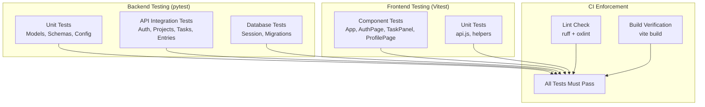

# Testing

## Testing Strategy



## Backend Tests

The backend uses **pytest** with **pytest-asyncio** for async test support.

### Running Tests

```bash
cd chronicles-logbook/backend
python -m pytest              # Run all tests
python -m pytest -v           # Verbose output
python -m pytest -k "auth"    # Run tests matching "auth"
```

### Test Structure

Tests are in `chronicles-logbook/backend/tests/`. The test suite uses an in-memory SQLite database via `aiosqlite` for isolation — no PostgreSQL needed for tests.

```python
@pytest.fixture
async def client():
    # Creates a test app with SQLite in-memory DB
    # Yields an httpx.AsyncClient for making requests
    ...
```

### Test Files

| File | Coverage |
|---|---|
| `test_auth.py` | Google OAuth, account deletion |
| `test_computed.py` | Expression parsing, safe evaluation, dependency order, cycle rejection |
| `test_config.py` | Environment variable loading and defaults |
| `test_database.py` | Database session, engine creation |
| `test_entries.py` | Entry CRUD, time tracking, global search |
| `test_main.py` | App startup, lifespan, router registration |
| `test_models.py` | ORM model definitions and relationships |
| `test_rich_fields.py` | Project-reference and computed field validation on entry writes |
| `test_routers_projects.py` | Project CRUD, archiving, schema management |
| `test_schema_editing.py` | Schema change preview and apply, entry migration, retired fields |
| `test_schemas.py` | Pydantic schema validation |
| `test_tasks.py` | Task CRUD, checklists, toggle, filtering |

### Writing New Tests

```python
import pytest
from httpx import AsyncClient

@pytest.mark.asyncio
async def test_create_task(client: AsyncClient, auth_headers: dict):
    response = await client.post(
        "/projects/{project_id}/tasks",
        json={"title": "Test task", "due_date": "2026-08-25"},
        headers=auth_headers,
    )
    assert response.status_code == 201
    data = response.json()
    assert data["title"] == "Test task"
    assert data["completed"] is False
```

---

## Frontend Tests

The frontend uses **Vitest** for unit and component tests.

### Running Tests

```bash
cd chronicles-logbook/frontend
npm run test            # Watch mode
npm run test -- --run   # Single run
```

### Test Files

| File | Coverage |
|---|---|
| `App.test.jsx` | App shell, navigation, project dashboard |
| `AuthPage.test.jsx` | Sign-in, sign-up form validation |
| `AuthCallback.test.jsx` | OAuth callback token handling |
| `fieldTypes.test.js` | Field-type catalogue, expression parsing and evaluation, computed values |
| `SchemaEditor.test.jsx` | Schema view/edit/review modes, change preview, reference and computed fields on an entry |
| `TaskPanel.test.jsx` | Task list, filters, checklist creation and toggling |
| `ProfilePage.test.jsx` | User display, theme cycling, sign-out, delete account |
| `api.test.js` | HTTP client, token injection, error handling |
| `main.test.jsx` | Route protection, redirect logic |

The tables list the files that cover the documented API surface. Other suites
exist alongside them for offline sync, calendar, statistics and the assistant.

### Writing New Tests

```javascript
import { describe, it, expect } from "vitest"
import { render, screen } from "@testing-library/react"

describe("TaskPanel", () => {
  it("renders the task form", () => {
    render(<TaskPanel projectId="proj-1" />)
    expect(screen.getByRole("heading", { name: /tasks/i })).toBeInTheDocument()
  })

  it("filters tasks by status", () => {
    // Test filter logic
  })
})
```

---

## Linting

| Tool | Scope | Command | Auto-fix |
|---|---|---|---|
| ruff | Python (backend) | `python -m ruff check .` | `python -m ruff check . --fix` |
| oxlint | JavaScript/JSX (frontend) | `npm run lint` | — |

Both tools are enforced in CI. A failing lint check blocks merge to `main`.

---

## Test Policy

### When to Write Tests

- **Every new API endpoint** must have at least one test for the happy path and one for each error case.
- **Every new frontend component** must have a test that verifies it renders correctly.
- **Bug fixes** must include a test that reproduces the bug before the fix, and passes after.

### Test Naming Convention

```
test_<action>_<scenario>_<expected_result>
```

Example: `test_create_task_with_checklist_returns_201`

### Coverage Targets

The project aims for tests that cover all user-facing API endpoints and critical UI interactions. Line coverage is reported as a badge on the README, but breadth of endpoint and component coverage is the target the team works to — a line executed incidentally is not the same as a behaviour that has been checked.

Backend line coverage currently stands at **94%** across 317 tests.

---

## The testing tools, and why each one

Every tool here was chosen over an alternative; the reason matters as much as the choice.

### Backend

| Tool | What it does | Why this one |
|---|---|---|
| **pytest** | Test runner | Plain functions and bare `assert` rather than a class hierarchy, so a test reads like a description of the behaviour. Its fixture model is what makes the database-per-test setup in `conftest.py` possible without repetition. |
| **pytest-asyncio** | Runs the async tests | The whole API is `async def`; without it, every test would need its own event-loop boilerplate. Configured as `asyncio_mode = "auto"` so tests need no decorator — one less thing to forget and a class of silently-skipped tests that cannot happen. |
| **pytest-cov** | Coverage measurement | Wraps `coverage.py` into the pytest run, so coverage comes from the same command CI already runs rather than a separate pass that can drift out of step. |
| **aiosqlite** | Async SQLite driver, tests only | Lets the suite run against a throwaway file database with no PostgreSQL server, so CI needs no database service and a developer can run tests on a fresh clone. The application itself runs on PostgreSQL via asyncpg. |
| **httpx `ASGITransport`** | Drives the app in tests | Sends real requests through the whole ASGI stack — routing, dependencies, middleware, serialisation — without binding a port. Calling endpoint functions directly would skip exactly the layers most likely to break. |
| **ruff** | Linting | Replaces flake8, isort and several plugins with one tool that runs in well under a second, which is what makes it viable as a pre-merge check rather than something people skip. |

### Frontend

| Tool | What it does | Why this one |
|---|---|---|
| **Vitest** | Test runner | Shares Vite's transform pipeline, so tests resolve modules exactly as the app does. A separate runner (Jest) would need its own duplicate transform config, which is a second place for the build to be subtly wrong. |
| **@testing-library/react** | Component testing | Queries by role, label and visible text rather than by class name or component internals. A test written that way fails when the user's experience breaks and survives a refactor that changes none of it — the opposite of a snapshot test. |
| **@testing-library/jest-dom** | DOM assertions | `toBeInTheDocument()`, `toBeDisabled()` and similar, so failures describe the DOM rather than printing a boolean. |
| **jsdom** | DOM implementation | Runs component tests in Node with no browser. Faster and more reproducible than a real browser for unit-level work; the trade-off is no real layout or paint, which is why UI appearance is still checked by hand. |
| **@vitest/coverage-v8** | Coverage | Uses V8's built-in coverage rather than instrumenting the source, so the code under test is the code that ships. |
| **oxlint** | Linting | Substantially faster than ESLint on this codebase and needs no configuration file to be useful. |

### A measurement bug worth recording

Backend coverage read **74%** for most of Sprint 2 and was wrong.

SQLAlchemy's asyncio support runs the ORM inside **greenlet** switches, and `coverage.py` only traces the concurrency models it is told about. With its default (`thread`), every line of an endpoint body reached after `await db.execute(...)` was recorded as never executed. `statistics.py` reported 23% while seventeen tests were calling its endpoints and asserting on the responses.

The fix is one line in `pyproject.toml`:

```toml
[tool.coverage.run]
concurrency = ["thread", "greenlet"]
```

Real coverage was **93%** all along. The lesson recorded here is that a coverage number is itself a measurement that can be wrong, and a figure far below what the tests visibly do is a reason to check the instrument before writing more tests. Chasing that 74% by adding tests would have produced redundant tests and still not moved the number.

### What was deliberately *not* tested

- **`generate_reply()` in `gemini_service.py`** was unreachable — nothing in the application or the tests called it. It accounted for 26 of the 32 uncovered statements in that module. It was **deleted rather than tested**: writing tests for dead code raises the percentage while testing nothing, which is worse than leaving it uncovered because it disguises the problem.
- **The Google OAuth callback and Calendar token-refresh paths** are partly uncovered (`auth.py` 85%, `calendar.py` 84%). Exercising them means standing in a fake Google, and a mock of an OAuth provider mostly tests the mock. These paths are verified by signing in for real against the deployed app.
- **The IndexedDB adapter in `offlineQueue.js`** (lines 40–69). `jsdom` provides no IndexedDB, so covering it needs a `fake-indexeddb` dependency. The queue's *behaviour* — ordering, per-user isolation, retry, rejection, attempt counting — is fully covered through `createMemoryAdapter`, which is the logic worth testing; the adapter itself is a thin translation to the browser API.

A worked example of why the *number* is not the goal: a first attempt at testing `newEntryId`'s older-browser fallback deleted `crypto.randomUUID` with `Reflect.deleteProperty`. The test passed — but `crypto`'s own properties are not configurable, so the deletion silently did nothing, the real implementation ran, and its output matched the UUID pattern being asserted. Coverage is what exposed it: the fallback's lines were still reported as unexecuted. Replacing the whole global with `vi.stubGlobal("crypto", {})` made the test real. **A passing test that never reaches the code it names is worse than no test, because it reports the opposite of the truth.**

---

## User feedback as a testing activity

Automated tests answer "does it do what we intended?". They cannot answer "did we intend the right thing" — 58% of surveyed users could not tell Entries and Tasks apart, and every test still passed.

Formal user feedback is therefore treated as part of the testing process, not as marketing. The collection method, results, resulting changes, and the requests deliberately declined are on the [User Feedback](../methodology/user-feedback.md) page.

---

## Sprint 2 Requirements

The rubric requires:

- Tests must pass and not be skipped
- Each user story should have corresponding tests
- Linting should show no errors or warnings
- A testing document describing strategy and test cases

This documentation serves as the testing document for the project.

AI Declaration: The preceding document was reviewed and edited with: Qoder
