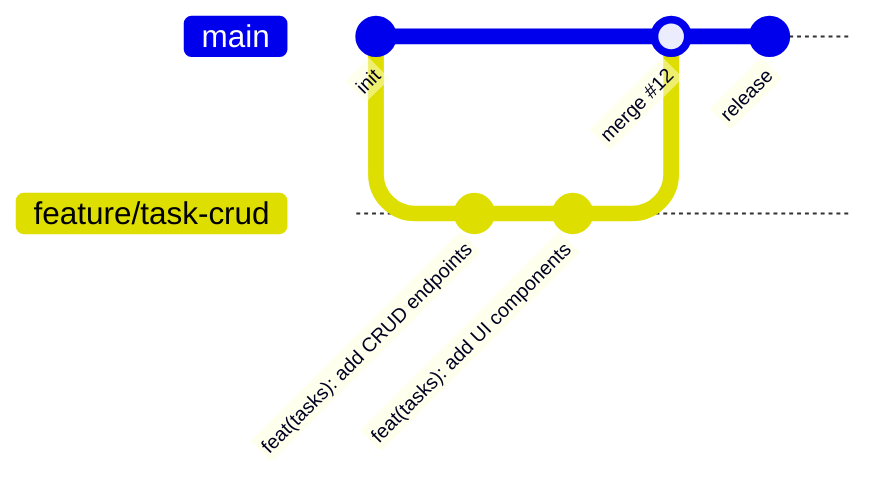
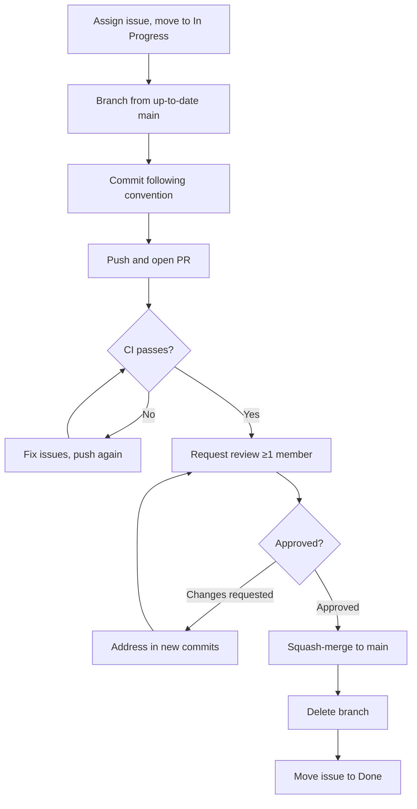
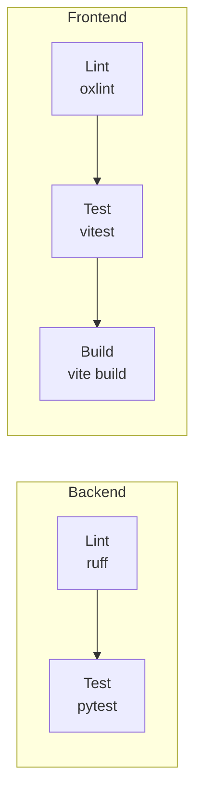

# Git Workflow

This document describes the Git methodology used by the Chronicles team. It follows **GitHub Flow** with a staging branch adaptation, combined with the **Conventional Commits** specification.

## 1. Branching Model

We follow **GitHub Flow** — `main` is always deployable, and all work happens on short-lived feature branches merged via pull requests.



### Long-lived branches

| Branch | Purpose |
|---|---|
| `main` | Always deployable. Protected — no direct pushes. |

### Short-lived branches

All feature, fix, and chore branches are created from `main` and deleted after merge.

Reference: Chacon and Straub, *Pro Git* (2nd edition, Apress, 2014); GitHub, "GitHub Flow," [https://docs.github.com/en/get-started/using-github/github-flow](https://docs.github.com/en/get-started/using-github/github-flow).

## 2. Branch Naming Convention

```
<type>/<issue-number>-<short-kebab-description>
```

**Types:** `feature`, `fix`, `docs`, `refactor`, `test`, `chore`.

**Examples from this project:**

```
feature/18-template-field-builder
fix/33-duration-aggregation-query
docs/12-api-specification
chore/7-husky-precommit-setup
refactor/41-extract-auth-middleware
test/55-task-panel-tests
```

Including the issue number creates a visible link between the work tracker and Git history, which serves both the work tracker and version control rubric criteria simultaneously.

## 3. Commit Message Convention

We follow the [Conventional Commits](https://www.conventionalcommits.org/) specification.

### Format

```
<type>(<scope>): <subject>

[optional body]

[optional footer]
```

### Rules

- **Imperative mood** in the subject: "add", not "added" or "adds"
- **Subject under 72 characters**
- **No trailing full stop** on the subject line
- **Body explains *why***, not *what* (the diff shows what)
- **Footer references the issue**: `Closes #23`

### Worked Examples

Good:

```
feat(entries): add time-spent field to entry creation

Track how long each work session takes so the statistics
dashboard can display per-project time totals.

Closes #42
```

Good:

```
fix(entries): handle missing time_spent in timeline view

The timeline endpoint returned 500 when entries lacked
time_spent because the serializer assumed non-null values.
Added a null-safe coalesce in the response model.

Closes #38
```

Bad (and its correction):

```
# BAD — no type, past tense, too vague
added some changes to the auth

# CORRECTED
feat(auth): add Google OAuth callback handler
```

## 4. Pull Request Workflow



### Sequence

1. Assign yourself the issue on the board; move it to **In Progress**
2. Branch from up-to-date `main`
3. Commit following the Conventional Commits convention
4. Push and open a PR using the template
5. Ensure CI passes (lint, test, build)
6. Request review from at least one member who did not write the code
7. Address review comments in new commits
8. Squash-merge on approval
9. Delete the branch

### Review Requirements

- Minimum **one approving review**
- CI must be **green** (all checks pass)
- **No unresolved conversations** on the PR
- PR description must **link its issue** (e.g., `Closes #23`)

### Reviewer Obligations

A reviewer checks for:

- **Correctness** — does the change do what the issue describes?
- **Convention adherence** — commit messages, naming, code style
- **Test coverage** — are new paths tested?
- **Accessibility** — for UI changes, are ARIA attributes and keyboard navigation present?
- **No regressions** — do existing tests still pass?

## 5. Merge Strategy

We use **squash merge** exclusively.

**Justification:** Squash merge produces one clean, semantic commit per feature on `main`, making the history legible when scanning `git log --oneline`. The cost is losing granular intra-branch history, which we accept because the PR itself preserves the full conversation and commit sequence.

## 6. Branch Protection Rules

The following rules are configured on the `main` branch:

| Rule | Status |
|---|---|
| No direct pushes to `main` | ✅ Enabled |
| Pull request required before merging | ✅ Enabled |
| Minimum one approving review | ✅ Enabled |
| Status checks must pass | ✅ Enabled (CI workflow) |
| Branches must be up to date before merge | ✅ Enabled |
| Force pushes disabled | ✅ Enabled |

!!! tip
    Take a screenshot of the branch protection settings page in your Gitea/GitHub repository settings and embed it here as evidence of enforcement.

## 7. What Must Not Be Committed

| Rule | Enforcement |
|---|---|
| No `.env` files or secrets | `.gitignore` entry |
| No `node_modules/` or `venv/` | `.gitignore` entry |
| No build output (`dist/`, `site/`) | `.gitignore` entry |
| No IDE configuration (`.vscode/`, `.idea/`) | `.gitignore` entry |
| No large binaries or media files | Manual review |

The committed `.env.example` files document required environment variables without exposing values:

- `chronicles-logbook/backend/.env.example`
- `chronicles-logbook/frontend/.env.example`

## 8. CI Enforcement

The Gitea Actions CI pipeline (`.gitea/workflows/ci.yml`) enforces the following on every push and pull request:



| Check | Scope | Command |
|---|---|---|
| Lint | Python | `python -m ruff check .` |
| Test | Python | `python -m pytest` |
| Lint | JavaScript/JSX | `npm run lint` |
| Test | JavaScript/JSX | `npm run test -- --run` |
| Build | Frontend | `npm run build` |

A failing CI check blocks merge to `main`.

## 9. References

1. S. Chacon and B. Straub, *Pro Git*, 2nd edition. Apress, 2014.
2. GitHub, "GitHub Flow," [https://docs.github.com/en/get-started/using-github/github-flow](https://docs.github.com/en/get-started/using-github/github-flow).
3. Conventional Commits, "Conventional Commits Specification," [https://www.conventionalcommits.org/](https://www.conventionalcommits.org/).

AI Declaration: The preceding document was reviewed and edited with: Qoder
