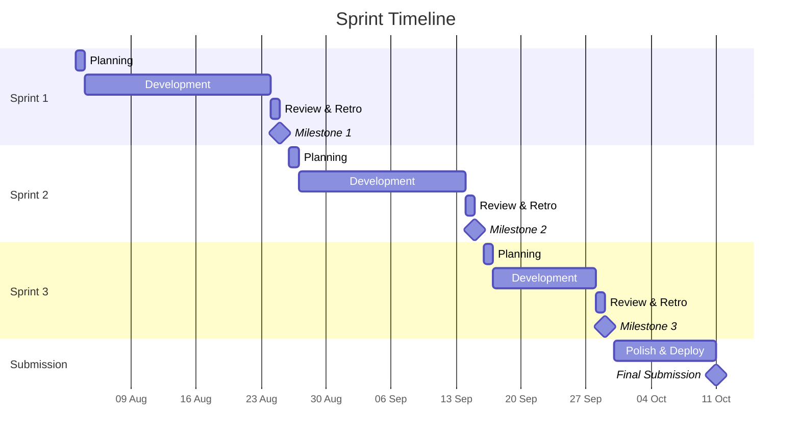

# Project Methodology

## 1. Purpose and Scope

This document defines the project management methodology adopted by the Driven by Design team for the development of Chronicles, a digital logbook application built as part of COMS3011A at the University of the Witwatersrand. It governs how the team plans, executes, reviews, and delivers work across the project's three sprints and final submission.

This methodology binds all group members and was ratified on **2026-08-04** by unanimous agreement. Any deviation from this document must be proposed at a retrospective and recorded in the Process Change Log (Section 11).

## 2. Chosen Methodology

The team has adopted **Scrumban** — a published, named methodology that combines Scrum's sprint cadence and ceremonies with Kanban's pull-based flow and work-in-progress (WIP) limits.

Scrumban retains Scrum's fixed-length sprints, defined roles, and core ceremonies (planning, review, retrospective), which align naturally with the course's externally imposed milestone dates. From Kanban, it adopts WIP limits to reduce context-switching and a pull-based backlog where team members self-assign the next highest-priority item when they have capacity. Daily coordination is handled informally via a WhatsApp group chat rather than scheduled standups (see Section 6).

The primary reference for Scrum mechanics is the *Scrum Guide* by Schwaber and Sutherland (2020). The Kanban adaptations draw on Anderson's *Kanban: Successful Evolutionary Change for Your Technology Business* (2010). The combination as Scrumban is documented in the software engineering literature as a legitimate, named methodology rather than an ad-hoc hybrid.

## 3. Motivation

### Constraints

The following constraints shaped our methodology choice:

- **Fixed sprint boundaries** — the course imposes three milestone dates (25 Aug, 15 Sep, 29 Sep) with a final submission on 11 Oct. Our cadence must align with these assessment points.
- **Embedded stakeholder** — a tutor acts as client with review authority over feature completion at each sprint boundary.
- **Tiered requirements** — basic, intermediate, and advanced tiers with the advanced tier potentially gaining requirements mid-semester. The methodology must tolerate scope change.
- **Divergent timetables** — team members have no shared free block for daily in-person meetings.
- **Concurrent CGV project** — the back half of the semester overlaps with the CGV project, reducing available capacity in Sprint 3 and the submission window.
- **Team size** — 4–6 students with varying experience levels across frontend, backend, and infrastructure.

### Options Considered and Rejected

| Option | Rejection Reason |
|---|---|
| **Waterfall** | The advanced tier explicitly permits new requirements mid-semester. A phase-gated model cannot absorb scope change without significant rework. |
| **Pure Kanban** | The course's fixed milestone dates already impose a cadence. Abandoning sprint boundaries would decouple our planning from the assessment schedule and remove the natural review points the client expects. |
| **Extreme Programming (XP)** | While we adopt some XP practices (code review on every PR, CI), we are not practising pair programming full-time, which is a core XP requirement. Claiming XP without pairing would misrepresent our process. |

### Why Scrumban Fits This Team

Scrumban was chosen not just because alternatives were rejected, but because its specific combination of practices maps directly onto this team's constraints:

- **Sprint boundaries match the assessment schedule.** The course imposes three milestone dates. Scrumban's fixed-length sprints align planning, review, and delivery with these dates naturally — each sprint ends at a milestone, and the review ceremony gives the PO a structured point to accept or reject completed work.
- **Pull-based flow suits divergent timetables.** Team members have no shared free block for daily in-person meetings. Kanban's pull-based backlog — where each person self-assigns the next highest-priority item when they have capacity — means work flows without needing everyone available at the same time.
- **WIP limits reduce context-switching.** Sprint 1 retrospective identified excessive multitasking. Scrumban's WIP limit of 2 items per member is a deliberate Kanban adaptation that keeps focus without prescribing how or when work gets done.
- **Retrospectives enable process improvement mid-project.** Over a 70-day project with three sprints, the retrospective is the primary mechanism for surfacing and correcting process failures. The team has already used it to adopt WIP limits and replace standups with informal WhatsApp coordination (see [Process Change Log](#11-process-change-log)).
- **The team size (4–6 developers) and sprint length (14–23 days) suit Scrum's ceremony overhead.** Planning, review, and retrospective consume approximately 2–3 hours per sprint — an acceptable cost for the structure and accountability they provide.

### Trade-offs Accepted

Scrumban's ceremony overhead consumes approximately 2–3 hours per sprint that could otherwise be development time. We accepted this cost because the retrospective mechanism is the primary way we surface and correct process failures across a 70-day project, and the sprint review gives the client a structured point to accept or reject completed work.

## 4. Roles and Responsibilities

### Scrum Roles

| Role | Member | Responsibility |
|---|---|---|
| Product Owner | **Matthew** | External product owner; owns backlog priority, primary client liaison, accepts or rejects completed work |
| Scrum Master | **Nkosinathi** | Facilitates ceremonies, maintains the board, removes blockers, enforces process |
| Development Team | Victor, Ronald, Ethan, Athalia, Tebogo | Estimation, implementation, testing, peer review |

### Technical Ownership

| Area | Owner | Responsibility |
|---|---|---|
| Frontend (React + Vite) | **Ethan** | Component coherence, accessibility, visual design review |
| Backend (FastAPI) | **Victor** | API design, ORM models, performance |
| Database (PostgreSQL) | **Nkosinathi** | Schema design, migrations, query optimisation |
| CI/CD (Gitea Actions) | **Athalia** | Pipeline configuration, deployment scripts |
| Documentation (MkDocs) | **Tebogo** | Documentation site coherence, final review |
| Testing | **Ronald** | Test coverage policy, automated testing procedure |

Ownership means *responsible for coherence and final review* in that area — not sole authorship. Any team member may contribute to any area.

Roles rotate at the start of each sprint to distribute experience and avoid single points of failure.

## 5. Sprint Cadence



| Sprint | Start | End | Duration | Planning | Review | Retrospective |
|---|---|---|---|---|---|---|
| 1 | 2026-08-02 | 2026-08-25 | 23 days | 2026-08-03 | 2026-08-24 | 2026-08-24 |
| 2 | 2026-08-26 | 2026-09-15 | 21 days | 2026-08-26 | 2026-09-14 | 2026-09-14 |
| 3 | 2026-09-16 | 2026-09-29 | 14 days | 2026-09-16 | 2026-09-28 | 2026-09-28 |

Sprint 3 is 14 days — significantly shorter than Sprint 1's 23 days. We adjusted capacity planning by reducing committed story points proportionally and prioritising bug fixes and polish over new features in the final sprint.

## 6. Ceremonies

| Ceremony | Frequency | Duration | Format | Artifact Produced |
|---|---|---|---|---|
| Sprint Planning | Once per sprint | 90 min | In person | Sprint plan document, populated board |
| Backlog Refinement | Weekly | 30 min | Online (Discord call) | Updated backlog with estimates |
| Sprint Review | Once per sprint | 45 min | With client tutor | Review minutes, acceptance decisions |
| Retrospective | Once per sprint | 45 min | Team only | Retro document with action items |

### Informal coordination (replaces daily standups)

Rather than scheduled daily standups, the team coordinates informally via a **WhatsApp group chat**. Members share progress, blockers, and next steps as they arise throughout the day. This approach was chosen because it takes less time and is more convenient for the team's busy schedules — there is no need to coordinate a shared time slot or write a structured standup message. The informal channel preserves the information-sharing function of a standup (what was done, what's next, what's blocked) without the ceremony overhead.

This is a deliberate departure from standard Scrum, which prescribes a daily time-boxed standup. The team found that a structured daily standup added friction without adding value given the team's divergent timetables and the concurrent CGV project. WhatsApp chat fills the coordination gap with near-zero overhead.

## 7. Definition of Ready and Definition of Done

### Definition of Ready

A backlog item may enter a sprint only when it has:

- A user story statement: *"As a [role], I want [capability], so that [benefit]"*
- Written acceptance criteria in Given/When/Then format
- A story point estimate from planning poker
- Identified dependencies on other items or external services
- Design assets (wireframes or mockups) where UI is involved

### Definition of Done

An item is done only when:

1. Code is merged to `main` via an approved pull request
2. CI pipeline passes (lint, build, all tests)
3. Unit tests cover new logic
4. Acceptance criteria are demonstrably met
5. Documentation is updated (API docs, architecture docs, or user-facing docs as appropriate)
6. The change is deployed to the staging/production environment
7. The client has accepted the item where client acceptance applies

## 8. Backlog Management

### User Story Format

```
As a [user/student/developer],
I want [capability],
So that [benefit].

Given [precondition]
When [action]
Then [expected result]
```

### Estimation

We use **planning poker** with a modified Fibonacci scale: 1, 2, 3, 5, 8, 13 story points. Points represent relative complexity, not hours.

**Reference story:** *A 3-point story is equivalent to implementing project creation (US14) — one backend CRUD endpoint, one frontend modal form, a database model, and corresponding tests.*

### Prioritisation

We use **MoSCoW** prioritisation, mapped directly onto the course's tier structure:

| MoSCoW | Course Tier | Meaning |
|---|---|---|
| Must-have | Basic | Required for minimum viable product |
| Should-have | Intermediate | Required for a functional, useful product |
| Could-have | Advanced | Required for market-ready quality |

### Capacity Planning

Each member's capacity is estimated at **8** story points per sprint, derived from Sprint 1 velocity. Total sprint capacity is adjusted for known absences and the CGV overlap in Sprint 3.

## 9. Adaptations to the Standard Methodology

| Standard Practice | Our Adaptation | Justification |
|---|---|---|
| Daily standup, in person, every day | Informal WhatsApp chat | Scheduled standups require a shared time slot the team does not have; informal WhatsApp chat is faster, more convenient for busy schedules, and still surfaces blockers and progress in real time |
| Product Owner is the client | Internal PO, tutor is external client | Tutor has limited availability; internal PO holds day-to-day priority and escalates scope questions at reviews |
| Sprint length is team-chosen | Sprint boundaries imposed by course | Milestone dates are fixed assessment points; aligning sprints keeps increments assessable |
| No WIP limits in standard Scrum | WIP limit of 2 items per member | Adopted from Kanban after Sprint 1 retrospective identified excessive context-switching |
| Architecture decisions are informal | Architecture Decision Records (ADRs) | The schema-flexibility decision governs everything downstream; ADRs document the rationale (following Nygard's format) |

Each adaptation traces to a constraint named in Section 3 or a retrospective action item.

## 10. Metrics and Tracking

| Metric | Tool | Frequency |
|---|---|---|
| Velocity (story points per sprint) | Gitea Projects board | Per sprint |
| Burndown chart | Gitea Projects board | Daily during sprints |
| Cycle time (In Progress → Done) | Gitea Projects board | Per item |
| PR review turnaround | Gitea PR timestamps | Per PR |
| Defect count | Gitea issue tracker | Weekly |

Velocity and burndown are the primary metrics. Velocity is used for capacity planning in subsequent sprints; burndown reveals whether the team is on track mid-sprint.

### Work Tracking Tool: Gitea Projects (Kanban)

The team uses **Gitea Projects** in **Kanban mode** as its work tracking board. This is the single source of truth for all backlog items, sprint progress, and cycle-time metrics.

**Board structure:**

| Column | Meaning |
|---|---|
| Backlog | All user stories not yet committed to a sprint |
| To Do | Stories committed to the current sprint, not yet started |
| In Progress | Stories actively being worked on (WIP limit: 2 per member) |
| In Review | Stories with an open pull request |
| Done | Stories merged to `main` and accepted |

**Item structure:** Each user story is a board item containing:

- The user story statement (*As a … I want … so that …*)
- Acceptance criteria in Given/When/Then format
- A checklist of sub-tasks that can be ticked off as work progresses (e.g., *Backend endpoint implemented*, *Frontend form built*, *Tests written*, *Docs updated*)
- A story-point estimate from planning poker
- A MoSCoW priority label (Must / Should / Could)

**Why Gitea Projects over a separate tool:** The repository is already self-hosted on Gitea, so using its built-in Projects board keeps work tracking, source control, pull requests, and CI/CD in one place. This eliminates the overhead of syncing issues between an external tracker and the repository. The Kanban mode provides WIP limits and a pull-based workflow that aligns with our Scrumban methodology.

**Pull-based workflow:** Team members self-assign the next highest-priority item from the To Do column when they have capacity, rather than having work assigned top-down. The WIP limit of 2 items per member prevents excessive context-switching.

## 11. Process Change Log

| Date | Change | Triggered By |
|---|---|---|
| 2026-08-04 | Initial methodology ratified | Team agreement at project kickoff |
| 2026-08-24 | Adopted WIP limit of 2 per member | Sprint 1 retrospective — excessive context-switching |
| 2026-08-24 | Replaced scheduled standups with informal WhatsApp chat | Sprint 1 retrospective — scheduled standups were too rigid for the team's busy schedules |

!!! note
    This log is updated after every retrospective. Entries here are evidence that the methodology is a living process, not a static plan.

## 12. References

1. K. Schwaber and J. Sutherland, *The Scrum Guide: The Definitive Guide to Scrum: The Rules of the Game*, Scrum.org, 2020.
2. D. J. Anderson, *Kanban: Successful Evolutionary Change for Your Technology Business*. Blue Hole Press, 2010.
3. M. Nygard, "Documenting Architecture Decisions," *Cognitect Blog*, 2011. [Online]. Available: https://cognitect.com/blog/2011/11/15/documenting-architecture-decisions
4. Conventional Commits, "Conventional Commits Specification," [Online]. Available: https://www.conventionalcommits.org/

AI Declaration: The preceding document was reviewed and edited with: Qoder
