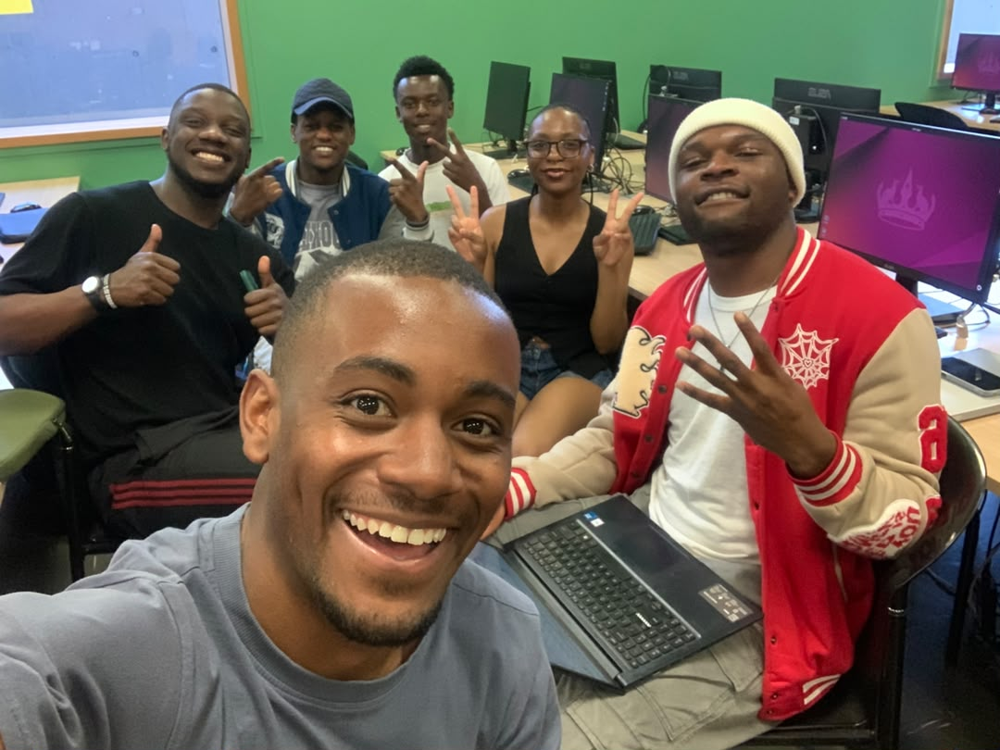
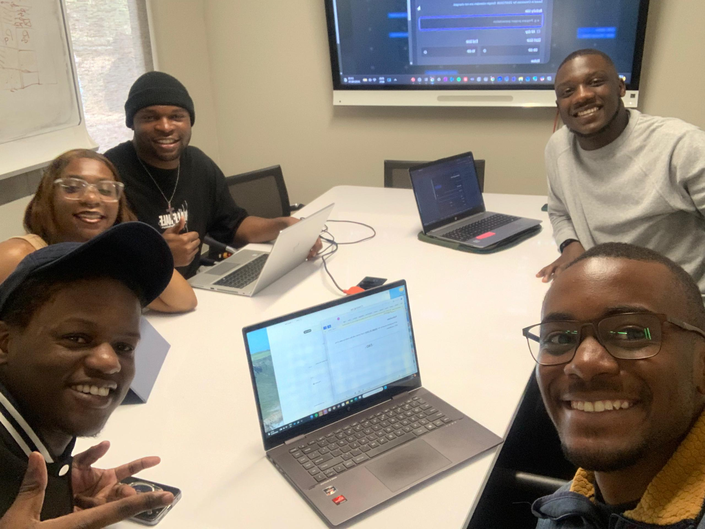
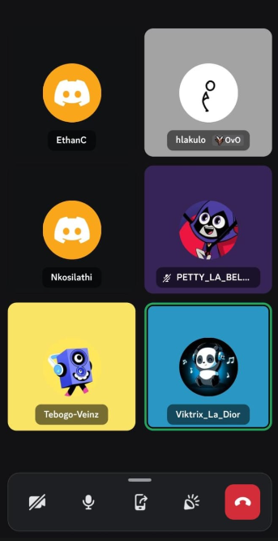

# Sprint 2 Meeting Minutes

This page records the sprint meetings held during Sprint 2 (26 August – 15 September 2026), including dates, attendees, decisions, and the rationale behind each one. Sprint 1 meetings are documented on the [Sprint 1 Meetings](sprint-meetings.md) page.

---

## Sprint 2 — Meeting 1: Sprint 1 Retrospective & Sprint 2 Task Delegation

| | |
|---|---|
| **Date** | 2026-08-26 |
| **Location** | DMSL004, Wits University |
| **Attendees** | Tebogo, Victor, Ronald, Athalia, Nkosinathi, Ethan |
| **Format** | In person |
| **Duration** | ~60 min |
| **Minutes taker** | Victor |

### Agenda

1. Review Sprint 1 marking feedback
2. Identify and discuss fixes required from Sprint 1
3. Review Sprint 2 scope and requirements
4. Delegate tasks for Sprint 2

### Discussion

The team opened by reviewing the marking feedback from Sprint 1. The lecturer flagged six specific gaps that needed to be addressed before Sprint 2 could begin in earnest: testing and debugging tracking, the motivation for using an agile methodology, the documentation site's colour scheme, the ability to edit already-created schema fields, the live documentation deployment, and a general call for motivations behind every decision the project makes.

Once the Sprint 1 fixes were discussed, the team moved to Sprint 2 scope. The [Sprint 2 assignment document](../methodology/sprint-2-plan.md) lists 20 intermediate-tier user stories (US-2.1 through US-2.20) across seven feature areas. Tasks were delegated based on each member's role, existing area ownership, and the dependencies between stories — see the [Sprint 2 Plan](../methodology/sprint-2-plan.md) page for the full decomposition.

### Decisions and Rationale

| ID | Decision | Rationale |
|---|---|---|
| **D-001** | Add a "Testing & Debugging" column to the Gitea work tracker | Sprint 1 marking feedback flagged that testing work was not separately visible. Adding a dedicated column makes the effort each team member spends on testing and bug-fixing trackable alongside feature work, rather than hidden inside other stories. |
| **D-002** | Add a motivation explaining why the team uses an agile methodology to the documentation | The marking feedback explicitly called out the absence of a "why agile" section. The [Project Methodology](../methodology/project-methodology.md) page already had a "Motivation" section with options considered and rejected, but it needed a positive explanation of *why* agile fits this team's constraints — fixed sprint boundaries, divergent timetables, concurrent CGV project, and scope change tolerance — not just why alternatives were rejected. |
| **D-003** | Update the documentation site colour scheme | Feedback noted that the MkDocs site needed a more professional, readable palette. The Material for MkDocs theme supports custom primary/accent colours via `mkdocs.yml`; adopting the project's indigo palette (matching the "Driven by Design" brand) improves consistency with the app itself. |
| **D-004** | Implement editing for already-created schema fields | US-2.6 ("Edit an existing schema field") is an intermediate-tier requirement from the Sprint 2 assignment brief. The Sprint 1 marking also flagged it specifically — the schema editor could only add and remove fields, not edit them. This story is assigned to Victor (Person 2) as part of the schema-editing workstream. |
| **D-005** | Fix the live documentation deployment | The deployed MkDocs site was either unreachable or stale at the time of Sprint 1 marking. A live, publicly accessible documentation site is a non-coding deliverable (Section 3 of the assignment brief) and must be reachable without an account. |
| **D-006** | Add motivations for all decisions throughout the project | The marking feedback's most sweeping point: "motivations for everything." This is not just about the methodology page — every decision recorded in meeting minutes, sprint reviews, and architecture docs needs a *why*, not just a *what*. This decision drives the format of this page and the [Sprint 2 Plan](../methodology/sprint-2-plan.md) page: every decision entry carries its rationale. |
| **D-007** | Review Sprint 2 work and delegate tasks | Sprint planning is a core Scrumban ceremony. With the intermediate-tier assignment document in hand, the team decomposed the 20 stories into six workstreams and assigned them. The grouping strategy and rationale are on the [Sprint 2 Plan](../methodology/sprint-2-plan.md) page. |

---

## Sprint 2 — Meeting 2: Sprint 2 Planning & Usability Review

| | |
|---|---|
| **Date** | 2026-09-02 |
| **Location** | Wartenweiler Library Focus Room 2 |
| **Attendees** | Tebogo, Victor, Ronald, Athalia, Nkosinathi, Ethan |
| **Format** | In person |
| **Duration** | ~75 min |
| **Minutes taker** | Victor |

### Agenda

1. Full walkthrough of the current app
2. Identify usability changes needed
3. Review external API integration (Google Calendar)
4. Document all required changes and new functionalities
5. Delegate remaining tasks for Sprint 2

### Discussion

#### Full app walkthrough

The team walked through every feature of the app end-to-end — project creation, schema editing, entry logging, the timeline, task tracking, and statistics. The general consensus was that the app **felt too difficult to use**: the schema builder required too many steps, the entry form's field types were not intuitive, and navigation between views was unclear. A round of usability improvements was agreed on as a Sprint 2 priority alongside the new feature work.

#### Google Calendar API integration

Ethan demonstrated the Google Calendar external API integration — the direction confirmed at the Sprint 1 Meeting 5 PO review. The integration lets the app read and write events to the user's personal Google Calendar, enabling students to see their logbook entries alongside their existing schedule. The team agreed this was the right choice over alternatives (Slack API, GitHub API) because it delivers the most tangible day-to-day value for the student user persona.

#### Documentation of changes

Athalia captured all usability changes, new features, and integration work in a central document during the meeting. This document became the single source of truth for the remaining Sprint 2 task delegation — rather than relying on verbal recollection from the meeting, the team could assign work against a written list.

### Decisions and Rationale

| ID | Decision | Rationale |
|---|---|---|
| **D-001** | Improve overall app usability — the app currently feels too difficult to use | The full walkthrough revealed friction points that were invisible during feature-by-feature development: schema editing was multi-step, entry types were not labelled intuitively, and navigation was unclear. Usability polish is a recurring Sprint 2 theme across all workstreams — the schema editor gets a review flow, the entry form gets a tag registry, the sidebar gets clearer labels. |
| **D-002** | Integrate Google Calendar as the external API for workflow management | Confirmed at Sprint 1 Meeting 5 (PO decision) and re-validated here. Google Calendar was chosen because (a) students already use it for scheduling, (b) the calendar metaphor maps directly to logbook entries (date ↔ event), and (c) the OAuth token exchange is already in place for Google sign-in, reducing integration effort. Alternatives (Slack, GitHub) deliver less student-facing value. |
| **D-003** | Document all required changes in a central Word document | A written record prevents task drift. When delegation happens verbally in a meeting, members remember different priorities; a single document means everyone can re-read what was agreed. Athalia's document became the input for the task decomposition table on the [Sprint 2 Plan](../methodology/sprint-2-plan.md) page. |
| **D-004** | Delegate Sprint 2 tasks based on the documented changes | The delegation follows the same principle as Sprint 1: group related stories with one owner to avoid two people touching the same area at once. The full rationale for each grouping is on the [Sprint 2 Plan](../methodology/sprint-2-plan.md) page. |

---

## Sprint 2 — Meeting 3: Sprint 2 Synchronisation & Rubric Review

| | |
|---|---|
| **Date** | 2026-09-11 |
| **Location** | Discord (voice channel) |
| **Attendees** | Tebogo, Victor, Ronald, Athalia, Nkosinathi, Ethan |
| **Format** | Discord voice call |
| **Duration** | ~60 min |
| **Minutes taker** | Victor |

### Agenda

1. Synchronise on current progress across all team members
2. Identify and resolve blockers preventing merges
3. Review the Sprint 2 rubric for missing requirements
4. Delegate remaining responsibilities for the sprint

### Discussion

#### Progress synchronisation

The team held a synchronisation meeting to assess the current state of the app and each member's progress. The finding: **all team members are mostly done with their individual parts** — the six workstreams from the [Sprint 2 Plan](sprint-2-plan.md) are near complete. The primary remaining task is to merge all the work to `main` so the team can see the full integrated state of the app.

The blocker: **pull requests have not yet been merged**. Six parallel feature branches are each individually healthy, but nobody can see or test the app as a whole until they land. Merging is not a mechanical afterthought — with six branches touching overlapping areas (the schema editor, `App.jsx`, the entry list), integration needs one person with full context of every branch.

#### Sprint 2 rubric review

The team reviewed the Sprint 2 rubric line by line and identified one significant gap:

- **User interactions / user feedback:** the rubric expects evidence that external users have been consulted on the current state of the app, and the team had not yet gathered any.

### Decisions and Rationale

| ID | Decision | Rationale |
|---|---|---|
| **D-001** | Nkosinathi will merge all pull requests to `main` for the remainder of Sprint 2. | Six unmerged branches block everyone from seeing the integrated app. Giving merge ownership to a single person — the Scrum Master — prevents two people attempting conflicting merges of the same branch and keeps integration decisions consistent. Nkosinathi already owns CI/CD and the Gitea pipeline from Sprint 1, so he has the full picture of what every branch does to the build. |
| **D-002** | Victor will create a Google Form to collect user feedback on the current state of the app. | The rubric review identified user feedback as the main missing requirement. A Google Form is the fastest standardised way to reach external users and collect structured, comparable responses (ratings plus free-text comments). It can be distributed by every team member through their own networks, maximising the number of respondents in the time left. |
| **D-003** | The team will spend the remainder of the sprint fixing issues identified by users, rather than gathering feedback while still completing development. | With most individual work complete, the scarce remaining time is more valuable spent on quality and usability fixes *informed by real user input* than on gathering feedback in parallel with development. Sequencing feedback → fixes means every fix addresses an actual observed problem rather than a guessed one, and the rubric's user-interaction evidence lands at the point where it can still change the product. |

### Action Items

| Action | Owner(s) | Deadline |
|---|---|---|
| Merge all pull requests to `main` | Nkosinathi | Sprint 2 |
| Create Google Form for user feedback | Victor | Sprint 2 |
| Distribute Google Form to potential users | Whole team | Sprint 2 |
| Review and prioritise user feedback for fixes | Whole team | Sprint 2 |
| Fix issues identified by users | Whole team | Sprint 2 |
| Finalise Sprint 2 documentation | Whole team | Sprint 2 |

---

## Cross-Meeting Themes

Several themes emerged across the three Sprint 2 meetings and shaped how the sprint is planned:

1. **Motivations matter as much as decisions.** The Sprint 1 marking feedback was explicit: every decision needs a *why*. This is why this page and the [Sprint 2 Plan](sprint-2-plan.md) page carry rationale for every entry, and why the [Project Methodology](project-methodology.md) page explains *why* Scrumban fits this team's constraints.

2. **Usability is a first-class concern, not polish.** Meeting 2's walkthrough showed that building features in isolation produces a working app that is hard to use. Sprint 2 treats usability as delivery work, not something that happens "after" features are done.

3. **Group related work to avoid merge conflicts and design drift.** The task decomposition keeps schema-shape changes with one owner (Victor), view-layer features with one owner (Athalia), and infrastructure-leaning work with one owner (Nkosinathi). This reduces the risk of two people editing the same file or making conflicting design choices.

4. **Written records beat verbal agreements.** Every meeting produced a written document — meeting minutes here, task delegation in the central Word document, decisions with rationale. This is deliberate: it lets any team member (or the PO, or the marker) verify what was agreed and why.

5. **Integration is scheduled work, not an afterthought.** Meeting 3 showed the cost of six parallel branches with no merged view: the team could not see or test the app as a whole. Merging was therefore assigned as explicit sprint work with a single owner, the same weight as any user story.

6. **Rubric evidence is planned, not squeezed in.** The user-feedback gap was identified at the rubric review and scheduled deliberately — after development completes — so the fixes that follow are based on real user input rather than guesswork, and the evidence lands while it can still change the product.

AI Declaration: The preceding document was reviewed and edited with: Qoder
