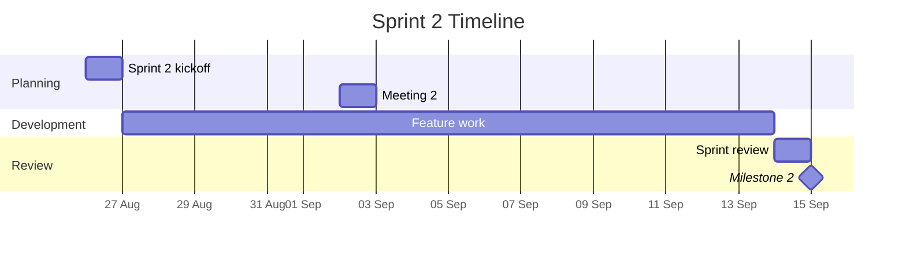

# Sprint 2 Plan

This page documents the Sprint 2 plan: the market alignment that shapes the product's go-to-market story, the 20 intermediate-tier user stories, and the task decomposition that assigns them to team members. Every decision carries its rationale.

Sprint 2 runs from **26 August to 15 September 2026** (21 days), targeting the **intermediate tier** of the COMS3011A Project 7 brief. Milestone 2 is due on 15 September.

## 1. Market Alignment

The Digital Logbook maps onto a B2B2C model — rather than selling directly to individual students or employees, the product is licensed or white-labelled to organisations that already have a captive audience needing logbook-style tracking. Four organisations illustrate this pattern:

### 1.1 Wits — Pilot / Anchor Customer

Faculties with mandatory Work-Integrated Learning (WIL), engineering practicals, medical rotations, and postgraduate research all require logbook-style records today — often kept on paper or in ad hoc spreadsheets. A university-wide licence replaces this fragmented manual process and gives Wits a case study it can point to. This pilot also makes the pitch to BCX, Telkom, and Alibaba credible, since it demonstrates the product already works for a real, large organisation.

### 1.2 BCX — Reseller to Enterprise Clients

BCX runs enterprise ICT services and manages graduate, intern, and apprenticeship pipelines for its clients. South African learnerships and apprenticeships are legally required to keep logbooks for SETA/QCTO compliance. The logbook can be white-labelled as BCX's compliance and skills-tracking product, sold as part of the managed-services offering to the corporates BCX already serves. This solves a real regulatory pain point — auditable hour and skills tracking — that BCX can resell at margin.

### 1.3 Telkom — Distribution via SME Bundles

Telkom runs large graduate and apprenticeship intakes, and its Telkom Business unit sells connectivity and digital-tools bundles to SMEs. The logbook can be bundled into Telkom Business's packages as a productivity add-on alongside connectivity — similar to how telcos upsell cloud or office tools. This creates a new recurring SaaS revenue line at near-zero additional infrastructure cost.

### 1.4 Alibaba — Infrastructure and Marketplace

Alibaba's fit is about infrastructure and global distribution through two channels: **Alibaba Cloud** (hosting and marketplace listing for global distribution and cloud-consumption revenue) and **DingTalk** (Alibaba's workplace collaboration suite, where a logbook-style time-tracking integration could plug into the SME ecosystem as a productivity add-on).

### Summary

| Company | Role | What they get |
|---|---|---|
| Wits | Pilot / anchor customer | Solves a real compliance and efficiency gap for students and WIL programmes |
| BCX | Reseller to enterprise clients | Turns a regulatory requirement (SETA/QCTO logbooks) into a sellable managed service |
| Telkom | Distribution via SME bundles | New recurring SaaS revenue bundled with connectivity, at no build cost |
| Alibaba | Infrastructure and marketplace | Cloud consumption growth plus ecosystem stickiness via DingTalk |

**Rationale:** The B2B2C model was chosen over direct-to-consumer because logbook adoption depends on a captive audience with a compliance or tracking requirement — individuals don't buy logbooks, organisations do. Wits is the pilot because the team is already embedded there; BCX and Telkom are the natural resellers because they already serve the organisations that need compliance tracking; Alibaba provides infrastructure and global distribution without requiring the team to build those channels.

---

## 2. Sprint 2 User Stories

The intermediate tier defines 20 user stories (US-2.1 through US-2.20) across seven feature areas.

### 2.1 Rich Fields (US-2.1 – US-2.5)

| US | Story | Acceptance Criteria |
|---|---|---|
| **US-2.1** | As an owner, I want to add **tags** to an entry, so that I can group related work across projects without changing my schema. | Tag field type available in schema; tags add/remove without reload; filterable from entry list |
| **US-2.2** | As an owner, I want to use a **checklist** field type, so that I can track sub-tasks within a single log entry. | Checklist items: add, check, uncheck, reorder, delete; completion count (e.g. 3/5) visible on entry preview |
| **US-2.3** | As an owner, I want to **link** one entry to another, so that I can trace related work. | Link field with search/select; bidirectional visibility; deleting an entry flags broken links |
| **US-2.4** | As an owner, I want to add a field that **references another project**, so that I can connect work across projects. | Project-reference field in schema builder; resolves to valid project only |
| **US-2.5** | As an owner, I want to define a **computed** field derived from other fields, so that I don't type data that can be calculated. | Defined from existing fields; updates when sources change; read-only in entry form |

### 2.2 Schema Editing & Migration (US-2.6 – US-2.9)

| US | Story | Acceptance Criteria |
|---|---|---|
| **US-2.6** | As an owner, I want to **edit** a field that has already been created. | Editable field rows in schema view; validates against existing data; entries update with defaults |
| **US-2.7** | As an owner, I want to **add or remove** a field from a live schema. | New fields backfilled with sensible defaults; removed fields hidden but not destroyed |
| **US-2.8** | As an owner, I want to **keep past entries readable** in the format they were written in. | Schema changes versioned; entry resolves to its creation version; old entries render correctly |
| **US-2.9** | As an owner, I want the schema definition **hidden** once a project's format is set. | Schema editor not shown by default; appears only in "Edit schema" mode; exiting returns to normal view |

### 2.3 Format-Aware Statistics (US-2.10 – US-2.11)

| US | Story | Acceptance Criteria |
|---|---|---|
| **US-2.10** | As an owner, I want to **total and group** entries by any field I've defined. | Numeric: sum/average; categorical: group/count; stats update when schema changes |
| **US-2.11** | As an owner, I want to **plot** any field's values over time. | Select field + time range → chart; respects schema versioning for historical entries |

### 2.4 Multiple Views (US-2.12 – US-2.15)

| US | Story | Acceptance Criteria |
|---|---|---|
| **US-2.12** | As an owner, I want to **save filters** I use often. | Named, saved, re-applied from list; persist across sessions |
| **US-2.13** | As an owner, I want to see entries on a **calendar**. | Entries render on logged date; clicking a day opens that day's entries |
| **US-2.14** | As an owner, I want a **board view** grouped by a field of my choosing. | Owner selects grouping field; entries movable between columns, updating the field value |
| **US-2.15** | As an owner, I want to **track unfinished work** with a due date. | Entry markable as unfinished/todo with due date; dedicated view sorted by due date |

### 2.5 Offline Capture & Portability (US-2.16 – US-2.17)

| US | Story | Acceptance Criteria |
|---|---|---|
| **US-2.16** | As an owner, I want to **capture entries offline**. | Works with no network; queues and syncs on reconnect; conflicts surfaced, not dropped |
| **US-2.17** | As an owner, I want to **export and re-import** my logbook. | Export: human-readable format (JSON/CSV); re-import restores projects, schemas, entries |

### 2.6 Cross-Cutting (US-2.18 – US-2.19)

| US | Story | Acceptance Criteria |
|---|---|---|
| **US-2.18** | As a developer, I want an **externally available, documented API**. | Endpoints for projects, schemas, entries, statistics; documented on the docs site |
| **US-2.19** | As a developer, I want **automated tests** for core flows. | Schema create/edit, entry CRUD, one statistics endpoint covered; tests run in CI |

### 2.7 AI Assistant (US-2.20)

| US | Story | Acceptance Criteria |
|---|---|---|
| **US-2.20** | As an owner, I want an in-app **AI chatbot** that answers questions about my logbook. | Widget open/close without losing context; answers about user's own data; creates entries on request; wired end-to-end |

---

## 3. Task Decomposition and Delegation

The 20 stories are distributed across six team members. Stories are grouped by feature area and, where dependencies exist, kept with the same owner so no one is blocked waiting on a teammate.

| Person | Team Member | Stories | Workstream | Count | Rationale for grouping |
|---|---|---|---|---|---|
| **Person 1** | **Tebogo** | US-2.1, US-2.2, US-2.3 | Rich Fields (entry-level) | 3 | Tags, checklists, and entry links are self-contained entry field additions with no dependency on schema-editing or statistics work. Tebogo can start immediately and run in parallel with the rest of the team. |
| **Person 2** | **Victor** | US-2.4, US-2.5, US-2.6, US-2.7 | Rich Fields (schema-level) + Schema Editing | 4 | Project-reference and computed fields are schema-defined types, so pairing them with schema edit/add/remove keeps all schema-shape changes in one owner. This avoids two people touching the schema builder at once — the area most likely to produce merge conflicts. Victor already owns the backend API and schema layer from Sprint 1. |
| **Person 3** | **Ronald** | US-2.8, US-2.9, US-2.10, US-2.11 | Schema Versioning + Format-Aware Statistics | 4 | US-2.11 explicitly depends on schema versioning ("charts respect schema versioning when historical entries differ in shape"). Putting US-2.8 (versioning) and US-2.10/US-2.11 (statistics) with Ronald removes a cross-person blocker — the versioning work must land before the statistics charts can render historical entries correctly. US-2.9 (hide schema editor) is a UI toggle that pairs naturally with the schema-editing flow. |
| **Person 4** | **Athalia** | US-2.12, US-2.13, US-2.14, US-2.15 | Multiple Views | 4 | Saved filters, calendar view, board view, and due-date tracking are independent, view-layer features that all read from the same entry data. Athalia's workstream is cohesive — four views of the same underlying data — and has no dependency on schema-editing or offline work. |
| **Person 5** | **Nkosinathi** | US-2.16, US-2.17, US-2.18, US-2.19 | Offline, Portability & Cross-Cutting | 4 | Offline sync, export/import, the public API, and automated tests are all backend and infrastructure-leaning work that touches the same data layer. One owner avoids duplicated plumbing — the sync queue, the export format, and the API endpoints all read from the same database models. Nkosinathi owns the database and CI/CD from Sprint 1. |
| **Person 6** | **Ethan** | US-2.20 | AI Assistant Chatbot | 1 | The AI chatbot is a new, self-contained workstream with no overlap with the other five. It requires a frontend widget, a backend endpoint, and a connection to the underlying language model — a full vertical slice that one person can own end-to-end. Ethan built the Google OAuth flow in Sprint 1 and the Google Calendar integration, so he has the external-integration experience. |

### Why this grouping strategy

The decomposition follows three principles:

1. **Cohesion over coupling.** Stories that touch the same files or models are kept together. Schema-shape changes (US-2.4 through US-2.7) all modify the schema builder and the backend schema-validation layer — giving them to Victor prevents two people from editing `App.jsx`'s schema editor simultaneously.

2. **Dependencies within one owner, not across owners.** Where Story B depends on Story A (e.g. statistics charts depend on schema versioning), both stories go to the same person. This turns a cross-person blocker into a personal sequencing decision — Ronald decides the order of US-2.8 and US-2.11 rather than waiting on someone else.

3. **Parallel start for everyone.** Every workstream can begin on day one of the sprint. Tebogo's entry-level fields, Athalia's views, and Ethan's chatbot have no dependency on Victor's schema work or Nkosinathi's offline queue. This maximises the team's throughput in a 21-day sprint.

---

## 4. Non-Coding Tasks

These support Sprint 2 but are not implementation work. They remain a shared team responsibility:

| Task | Owner | Rationale |
|---|---|---|
| Choose and configure a docs tool | Tebogo (completed in Sprint 1) | MkDocs with Material theme was chosen at Meeting 3 — see [Sprint 1 Meetings](sprint-meetings.md). Alternatives considered: Docusaurus (too heavy), GitBook (limited free tier). |
| Write documentation content | All (coordinated by Tebogo) | Every feature story includes a documentation update. The docs site covers getting started, architecture, API reference, and methodology. |
| Deploy the docs site to static hosting | Tebogo | The docs site is deployed to Azure alongside the app. The live URL is in `mkdocs.yml`. Sprint 1 feedback flagged the deployment as broken; D-005 from [Sprint 2 Meeting 1](sprint-2-meetings.md) addresses this. |
| Schedule stakeholder review session | Nkosinathi (Scrum Master) | The sprint review with the PO is scheduled for 14 September. |
| Log stakeholder feedback | Nkosinathi | Feedback from the review is recorded in the team's Gitea issue tracker. |
| Review and action feedback | All | Decided at the retrospective which feedback items are actioned and which are not, with rationale for each. |

---

## 5. Decision Rationale

This section consolidates the rationale for the key decisions that shape Sprint 2. Meeting-specific decisions with their rationale are on the [Sprint 2 Meeting Minutes](sprint-2-meetings.md) page.

### 5.1 Why we chose an agile methodology (Scrumban)

The team uses **Scrumban** — a combination of Scrum's sprint cadence and Kanban's pull-based flow with WIP limits. The full rationale is in the [Project Methodology](project-methodology.md) page, but the key reasons are:

- **The course imposes fixed milestone dates** (25 Aug, 15 Sep, 29 Sep, 11 Oct). A methodology without sprints (pure Kanban) would decouple our planning from the assessment schedule and remove the review points the PO expects. Scrumban's sprint cadence aligns naturally with these fixed boundaries.

- **The advanced tier permits new requirements mid-semester.** Waterfall or phase-gated models cannot absorb scope change without significant rework. An iterative methodology tolerates scope change by design — each sprint plans from the current backlog, not from a fixed specification.

- **The team has no shared free block for daily standups.** Standard Scrum prescribes a daily time-boxed standup. Our team has divergent timetables and a concurrent CGV project. Scrumban's adaptation — informal WhatsApp coordination instead of scheduled standups — preserves the information-sharing function (what was done, what's next, what's blocked) with near-zero overhead.

- **Sprint 1 retrospective identified excessive context-switching.** Kanban's WIP limit of 2 items per member was adopted as a Scrumban adaptation to reduce multitasking. This is a deliberate departure from standard Scrum, which has no WIP limits.

- **The team size (6 developers) and sprint length (14–23 days) suit Scrum's ceremony overhead.** Planning, review, and retrospective consume ~2–3 hours per sprint. For a 70-day project with three sprints, this cost is acceptable because the retrospective is the primary mechanism for surfacing and correcting process failures.

### 5.2 Why we grouped tasks this way

See Section 3 above. The short version: **cohesion** (related stories with one owner), **dependencies within one owner** (no cross-person blockers), and **parallel start** (everyone can begin on day one).

### 5.3 Why Google Calendar over other external APIs

Confirmed at the Sprint 1 PO review (Meeting 5) and re-validated at Sprint 2 Meeting 2. Google Calendar was chosen because:

- Students already use it for scheduling — the calendar metaphor maps directly to logbook entries (date ↔ event)
- Google OAuth is already in place for sign-in, reducing integration effort
- Alternatives (Slack API, GitHub API) deliver less day-to-day value for the student user persona

### 5.4 Why MkDocs over Docusaurus or GitBook

Decided at Sprint 1 Meeting 3. MkDocs with Material for MkDocs was chosen because:

- **Docusaurus** requires a full JavaScript build pipeline (Node.js, webpack) for what is fundamentally a static site — too heavy for documentation-only content
- **GitBook** has a limited free tier and proprietary features that would lock the team into a platform
- **MkDocs** is markdown-first with no JS build step, has built-in search, supports Mermaid diagrams for architecture visuals, and the Material theme provides professional styling out of the box

### 5.5 Why Google OAuth only (no local password auth)

Decided at Sprint 1 Meeting 5 (PO decision). Local password authentication (signup, login, reset) was removed in favour of Google OAuth only because:

- Eliminates the security burden of password storage, hashing, and reset flows
- Google OpenID Connect provides verified email addresses without the team managing email validation
- Simplifies the auth flow to one code path instead of two (OAuth + password)
- The PO confirmed this is acceptable for the course's assessment context

---

## 6. Sprint 2 Timeline

---

## 7. Sprint 2 Priorities

1. **Complete the 20 intermediate-tier user stories** (US-2.1 through US-2.20) across the six workstreams
2. **Usability improvements** identified in the Sprint 2 Meeting 2 walkthrough — the app should feel easier to use, not just more capable
3. **Google Calendar integration** (US-2.18 external API, confirmed direction from Sprint 1)
4. **Address Sprint 1 marking feedback** — testing column, agile motivation, documentation colour scheme, field editing, decision rationale throughout
5. **Documentation updates** for every feature delivered — the docs site should reflect Sprint 2's work, not just Sprint 1's

AI Declaration: The preceding document was reviewed and edited with: Qoder
