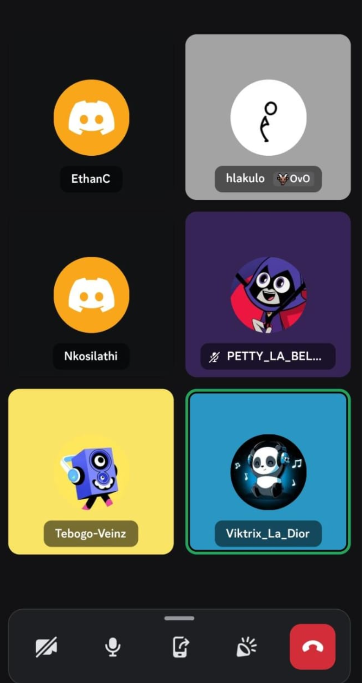
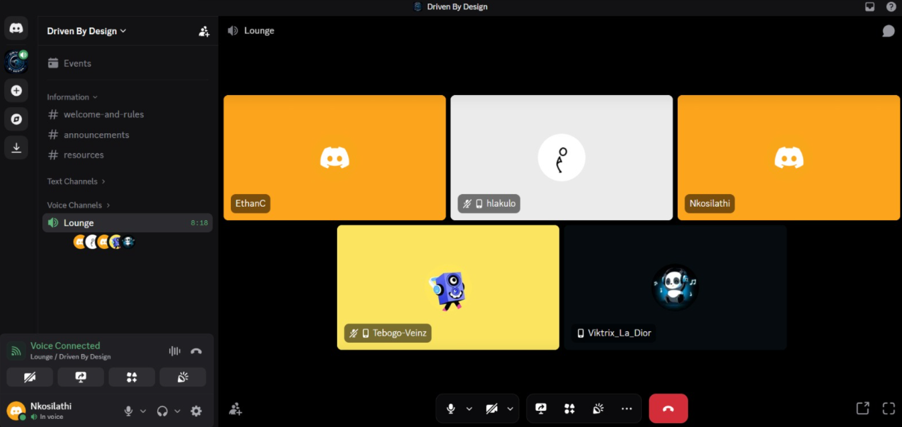
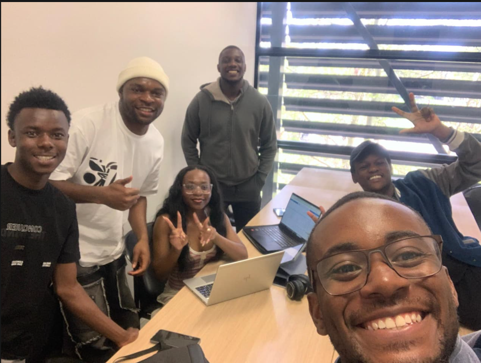

# Sprint 3 Meetings

This page records the sprint meetings held during Sprint 3 (22–29 September
2026), including dates, attendees, decisions, and the rationale behind each
one, in the same format as [Sprint 2 Meetings](sprint-2-meetings.md).

!!! warning "Disclaimer"
    Sprint 3 held **three** documented meetings rather than the four-plus
    pattern of earlier sprints. Heavy academic pressure and overlapping
    coursework commitments across the team this sprint pushed several planned
    check-ins back; the team judged it better to hold fewer, more substantive
    meetings than to schedule ones nobody could meaningfully prepare for. The
    fourth meeting planned for this sprint (a final sync and retrospective)
    was scheduled for 29 September 2026 — the sprint deadline itself — and its
    outcomes, if it happened as planned, are recorded separately rather than
    backfilled here.

**Raw minutes and screenshots** for all three meetings are archived at
[`Sprint3_meetings.zip`](../assets/meetings/Sprint3_meetings.zip), the same
way [`Sprint2_meeting.zip`](../assets/meetings/Sprint2_meeting.zip) archives
Sprint 2's.

---

## Meeting 1 — Sprint 3 Planning & Task Delegation

| | |
|---|---|
| **Date** | 22 September 2026 |
| **Location** | Discord voice channel |
| **Attendees** | Ethan, Victor, Ronald, Athalia, Tebogo, Nkosinathi (all attended) |
| **Minutes taker** | Victor |

### Agenda

1. Review Sprint 2 marker feedback.
2. Compile new features from marker and user feedback.
3. Integrate new features with pre-planned Sprint 3 tasks.
4. Create user stories for all new and existing tasks.
5. Delegate tasks to all team members.

### Discussion

The team's Sprint 2 marker identified four features to add:

| # | Feature | Description |
|---|---|---|
| 1 | FAQs | A Frequently Asked Questions section in the application. |
| 2 | Walkthrough guide | A guided walkthrough to help new users navigate. |
| 3 | Help manual | A reference manual for users needing assistance. |
| 4 | Theme-responsive background | The animated background should follow the light/dark theme. |

These were combined with features requested in the Sprint 2 user feedback
form and the team's own pre-planned Sprint 3 work into one prioritised list,
then turned into user stories with acceptance criteria so each piece of work
could be estimated and assigned.

### Decisions

| ID | Description |
|---|---|
| D-001 | Integrate FAQs into the application. |
| D-002 | Add a walkthrough guide for the application. |
| D-003 | Add a help manual. |
| D-004 | Make the background responsive to theme changes. |
| D-005 | Compile and prioritise user feedback from the Google Form. |
| D-006 | Create user stories for all Sprint 3 tasks. |
| D-007 | Delegate all Sprint 3 tasks to team members. |

### Action items

| Action | Deadline |
|---|---|
| Integrate FAQs, walkthrough guide, help manual, theme-responsive background | Sprint 3 |
| Review and prioritise user feedback | Sprint 3 |
| Create user stories and delegate all tasks | Complete |

---

## Meeting 2 — Sprint 3 Progress Check-in & Performance Review

| | |
|---|---|
| **Date** | 25 September 2026 |
| **Location** | Discord voice channel |
| **Attendees** | Ethan, Victor, Ronald, Tebogo, Nkosinathi |
| **Minutes taker** | Victor |

### Agenda

1. Check in on progress of each team member's user stories.
2. Assess the current state of the app.
3. Review performance metrics.
4. Distribute the user feedback form.

### Discussion

Each member reported progress against their assigned user stories and any
blockers. The team then ran a Lighthouse/PageSpeed performance analysis
against the deployed app (the tool the course guidance names —
[developer.chrome.com/docs/lighthouse](https://developer.chrome.com/docs/lighthouse))
and found **poor performance** on the live site.

**Decision:** treated as a bug and fixed the same meeting rather than
scheduled for later — see
[API Performance, Load & Robustness — Frontend performance](../testing/api-performance.md#frontend-performance-google-lighthouse-us-317)
for the before/after scores (Performance 69 → 95, Accessibility 95 → 100,
Best Practices 96 → 100, SEO 82 → 100) and exactly what was fixed.

With performance addressed, the team distributed the Sprint 3 user feedback
forms (new-user and returning-user) the same session.

### Decisions

| ID | Description |
|---|---|
| D-001 | Flag poor performance as a bug and fix it immediately. |
| D-002 | Send out the Google Forms for Sprint 3 user feedback. |

### Action items

| Action | Deadline |
|---|---|
| Fix the identified performance issues | Complete |
| Distribute the Google Forms for user feedback | Complete |
| Review user feedback once collected | Sprint 3 |
| Continue work on individual user stories | Sprint 3 |

---

## Meeting 3 — Product Owner Review (in person)

| | |
|---|---|
| **Date** | 28 September 2026 |
| **Location** | MSL Laptop Areas |
| **Attendees** | Ethan, Victor, Ronald, Athalia, Tebogo, Nkosinathi, Matthew (Product Owner / Mentor / Reviewer) |
| **Minutes taker** | Victor |

### Agenda

1. Review current app progress with the Product Owner.
2. Receive feedback on documentation.
3. Discuss additional differentiating features.
4. Finalise Sprint 3 priorities.

### Discussion

Matthew reviewed the latest Sprint 3 features and was satisfied with the
progress and direction. He raised two documentation gaps to close before the
sprint review session:

| # | Issue | Description |
|---|---|---|
| 1 | User interaction information | Documentation of user feedback and interaction data needed fixing. |
| 2 | External API documentation | Documentation of the external API integrations needed fixing. |

Both are addressed by this documentation pass — see
[User Feedback — Sprint 3](user-feedback-sprint-3.md) and
[External Services & Integrations](../api/external-services.md).

Matthew also suggested a differentiating feature for a future sprint:
**daily streak badges, unlocks or awards** as a gamification incentive to
encourage regular use.

### Decisions

| ID | Description |
|---|---|
| D-001 | Fix user interaction/feedback documentation. |
| D-002 | Fix external API documentation. |
| D-003 | Consider daily streak badges/unlocks/awards as a Sprint 4 differentiator. |

### Action items

| Action | Deadline |
|---|---|
| Fix user interaction documentation | Before Sprint 3 review session |
| Fix external API documentation | Before Sprint 3 review session |
| Evaluate gamification features (streaks, badges) | Sprint 3 / Sprint 4 |
| Finalise all Sprint 3 deliverables | Sprint 3 deadline (29 Sep) |

---

## Themes across Sprint 3's meetings

1. **Marker and user feedback were combined into one plan**, not treated as
   two separate backlogs — Meeting 1 deliberately merged both before writing
   user stories.
2. **A measured problem was fixed in the same session it was found**, rather
   than filed for later — the performance regression in Meeting 2 was caught
   and fixed within the meeting itself.
3. **Documentation gaps were named by an external reviewer, not found
   internally** — the Product Owner's review in Meeting 3 is what identified
   the exact two documentation weaknesses (user feedback, external APIs)
   that this documentation pass exists to close.

AI Declaration: The preceding document was generated with: Claude Code [Claude Sonnet 5]
