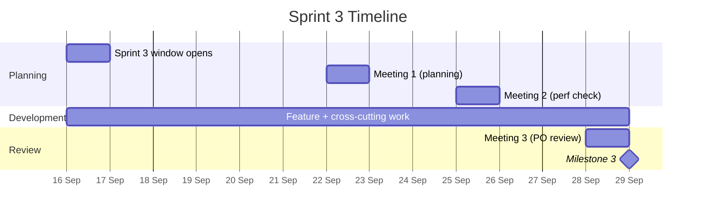

# Sprint 3 Plan

This page documents the Sprint 3 plan: carried-over work from Sprint 2, the
Advanced tier defined by the project brief (§1.1.3), the cross-cutting
testing/performance/accessibility/compliance work set by the course's Sprint
3 & Final Submission guidance session, a small UX-polish set, and the task
decomposition that assigns them. Source: *Digital Logbook — Sprint 3 Planning
Document*, drafted ahead of [Sprint 3 Meeting 1](sprint-3-meetings.md) on
2026-09-22, where it was reviewed against the guidance notes and finalised.
Every decision carries its rationale, the same standard set in the Sprint 2
Plan.

Sprint 3 runs from **16 to 29 September 2026** — 14 days against Sprint 2's
21, and overlapping the team's concurrent CGV project, so capacity is planned
tighter than Sprint 2's. Milestone 3 is due on 29 September.

The market alignment (B2B2C via Wits/BCX/Telkom/Alibaba) established in the
[Sprint 2 Plan](sprint-2-plan.md#1-market-alignment) is unchanged for Sprint
3 and isn't repeated here.

---

## 1. Context

Sprint 2 (Intermediate tier) was planned as mostly complete going into Sprint
3, with Rich Fields (tags, checklists, links, project references, computed
fields) and format-aware statistics (totals/grouping, comparison/plotting)
flagged in the planning document as carried over. By the time Sprint 3
actually started, both areas had in fact been completed and fixed during
Sprint 2 itself — the field-editor wiring bug documented in the
[Sprint 2 Retrospective](sprint-2-retrospective.md) was found and fixed on
2026-09-14, the day before Sprint 2 closed. The planning document was drafted
slightly ahead of that fix landing, so Section 2 below is kept as originally
planned (for an honest record of what was carried *into* the sprint) with a
note on where each item actually stood at Sprint 3's start.

Sprint 3 otherwise targets the **Advanced tier** described in the project
brief — six stories (US-3.8–US-3.13, opened early as US27–US32) expanded
below with full acceptance criteria.

On top of the brief itself, the course's Sprint 3 & Final Submission guidance
session set a much stricter bar than Sprint 2's: formal user testing with
10+ independent users, platform-wide code coverage (30% acceptable, 60%+
preferable), API robustness under load, latency targets, accessibility, and
documentation of anything skipped. These are captured as their own
cross-cutting stories (US-3.14–US-3.22) rather than folded into feature work,
since the instructor is explicit that final marking evaluates
production-readiness, not feature presence, and will ask interrogative,
evidence-based questions.

A small set of UX-polish items (onboarding, a theme-aware background,
starred FAQs) close out the plan as US-3.23–US-3.25.

Everything below can still be edited, split, reassigned, or dropped as the
sprint reveals what's actually needed — several items were in practice
re-prioritised mid-sprint; see the [Sprint 3 Review](sprint-3-review.md) for
what changed and why.

---

## 2. Carried Forward from Sprint 2 — Rich Fields & Statistics

Planned as unfinished at the time of writing; **in fact already complete**
by Sprint 3's start (see Context above). Kept here, rather than deleted, so
the plan is an honest record of what was expected rather than a retroactively
tidied one.

| US | Story | Acceptance Criteria | Status at Sprint 3 start |
|---|---|---|---|
| **US-3.1** *(was US-2.1)* | Tag entries | Tag field type available; add/remove without reload; filterable from entry list | Already complete |
| **US-3.2** *(was US-2.2)* | Checklists on an entry | Add, check, uncheck, reorder, delete; completion count visible on preview | Already complete |
| **US-3.3** *(was US-2.3)* | Link entries together | Search/select another entry; bidirectional visibility; broken links flagged on deletion | Already complete |
| **US-3.4** *(was US-2.4)* | Reference between projects | Selectable field type; resolves to a valid, existing project only | Already complete |
| **US-3.5** *(was US-2.5)* | Computed fields | Defined from existing fields; updates on change; read-only in the form | Already complete |
| **US-3.6** *(was US-2.10)* | Total and group by any field | Numeric summed/averaged, categorical grouped/counted; updates on schema change | Already complete |
| **US-3.7** *(was US-2.11)* | Compare and plot fields over time | Field + time range → chart; respects schema versioning | Already complete |

---

## 3. Advanced Tier (Sprint 3 target)

| US | Story | Acceptance Criteria |
|---|---|---|
| **US-3.8** *(US27)* | As an owner, I want to write my own expression over my entries and save it, so that I can answer questions the built-in statistics don't cover. | Expression references one or more fields across entries; saved expressions appear alongside built-in statistics; an invalid expression is rejected with a clear error, never crashes or silently returns the wrong data. |
| **US-3.9** *(US28)* | As an owner, I want to arrange my saved statistics and views into a dashboard of my own, so that I see what matters to me at a glance. | Add, remove, rearrange panels (built-in/custom statistics, saved filters, boards); layout persists across sessions; reopens without re-configuring. |
| **US-3.10** *(US29)* | As an owner, I want to correct an entry without losing what it used to say, so that my record stays trustworthy. | Editing keeps the previous version rather than overwriting it; owner can view an entry as it stood on a given date; owner can revert to a prior version. |
| **US-3.11** *(US30)* | As an owner, I want search to understand my custom fields, so that I can find entries by more than free text. | Filter and combine conditions on any custom field; AND/OR combinations return correct results; results ranked by relevance. |
| **US-3.12** *(US31)* | As an owner, I want the logbook to apply rules automatically and remind me of what's due, so that I don't have to do routine bookkeeping myself. | A rule runs automatically on a matching captured entry (auto-tag, auto-fill); an entry can be marked recurring and the next occurrence is created automatically; reminders are raised for entries/todos approaching or past due. |
| **US-3.13** *(US32)* | As an owner with years of entries, I want the logbook to stay fast, so that a long history doesn't slow down day-to-day use. | Timeline/search/statistics stay responsive into the thousands of entries; old entries archivable without deletion or losing searchability; archived entries excluded from default views but reachable when asked for. |

---

## 4. Cross-Cutting — Testing, API, Performance & Compliance

Mapped directly to the Sprint 3 & Final Submission guidance session, and to
what the instructor said will be checked in final marking.

| US | Story | Acceptance Criteria |
|---|---|---|
| **US-3.14** | Platform-wide code coverage report | Measured across backend, frontend, database integration and any microservices, not one codebase; ≥30%, targeting 60%+; deliberately untested code documented with a reason; presentable on request during marking. |
| **US-3.15** | API robustness & external availability | Every endpoint implemented, RESTful, documented; deployed and reachable via plain HTTP from outside the app, with access details for protected routes; malformed input returns 400 with a meaningful message, never a generic 500; the API keeps functioning and recovers under repeated failure. |
| **US-3.16** | API latency & hosting | Typical latency around ~200ms, never exceeding ~500ms under normal load; hosting region chosen and documented with latency in mind; cold-start delay measured and minimised. |
| **US-3.17** | Perceived performance & Lighthouse pass | Skeleton placeholders or an explicit loading message instead of a blank page during fetches; Lighthouse run against key pages, LCP/CLS in an acceptable range, worst offenders fixed first. |
| **US-3.18** | Load & stress testing | A script (Postman or Python) sends ~1,000 concurrent requests directly to the API, never through the UI; response times, error rates and crash frequency recorded as evidence; any bottleneck fixed or documented with a plan. |
| **US-3.19** | Accessibility | Semantic HTML and ARIA roles where needed; meaningful alt text; colour-blind-friendly, adequately contrasted, never colour-only status; core flows usable with a screen reader. |
| **US-3.20** | Extensive, hands-off user testing | 10+ distinct users, each independent, unguided; observed without instructing; a short questionnaire; testers include people not already confident with computers; findings logged with what was actioned and what wasn't, and why. |
| **US-3.21** | Close the documentation gap | Architecture, endpoints, database schema and testing strategy each documented; any dropped/unimplemented feature states why; answers are direct, not padded; site content cited as evidence in reports rather than copied. |
| **US-3.22** | Legal & compliance readiness (POPIA) | Team can describe, in plain terms, what personal data is collected, why, and how a user could access or delete it; where full compliance isn't in place, the team says so and names the concrete next step. |

---

## 5. New UX Polish

| US | Story | Acceptance Criteria |
|---|---|---|
| **US-3.23** | First-time login onboarding | A first-login tour highlights creating a project, defining a schema, capturing an entry; skippable/dismissible; doesn't reappear uninvited. |
| **US-3.24** | Theme-aware background | Switching theme updates the background, not just text/component colours; applies immediately and persists. |
| **US-3.25** | Starred FAQs | Any FAQ entry can be starred/unstarred; starred FAQs shown in a dedicated list; status persists across sessions. |

---

## 6. Task Decomposition and Delegation

Person 4–6 carried no leftover Sprint 2 work into the plan (Section 2 was
assigned to Persons 1–3), so the cross-cutting guidance-note stories are
weighted toward them to keep the load roughly even.

| Person | Team Member | Carried Over (Sec. 2) | Advanced Story | Additional Sprint 3 Work |
|---|---|---|---|---|
| **Person 1** | **Tebogo** | US-3.1, US-3.2, US-3.3 | US-3.8 Custom statistics | — |
| **Person 2** | **Victor** | US-3.4, US-3.5 | US-3.9 Custom dashboards | — |
| **Person 3** | **Ronald** | US-3.6, US-3.7 | US-3.10 Entry history & corrections | — |
| **Person 4** | **Athalia** | — | US-3.11 Structured search | US-3.17 Perceived performance/Lighthouse, US-3.19 Accessibility, US-3.23 Onboarding, US-3.24 Theme background |
| **Person 5** | **Nkosinathi** | — | US-3.12 Entry rules, recurrence & reminders | US-3.14 Coverage report, US-3.15 API robustness, US-3.16 API latency/hosting, US-3.18 Load/stress testing |
| **Person 6** | **Ethan** | — | US-3.13 Long-record performance | US-3.25 Starred FAQs (pairs with the AI assistant/help surface) |
| **Shared** | All | — | — | US-3.20 User testing, US-3.21 Documentation, US-3.22 Legal/compliance |

Adjust to how far each story has already progressed, as the plan itself
says — and it was adjusted: see [Sprint 3 Review](sprint-3-review.md) for
what actually happened against this table, including work that moved between
people and cross-cutting items absorbed outside their planned owner (most of
the documentation and accessibility work ended up done as one continuous
pass rather than split by the original assignment, once it became clear how
much of it was interdependent — a Lighthouse fix, an accessibility fix and a
documentation fix for the same page are one piece of work, not three).

### Why this grouping strategy

Unchanged from Sprint 2's three principles — cohesion over coupling,
dependencies kept within one owner, and a parallel start for everyone. The
Advanced tier stories (US-3.8–US-3.13) each read from the same computed-field
expression engine and JSONB entry model already in place, so no story
here structurally blocks another; the cross-cutting stories were grouped by
who had spare capacity after carried-over work, not by technical dependency,
since none of US-3.14–US-3.22 depends on another completing first.

---

## 7. Non-Coding Tasks

| Task | Owner | Rationale |
|---|---|---|
| Recruit 10+ independent testers, including some not confident with computers | Shared | The guidance note is explicit that a session where everyone is happy is a sign the test group wasn't diverse enough |
| Run the user-testing round hands-off; review findings as a team | Shared | Matches the guidance's "observe without instructing" requirement |
| Write and run the load/stress-testing script; keep results as evidence | Nkosinathi | US-3.18; evidence, not just a claim it was done |
| Generate the platform-wide coverage report; document deliberately untested code | Nkosinathi | US-3.14 |
| Run Lighthouse against key pages; fix the worst-scoring metrics first | Athalia | US-3.17, US-3.19 |
| Prepare a short, plain-language POPIA summary for presentation Q&A | Shared | US-3.22 |
| Audit the documentation site: fill gaps, document dropped features, ensure reports cite rather than copy it | Shared | US-3.21 |
| Rehearse the presentation as 20 minutes + 10 minutes Q&A, every member speaking to their own contribution | Shared | Per the guidance session's presentation format |

---

## 8. Sprint 3 Timeline

---

## 9. Sprint 3 Priorities

1. **Advanced tier, narrowest first** — custom statistics and dashboards
   build directly on the existing computed-field engine; entry history,
   structured search and automation follow.
2. **The cross-cutting guidance-note bar** — coverage, API robustness,
   latency, Lighthouse, accessibility, load testing, documentation, and
   compliance — treated as first-class Sprint 3 deliverables, not
   after-the-fact polish, per the guidance session's explicit warning that
   final marking evaluates production-readiness.
3. **A second, discoverability-focused user-feedback round** (Sprint 2
   Retrospective, Action 4), split into New User and Returning User forms
   this time rather than one form for both.
4. **UX polish** (onboarding, theme-aware background, starred FAQs) once the
   above are on track, not before.

AI Declaration: The preceding document was generated with: Claude Code
[Claude Sonnet 5], from the team's "Digital Logbook — Sprint 3 Planning
Document" (Word document, prepared ahead of Sprint 3 Meeting 1).
