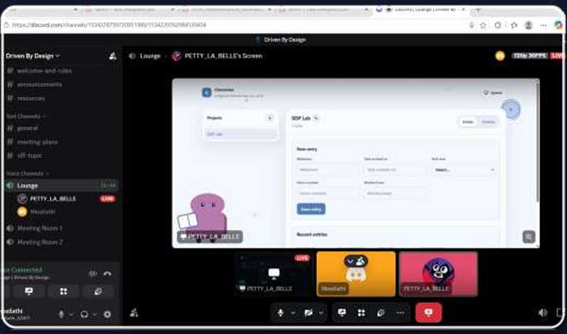
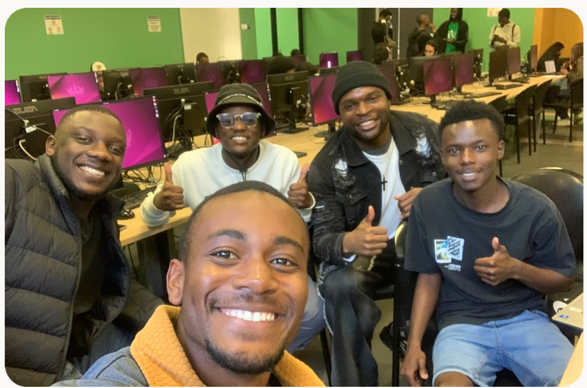
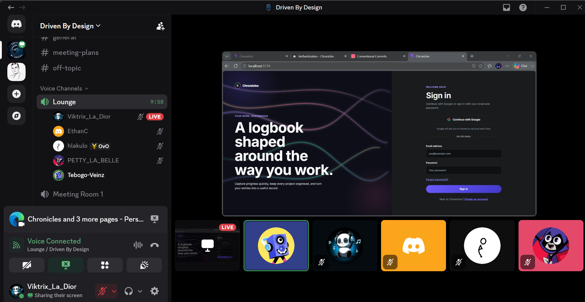
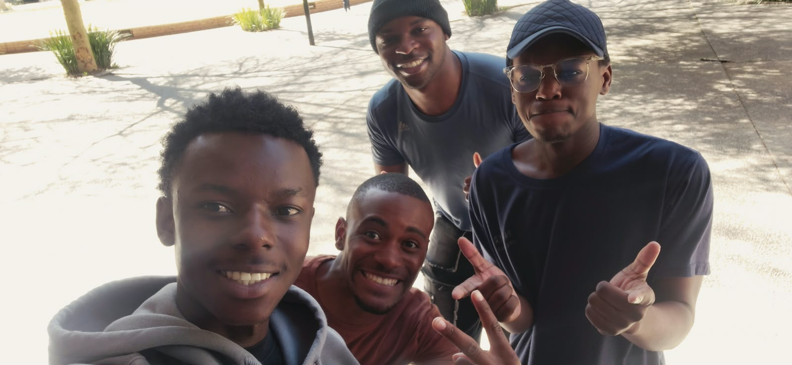

# Sprint Meeting Evidence

This page documents the sprint meetings held during Sprint 1, including dates, locations, key decisions, and photographic evidence. Meeting photos serve as proof markers for the project methodology rubric.

## Product Owner meetings

The team was scheduled to have regular meetings with the Product Owner (Matthew) throughout the sprint. However, **Matthew was ill during the sprint**, which reduced the number of PO meetings to **two** (Meeting 1 on 4 August and Meeting 5 on 24 August). The team **notified the lecturers** of the PO's illness and the impact on meeting frequency. The remaining meetings (2, 3, 4) were team-only working sessions.

The two PO meetings that did take place were substantive:

- **Meeting 1 (kickoff):** PO presented the brief, clarified the AI policy, and set the tier target
- **Meeting 5 (sprint review):** PO reviewed progress, approved the Google OAuth migration, and confirmed the Google Calendar API direction

---

## Meeting 1 — Project Kickoff (with PO)

| | |
|---|---|
| **Date** | 2026-08-04 |
| **Location** | MSL004, Wits University |
| **Attendees** | Victor, Ronald, Ethan, Nkosinathi, Athalia, Tebogo, Matthew (PO) |
| **Format** | In person |
| **Duration** | ~90 min |

**Agenda and outcomes:**

- Product Owner (Matthew) presented the COMS3011A project brief and the Project 7 (Digital Logbook) specification
- Reviewed the three-tier structure (basic, intermediate, advanced) and the four milestone dates
- **Decision:** Target the **basic tier** as the minimum viable product for Sprint 1
- Discussed CodeCov integration for test coverage tracking
- Agreed to set up a documentation site (tool undecided at this point — MkDocs was proposed later at Meeting 3)
- Discussed commit message structure and the need for a consistent convention
- **AI policy clarified:** AI is permitted for code generation and documentation but must be declared in the project. The AI declaration was noted for the README
- Discord established as the primary communication channel for team meetings and async coordination
- Athalia assigned to decompose the user stories from the project brief into Gitea issues with acceptance criteria
- Discussed branching strategy: agreed on a trunk-based workflow with feature branches and PRs

**Note:** No photograph was taken at this meeting. The team was not yet aware that meeting photos were required as evidence. Subsequent meetings include photographic evidence below.

---

## Meeting 2 — Tech Stack Review and Demo

| | |
|---|---|
| **Date** | 2026-08-14 |
| **Location** | Discord (online) |
| **Attendees** | Victor, Ronald, Ethan, Nkosinathi, Athalia, Tebogo |
| **Format** | Discord voice + screen share |
| **Duration** | ~60 min |

**Agenda and outcomes:**

- Discussed tech stack rationale — the team needed to document *why* each technology was chosen for the architecture docs
- **Live demo of early app prototype:**
  - Demonstrated dark, light, and system theme modes
  - Showed entry logging with user-defined fields
  - Demonstrated the schema editor (add/remove/reorder fields)
  - Showed project creation flow
- **Identified PostgreSQL SSL connection issue** on Azure — the connection was failing in production due to SSL configuration. This was tracked as a blocker and resolved at Meeting 3
- Discussed splitting the CGV (Computer Graphics and Vision) project into a separate repository to avoid cluttering the Chronicles repo
- PO accountability message relayed (Matthew was not present due to illness): the team needs to maintain momentum and ensure consistent commit cadence
- Reviewed progress on Wave 1 stories (US7, US4, US10, US14) — all on track

---

## Meeting 3 — Environment Setup and Unblocking

| | |
|---|---|
| **Date** | 2026-08-17 |
| **Location** | MSL004, Wits University |
| **Attendees** | Victor, Ronald (Hlakulo), Ethan, Nkosinathi, Athalia, Tebogo |
| **Format** | In person |
| **Duration** | ~75 min |

**Agenda and outcomes:**

- Hlakulo (Ronald) led an environment setup session — walked through local development setup for members who were struggling with dependencies
- **Blocker identified:** US5 and US6 were blocked because the Azure account had hit its subscription quota limit, preventing creation of the PostgreSQL Flexible Server
- **Resolution:** Nkosinathi created a new Azure account to unblock deployment. The team agreed on an Azure account rotation plan for future quota issues
- **Decision:** Tebogo proposed using **MkDocs** (with Material for MkDocs theme) for the documentation site — adopted unanimously. Alternatives considered: Docusaurus (too heavy for our needs), GitBook (limited free tier)
- Discussed CGV game concepts and how to balance time across both projects
- Reviewed Wave 2 stories — US5, US6, US12, US13, US11, US15, US8 were in progress
- Confirmed that the team would use **WhatsApp** for informal daily coordination instead of scheduled standups, given everyone's busy schedules

---

## Meeting 4 — UI Design Review

| | |
|---|---|
| **Date** | 2026-08-20 |
| **Location** | Hybrid — Discord screen share + in-person at the Library |
| **Attendees** | Victor, Ronald, Ethan, Nkosinathi, Athalia, Tebogo |
| **Format** | Hybrid (Discord screen share for remote members + in-person) |
| **Duration** | ~60 min |

**Agenda and outcomes:**

- Reviewed multiple UI design options and mockups
- **Decision:** Adopted "The Wordmark" colour palette with dynamic visual elements — the palette features dusty blue and mauve tones that align with the team's "Driven by Design" brand identity
- Reviewed component styling: card layouts, spacing, typography, and button states
- Reviewed responsive design: confirmed the app works on desktop, tablet, and mobile viewports
- Alignment on light/dark/system theme implementation using CSS custom properties (no CSS-in-JS library)
- Discussed accessibility: ARIA attributes, keyboard navigation, and focus management
- Reviewed the entry form's dynamic field rendering (text, number, date, dropdown types)
- Tebogo shared progress on the MkDocs documentation site — structure was approved

---

## Meeting 5 — PO Review and Key Decisions (with PO)

| | |
|---|---|
| **Date** | 2026-08-24 |
| **Location** | MSL006, Wits University |
| **Attendees** | Victor, Ronald, Ethan, Nkosinathi, Athalia, Tebogo, Matthew (PO) |
| **Format** | In person with PO |
| **Duration** | ~90 min |

**Agenda and outcomes:**

- Product Owner reviewed all Sprint 1 progress — 17 of 20 user stories completed, 3 incomplete (US12, US13, US18 deferred to Sprint 2), US6 removed from deliverables
- **Demo to PO:** Showed the full application — project creation, schema definition, entry logging, time tracking, task management with checklists, search, and timeline. Statistics (US18) was shown as a work-in-progress prototype
- **Key decisions made by PO:**
  1. **Remove all local authentication** (password signup/login/reset) — Google OAuth only. This simplifies the auth flow and eliminates the security burden of password storage. US6 (Password reset) is removed from the sprint deliverables entirely.
  2. **Polish light mode** — the dark mode was production-ready, but the light mode needed refinement for production readiness
  3. **Pursue Google Calendar API** as the external API integration — the PO suggested this because it adds tangible value for students who already use Google Calendar for scheduling. This confirms the direction identified in the US9 plan document.
  4. **Ensure commit message convention consistency** — some commits were not following the Conventional Commits specification. The team agreed to enforce this going forward.
  5. **Multi-repo vs monorepo** — the question of whether to split into multiple repositories was raised. This is **pending lecturer confirmation** and will be decided before Sprint 2.
- Sprint 1 retrospective conducted immediately after the PO review (team only):
  - **Action:** Replace scheduled standups with informal WhatsApp chat — scheduled standups were too rigid for the team's busy schedules
  - **Action:** Adopt WIP limit of 2 items per member — excessive context-switching was identified during the sprint
  - **Action:** Complete deferred stories US12, US13, US18 as Sprint 2 priorities
  - **Action:** Rotate the Scrum Master role for Sprint 2

